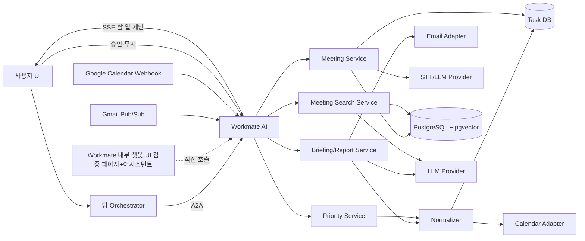

# 프로젝트 개요와 아키텍처

[← 목차](README.md) · [다음: A2A 인터페이스 →](02-a2a-interface.md)

## 1. 목표

Workmate AI는 메일, 캘린더, 회의록, Task DB에 흩어진 정보를 통합해 다음 업무를 지원한다.

- 오늘의 업무 브리핑과 우선순위 Top 3
- 주간 업무보고
- 회의 녹음 분석
- 이전 회의록 기반 질의응답
- 업무 상태 변화에 따른 우선순위 재계산

## 2. MVP 범위

### 포함

- A2A Agent Card와 Orchestrator 요청 처리
- 오늘 브리핑, 주간 보고서, 우선순위 Top 3
- 실시간 녹음 또는 녹음 파일 업로드 기반 STT와 회의 분석
- Task 등록 전 사용자 승인
- Gmail 읽음 메일의 할 일 후보 판단과 사용자 승인
- 회의록 검색과 출처 제공
- 샘플 데이터와 Gmail Push 기반 시연
- Workmate 내부 Skill 검증 챗봇과 UI(2026-08-17 이전 5개 Skill → 현재 11개, 07 §5.4 참고)

### 제외

- 실시간 화자 분리
- 자동 메일 발송, Task 자동 승인
- 경영진 전용 BI와 다중 조직 권한 체계
- 이벤트 브로커 기반 우선순위 실시간 재계산

## 3. 사용자 유스케이스

| 사용자 요청                                | 결과                                        |
| ------------------------------------------ | ------------------------------------------- |
| 오늘 브리핑 해줘                           | 일정/업무/메일 요약, Top 3와 근거           |
| 이번 주 보고서 정리해줘                    | 완료/진행/지연/회의 주요 내용/이슈/다음 주 계획 |
| 회의 녹음 분석해줘                         | 회의록, 통합 분석 Text, taskDB 저장 전 승인 |
| 이전 회의에서 빌드 일정이 어떻게 결정됐어? | 답변과 회의명/날짜/발화자 출처              |
| 우선순위 다시 계산해줘                     | 변경된 Top 3와 변경 사유                    |

## 4. 전체 구조

Workmate AI는 하나의 배포 단위다. 내부 Service는 코드 모듈이며 별도 A2A Agent가 아니다. 외부 시스템별 데이터 차이는 Adapter와 Normalizer에서 공통 업무 형식으로 변환한다.

Workmate 내부 챗봇 경로는 Orchestrator를 거치지 않고 같은 Skill Workflow와 Domain 함수를 직접 호출한다. A2A 전송 계층만 생략하며, 결과 Artifact·Task 상태·오류 규약은 Orchestrator 경로와 동일하게 사용한다.

> **정정(2026-08-24, 99번 문서 정합성 검증 31번 항목)**: 이 경로를 "검증용"으로만 부르던 서술은
> 낡았다 — 2026-08-17 이후 같은 API(`/api/v1/internal/skill-chat/*`)를 개발자 전용 검증 페이지
> (`/internal/skill-chat`)뿐 아니라 💬 Workmate 어시스턴트(Drawer, 15·18번 문서)도 최종 사용자
> 프로덕션 기능으로 그대로 재사용한다(07번 문서 §5.4, 02번 문서 §5.2 참고). "검증용 직접 호출"은
> 개발자 페이지에만 해당하고, Drawer는 같은 경로를 실제 업무 기능으로 쓴다.

Gmail과 Google Calendar 변경 알림은 Workmate가 직접 수신하고 브라우저에는 같은 SSE 연결로 임시 할 일 제안을 보낸다. Priority Service는 Gmail을 호출하지 않고 승인되어 Task DB에 저장된 업무만 순위 대상으로 사용한다.

## 5. 구성요소 책임

| 구성요소               | 책임                                       |
| ---------------------- | ------------------------------------------ |
| Orchestrator           | 사용자 의도에 맞는 Agent 선택 및 결과 전달 |
| Briefing               | 일일 브리핑                                |
| Report Service         | 주간 보고 생성                             |
| Priority Service       | 점수 계산, Top 3, 순위 변경 사유           |
| Meeting Service        | STT, 통합 회의 분석 Text와 Action Item 추출 |
| Meeting Search Service | 회의록 검색, 근거 기반 답변, 출처 생성     |
| Normalizer             | 서로 다른 데이터 구조 통합 및 중복 제거    |
| Adapter                | 메일/캘린더 Provider 연결                  |

## 6. 권장 기술

| 영역 | MVP 선택 |
| --- | --- |
| API/A2A | Python 3.12 + FastAPI + A2A Python SDK |
| Agent Workflow | LangGraph |
| 업무 DB·Vector 검색 | PostgreSQL + pgvector |
| LLM | OpenAI 호환 API · `openai/gpt-4.1-mini` |
| Embedding | 확정 — `openai/text-embedding-3-small`, 1536차원 |
| STT | 확정 — OpenAI `gpt-4o-transcribe` (파일·Realtime Streaming) |
| 서비스 인증 | Bearer Service Token |
| UI | `workmate-agent` 최소 내부 검증 페이지 + 팀 공통 Orchestrator 제품 UI |
| 실행 환경 | Docker Compose |

메일은 Gmail API, 캘린더는 Google Calendar API 하나만 구현한다.

M0.4의 Skill·Schema·Workflow 검증은 `workmate-agent`가 제공하는 최소 개발자 페이지에서 수행한다. 사용자가 실제로 이용하는 다섯 개 제품 화면은 팀 공통 Orchestrator UI에 M5에서 통합한다. 내부 검증 페이지와 제품 UI 모두 업무 데이터를 자체 저장하지 않고 Workmate API와 Workflow 결과를 사용한다. `workmate-ui`는 1차로 완성해 개인용으로 보관하고, 2차로 팀 공통 Orchestrator UI 양식에 맞게 조정해 이식하는 대상이다 — 폐기된 샘플이 아니며 구현·검수에 계속 사용한다.

버전 정책, LangGraph State, A2A Binding, DB·검색, 인증과 환경변수는 [기술 상세 설계](07-technical-specification.md)를 따른다.
