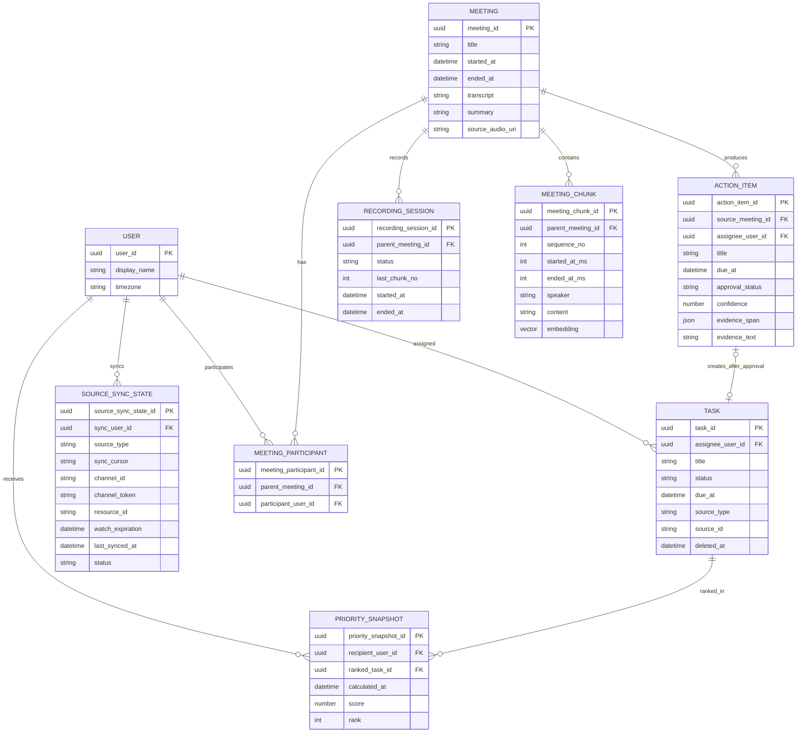

# 데이터, 날짜, 우선순위 규칙

[← 이전](02-a2a-interface.md) · [목차](README.md) · [다음: 시나리오 →](04-scenarios.md)

## 1. 핵심 데이터 모델

| 엔터티             | 설명                                                         |
| ------------------ | ------------------------------------------------------------ |
| `User`             | Workmate를 사용하는 사용자와 시간대 정보를 관리한다.         |
| `Task`             | 사용자가 수행해야 할 업무와 상태·마감·출처를 관리한다.       |
| `Meeting`          | 회의 기본정보와 전체 회의록·요약·원본 음성 위치를 관리한다.  |
| `MeetingParticipant` | 회의와 참여 사용자의 다대다 관계를 관리한다.               |
| `RecordingSession` | 실시간 녹음의 연결·Chunk 수신·종료 상태를 관리한다.          |
| `MeetingChunk`     | 회의록 검색을 위해 나눈 문맥 구간과 embedding을 보관한다.    |
| `ActionItem`       | 회의에서 추출한 후속업무 후보와 사용자 승인 상태를 관리한다. |
| `PrioritySnapshot` | 특정 시점에 계산된 Task의 점수·순위·산정 근거를 기록한다.    |
| `SourceSyncState`  | 사용자별 외부 데이터 소스의 마지막 동기화 상태를 기록한다.   |

상태값:

- Task: `todo`, `in_progress`, `blocked`, `done`, `cancelled`
- Action Item 승인: `pending`, `approved`, `rejected`

### 1.1 속성 설명

`created_at`, `updated_at`은 해당 데이터의 생성·최종 수정 시각을 의미하며 필요한 엔터티에 공통으로 적용한다.

| 엔터티             | 속성               | 설명                                                                                                              |
| ------------------ | ------------------ | ----------------------------------------------------------------------------------------------------------------- |
| `User`             | `user_id`          | 사용자를 식별하는 고유 ID                                                                                         |
|                    | `display_name`     | 화면과 보고서에 표시할 사용자 이름                                                                                |
|                    | `timezone`         | 브리핑·보고서의 날짜 경계를 계산할 IANA 시간대                                                                    |
| `Task`             | `task_id`          | Task를 식별하는 고유 ID                                                                                           |
|                    | `title`            | 수행해야 할 업무 제목                                                                                             |
|                    | `assignee_user_id` | 업무 담당 사용자의 `User.user_id`                                                                                 |
|                    | `status`           | 업무 진행 상태                                                                                                    |
|                    | `priority_hint`    | 사용자가 지정하거나 외부에서 받은 중요도 신호                                                                     |
|                    | `due_at`           | 업무 마감 시각                                                                                                    |
|                    | `source_type`      | Task 생성 출처. `manual`, `action_item`, `email`, `calendar` 중 하나                                              |
|                    | `source_id`        | `manual`은 `null`, `action_item`은 ActionItem ID, `email`은 Gmail Message ID, `calendar`는 Calendar·Event ID 조합 |
|                    | `deleted_at`       | 삭제되지 않았으면 `null`, 사용자가 삭제했으면 삭제 시각                                                           |
| `Meeting`          | `meeting_id`       | 회의를 식별하는 고유 ID                                                                                           |
|                    | `title`            | 회의 제목                                                                                                         |
|                    | `started_at`       | 회의 시작 시각                                                                                                    |
|                    | `ended_at`         | 회의 종료 시각                                                                                                    |
|                    | `transcript`       | STT 보정이 끝난 전체 회의록                                                                                       |
|                    | `summary`          | 회의 요약, 주요 논의·결정과 이슈를 포함해 AI가 생성한 통합 분석 Text                                              |
|                    | `source_audio_uri` | Cloudflare R2 Object Key. 만료되는 Presigned URL은 저장하지 않음                                                  |
| `MeetingParticipant` | `meeting_participant_id` | 회의 참여 관계를 식별하는 고유 ID                                                                          |
|                    | `parent_meeting_id` | 참여자가 속한 `Meeting.meeting_id`                                                                               |
|                    | `participant_user_id` | 회의에 참여한 `User.user_id`                                                                                   |
| `RecordingSession` | `recording_session_id` | 실시간 녹음 세션을 식별하는 고유 ID                                                                            |
|                    | `parent_meeting_id` | 세션이 속한 `Meeting.meeting_id`                                                                                |
|                    | `status`           | `recording`, `processing`, `completed`, `failed` 중 하나                                                        |
|                    | `last_chunk_no`    | 재연결 시 이어서 전송하기 위한 마지막 수신 Chunk 순번                                                            |
|                    | `started_at`       | 실시간 녹음 시작 시각                                                                                            |
|                    | `ended_at`         | 실시간 녹음 종료 시각                                                                                            |
| `MeetingChunk`     | `meeting_chunk_id` | 회의록 구간을 식별하는 고유 ID                                                                                    |
|                    | `parent_meeting_id`| 구간이 속한 `Meeting.meeting_id`                                                                                  |
|                    | `sequence_no`      | 원문 순서를 보존하기 위한 구간 순번                                                                               |
|                    | `started_at_ms`    | 회의 시작부터 해당 구간이 시작된 밀리초 위치                                                                      |
|                    | `ended_at_ms`      | 회의 시작부터 해당 구간이 종료된 밀리초 위치                                                                      |
|                    | `speaker`          | 해당 구간의 발화자                                                                                                |
|                    | `content`          | 검색과 답변 근거로 사용하는 회의록 원문                                                                           |
|                    | `embedding`        | 의미 기반 검색에 사용하는 원문 벡터                                                                               |
| `ActionItem`       | `action_item_id`   | Action Item 후보를 식별하는 고유 ID                                                                               |
|                    | `source_meeting_id`| 후속업무가 추출된 `Meeting.meeting_id`                                                                            |
|                    | `title`            | 수행해야 할 후속업무 내용                                                                                         |
|                    | `assignee_user_id` | 후속업무 담당자의 `User.user_id`                                                                                  |
|                    | `due_at`           | 후속업무 마감 시각                                                                                                |
|                    | `status`           | 후속업무의 진행 상태                                                                                              |
|                    | `confidence`       | AI 추출 결과의 신뢰도                                                                                             |
|                    | `evidence_span`    | 근거 Chunk ID 목록과 시작·종료 위치(`start_ms`, `end_ms`)                                                         |
|                    | `evidence_text`    | 근거 구간에서 서버가 복사해 저장한 읽기 전용 회의록 원문                                                          |
|                    | `approval_status`  | 사용자의 승인·거절 여부                                                                                           |
| `PrioritySnapshot` | `priority_snapshot_id` | 우선순위 계산 기록을 식별하는 고유 ID                                                                         |
|                    | `recipient_user_id`| 우선순위를 제공받는 `User.user_id`                                                                                |
|                    | `ranked_task_id`   | 평가 대상 `Task.task_id`                                                                                          |
|                    | `calculated_at`    | 우선순위를 계산한 시각                                                                                            |
|                    | `score`            | 우선순위 규칙으로 계산한 총점                                                                                     |
|                    | `rank`             | 계산 시점의 순위                                                                                                  |
|                    | `reasons`          | 점수와 순위가 산출된 근거 목록                                                                                    |
| `SourceSyncState`  | `source_sync_state_id` | 동기화 상태를 식별하는 고유 ID                                                                                |
|                    | `source_type`      | `gmail`, `google_calendar` 등 외부 데이터 소스 유형                                                               |
|                    | `sync_user_id`     | 동기화 대상 `User.user_id`                                                                                        |
|                    | `sync_cursor`      | 마지막 처리 위치. Gmail은 `historyId`, Google Calendar는 `nextSyncToken`을 문자열로 저장                           |
|                    | `channel_id`       | Google Calendar Watch Channel ID                                                                                  |
|                    | `channel_token`    | Calendar Webhook 검증용 Token                                                                                     |
|                    | `resource_id`      | Watch 대상 Calendar Resource ID                                                                                   |
|                    | `watch_expiration` | Gmail 또는 Calendar Watch 만료 시각                                                                               |
|                    | `last_synced_at`   | 마지막 동기화가 완료된 시각                                                                                       |
|                    | `status`           | 동기화 성공·진행·실패 상태                                                                                        |
|                    | `error_message`    | 동기화 실패 원인 요약                                                                                             |

### 1.2 논리 데이터 모델



관계 규칙:

- `Meeting`은 여러 `MeetingParticipant`, `RecordingSession`, `ActionItem`, `MeetingChunk`를 가질 수 있고 통합 분석 결과는 `Meeting.summary`에 저장한다.
- 같은 회의와 사용자의 `MeetingParticipant`는 하나만 허용한다.
- 파일 업로드와 실시간 녹음은 최종 원본 음성을 R2에 저장하고 Object Key를 `Meeting.source_audio_uri`에 확정한 뒤 같은 분석 Workflow를 사용한다. Presigned URL은 DB에 저장하지 않는다.
- 승인된 `ActionItem`만 최대 하나의 `Task`를 생성하며 `Task.source_id`로 원본을 추적한다.
- Gmail 메일에서 사용자가 승인한 Task는 `Task.source_id`에 Gmail `message.id`를 저장한다.
- 같은 Gmail `message.id`로 Task를 중복 생성하지 않는다.
- Calendar Task는 `source_id={calendar_id}:{event_id}`로 원본을 식별하며 같은 원본으로 중복 생성하지 않는다.
- 캘린더 일정은 테이블에 저장하지 않고 브리핑·주간보고·우선순위 요청 시 Calendar Provider에서 조회해 사용한다.
- `PrioritySnapshot`은 사용자·Task별 계산 시점의 점수와 순위를 보존한다.
- `MeetingChunk`는 회의록 검색용 원문 구간과 embedding을 저장한다.
- `ActionItem.evidence_span`은 원문 위치를 나타내고 `evidence_text`는 해당 위치의 원문 Snapshot이다. 사용자는 `evidence_text`를 수정할 수 없다.
- Task 상세의 회의 근거는 `Task.source_id → ActionItem → Meeting` 관계로 조회하며 Task 테이블에 근거 컬럼을 중복 저장하지 않는다.

### 1.3 Task 관리와 삭제 규칙

- 사용자는 직접 생성한 Task를 등록·조회·수정·삭제할 수 있다.
- 삭제는 행을 제거하지 않고 `deleted_at`을 기록하는 Soft Delete로 처리한다.
- 삭제된 Task는 목록, 브리핑, 보고서, 우선순위 계산에서 제외한다.
- MVP UI에서는 삭제 복구 기능을 제공하지 않는다.
- `ActionItem`에서 생성된 Task를 삭제해도 원본 Action Item과 회의 기록은 유지한다.

## 2. 중복 제거

1. Task 생성 원본은 `(source_type, source_id)`로 식별한다.
2. 승인된 Action Item은 `Task.source_id = ActionItem.action_item_id`로 연결한다.
3. 메일과 Calendar 일정은 사용자 승인 후에만 Task를 만든다.
4. 동일 `(source_type, source_id)`의 Task가 있으면 기존 Task를 반환한다.
5. 원본 ID는 다르지만 `정규화 제목 + 담당자 + 마감일`이 유사하면 사용자에게 재확인을 요청하고 승인한 경우에만 별도 Task를 만든다.

메일 제안을 승인할 때 LLM이 추출하고 사용자가 확인한 마감일과 중요도를 `Task.due_at`, `Task.priority_hint`에 저장한다. 우선순위 계산은 Gmail을 다시 조회하지 않고 이 값을 사용한다.

## 3. 시간 저장과 timezone

- DB에는 UTC로 저장한다.
- 조회 경계와 출력은 요청의 IANA timezone을 사용한다.
- 요청에 없으면 사용자 설정, 설정도 없으면 `Asia/Seoul`을 사용한다.
- 기간은 종료 시각을 포함하지 않는 `[start, end)` 형식으로 계산한다.

## 4. 오늘 조회 범위

- 지역 시각의 오늘 00:00 이상, 다음 날 00:00 미만
- 일정은 오늘 구간과 겹치면 포함
- Task는 완료·취소가 아니면서 다음 중 하나에 해당하면 포함
  - 마감이 오늘 또는 기한 초과
  - 오늘 일정/메일/회의 Action Item과 연결
  - 이후 마감이지만 중요도 신호가 높음
- 브리핑의 Gmail 조회 범위는 사용자 지역 시각 기준 `[직전 영업일 00:00, as_of)`다.
- 영업일은 토·일요일과 조직 휴일 설정을 제외한 날이다. 조직 휴일 설정이 없으면 토·일요일만 제외한다.

## 5. 이번 주 조회 범위

- ISO 주간: 월요일 00:00 이상, 다음 월요일 00:00 미만
- `week_of`가 있으면 해당 날짜가 속한 ISO 주간
- 완료 업무: `completed_at`이 조회 범위 안인 Task
- 진행/지연 업무: 주간 종료 시점 상태 기준
- 다음 주 계획: 다음 주 마감 Task, 미완료 Action Item, 명시된 예정 문장
- 근거 없는 LLM 생성 계획은 넣지 않고 별도 `제안`으로 표시

## 6. 우선순위 점수

LLM이 순위를 정하지 않는다. 코드는 다음 공식을 계산하고 LLM은 근거를 읽기 쉽게 표현한다.

```text
score = deadline(0~40)
      + importance(0~20)
      + blocked_or_overdue(0~15)
      + meeting_commitment(0~10)
      + calendar_relevance(0~10)
```

| 요소       | 규칙                                                        |
| ---------- | ----------------------------------------------------------- |
| 마감임박도 | 기한 초과 40, 오늘 35, 1일 30, 2~3일 20, 4~7일 10, 나머지 0 |
| 중요도     | 긴급 20, 높음 15, 보통 8, 낮음/없음 0                       |
| 지연/차단  | 차단 및 타 업무 영향 15, 지연 10, 나머지 0                  |
| 회의 약속  | 승인된 Action Item 10, 그 외 0                              |
| 일정 연관  | 24시간 내 관련 회의 10, 3일 내 5                            |

완료와 취소 Task는 제외한다. 동점은 `due_at 빠른 순 → updated_at 최근 순 → task_id 오름차순`으로 결정한다.

Top 3의 후보는 Task DB의 미완료 Task로 한정한다. Gmail 메일 자체와 사용자가 승인하지 않은 메일 제안은 순위에 포함하지 않는다.

## 7. 순위 변경 사유

직전 `PrioritySnapshot`과 비교한다.

- `entered`: Top 3 신규 진입
- `moved_up`, `moved_down`: 순위 변경
- `removed`: 완료, 취소 또는 점수 하락
- `unchanged`: 순위 유지

예: `마감이 내일로 가까워져 deadline 점수가 20에서 30으로 상승하여 4위에서 2위로 변경됨`.
