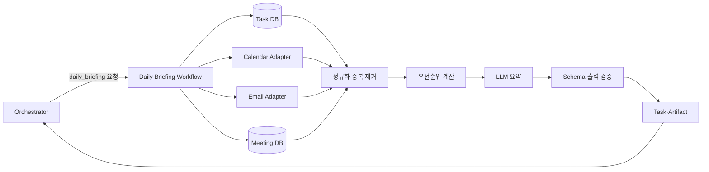
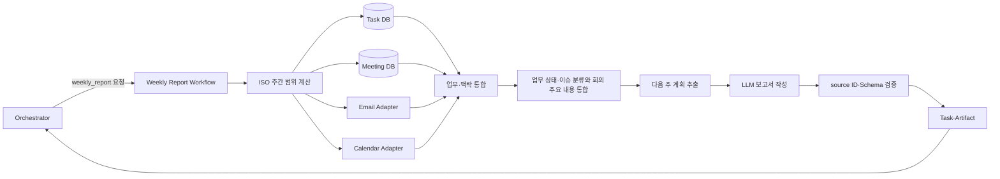
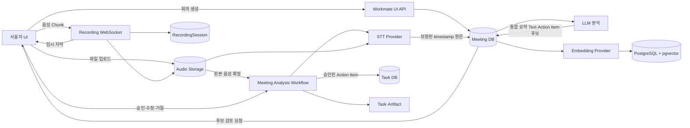
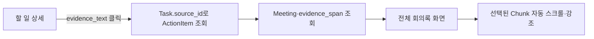
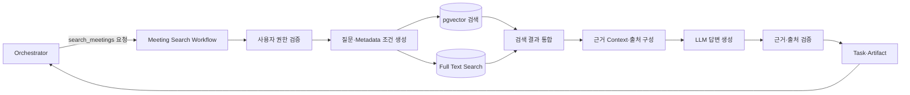
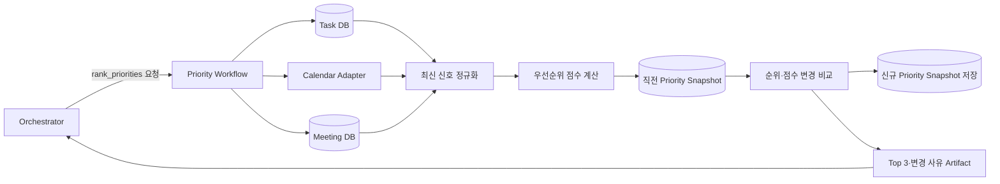
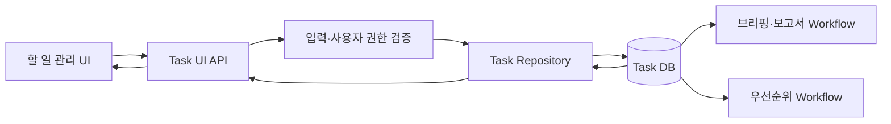
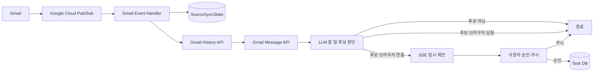
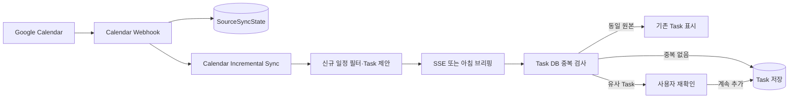

# 시나리오별 처리 흐름

[← 이전](03-data-priority-rules.md) · [목차](README.md) · [다음: AI·보안·운영 →](05-ai-security-operations.md)

## 1. 오늘 브리핑

```text
요청 인증
→ timezone/기준 시각 확정
→ 네 데이터 소스 병렬 조회
→ 정규화와 중복 제거
→ 우선순위 계산
→ LLM 요약
→ 출력 검증
→ Artifact 반환
```

네 데이터 소스는 Task, Calendar, Gmail, Meeting이다. Calendar 일정과 Gmail 메일은 저장 테이블 없이 요청 시 Provider에서 조회한다. Gmail은 사용자 지역 시각 기준 `[직전 영업일 00:00, as_of)` 범위를 조회한다. 일부 조회가 실패하면 나머지 데이터로 결과를 만들고 경고와 데이터 기준 시각을 표시한다.

메일 할 일 후보는 기존 `important_signals`에 포함한다. Email 항목의 `source_id`는 Gmail `message.id`이며, `related_task_ids`로 Task 등록 여부를 표시한다.

Calendar의 미등록 할 일 후보도 기존 `important_signals`에 포함한다. Calendar 항목의 `source_id`는 `{calendar_id}:{event_id}`이며 `related_task_ids`로 Task 등록 여부를 표시한다. 사용자가 추가하면 저장 직전에 동일 원본과 유사 Task를 검사한다.

### 데이터 흐름



출력:

```text
# 오늘의 브리핑
## 오늘 일정
## 확인할 요청과 이슈
## 중요 우선순위 Top 3
1. 업무명 — 점수
   근거: ...
## 주의사항
```

## 2. 주간 업무보고

```text
ISO 주간 경계 계산
→ 데이터 소스 병렬 조회
→ 업무와 맥락 연결
→ 완료/진행/지연/이슈 분류와 회의 주요 내용 통합
→ 근거 있는 다음 주 계획 추출
→ LLM 보고서 작성
→ 출처 참조 및 근거 검증
→ Artifact 반환
```

이번 주와 다음 주 일정은 보고서 생성 시 Calendar Provider에서 조회하며 별도 Calendar 테이블에는 저장하지 않는다.

### 데이터 흐름



출력:

```text
# 주간 업무보고 (YYYY-MM-DD ~ YYYY-MM-DD)
## 요약
## 완료 업무
## 진행 중 업무
## 지연 및 미해결 이슈
## 주요 회의 내용
## 다음 주 계획
```

`주요 회의 내용`은 이번 주 `Meeting.summary`와 근거 `MeetingChunk`를 사용해 보고서 생성 시 작성한다. 회의 원문에서 확정이 명시된 경우에만 `확정`으로 표현하며, 논의·제안·검토 단계의 내용은 확정된 결정처럼 작성하지 않는다.

## 3. 회의록 입력 및 분석

구현 시 WebSocket Chunk, Partial 이벤트, 실패·재시도와 Action Item 멱등성은 [구현·검증 가이드](12-implementation-verification-guide.md)를 따른다.

1. 회의 메타데이터를 생성하고 `upload` 또는 `realtime` 입력 방식을 선택
2. 파일 업로드는 완성된 녹음 파일을 등록하고, 실시간 녹음은 음성 Chunk를 전송하며 임시 STT 자막을 표시
3. 실시간 녹음 종료 시 Chunk를 원본 음성 파일로 확정
4. 원본 음성이 준비되면 비동기 A2A Task 생성
5. 원본 음성 기반 최종 STT를 수행하고 timestamp가 포함된 보정 원문 저장
6. LLM으로 주요 논의·결정·이슈를 포함한 통합 요약 Text와 Action Item 후보 추출
7. 회의록을 문단/주제 단위로 나눠 PostgreSQL `meeting_chunks`에 embedding과 함께 저장
8. UI에서 Action Item 후보 수정, 승인 또는 거절
9. 승인된 Action Item만 Task DB에 등록

### 데이터 흐름



Action Item 후보 필드:

| 필드 | 설명 |
| --- | --- |
| `title` | 수행할 업무 |
| `assignee` | 담당자, 불명확하면 `null` |
| `due_at` | 마감 시각, 불명확하면 `null` |
| `description` | 세부 내용 |
| `evidence_span` | 추출 근거가 된 회의록 구간 |
| `evidence_text` | 근거 구간에서 서버가 추출한 읽기 전용 회의록 원문 |
| `confidence` | 추출 신뢰도 |

LLM은 Action Item과 `evidence_span.meeting_chunk_ids`, `start_ms`, `end_ms`를 구조화해 반환한다. 서버는 최종 회의록의 해당 구간에서 원문을 추출해 `evidence_text`로 저장하며 LLM이 생성한 인용문을 그대로 저장하지 않는다.

### 할 일에서 회의 근거 조회



Action Item 전용 조회 화면은 만들지 않는다. 회의 분석 직후 승인·수정·거절을 위한 임시 검토 UI만 유지하고, 승인 이후에는 할 일 상세에서 `evidence_text`를 표시한다. 사용자가 근거 문장을 누르면 전체 회의록 화면으로 이동해 `evidence_span.meeting_chunk_ids`에 해당하는 라인을 강조한다.

## 4. 이전 회의록 검색

1. 사용자 접근권한 검증
2. 질문에서 날짜, 회의명, 참여자 필터 추출
3. Vector 검색과 keyword 검색
4. 상위 문맥과 회의 메타데이터 구성
5. LLM이 제공된 문맥 안에서 답변
6. 출처 및 인용 구간 검증
7. 답변과 회의명/날짜/발화자 반환

### 데이터 흐름



MVP 하이브리드 점수:

```text
0.7 × vector similarity + 0.3 × keyword score
```

별도 Reranker는 평가에서 Top-3 정확도가 부족할 때 추가한다. 근거가 없으면 `관련 회의록에서 확인할 수 없습니다`라고 반환한다.

## 5. 우선순위 재계산

1. 브리핑 또는 명시적 재계산 요청 수신
2. 미완료 Task와 Calendar·Meeting 관련 신호 조회
3. Task와 관련 신호 정규화
4. 점수 계산과 직전 Snapshot 비교
5. Top 3, 점수 구성, 변경 사유 반환

### 데이터 흐름



Top 3 후보는 Task DB의 미완료 Task만 사용한다. Priority Workflow는 Gmail을 호출하지 않으며, 메일에서 승인된 Task는 등록 시 저장된 마감·중요도를 사용한다. 미승인 메일 제안은 Top 3에 포함하지 않는다.

## 6. 할 일 관리

1. 사용자가 할 일 목록을 조회한다.
2. 제목, 담당자, 마감일, 중요도를 입력해 할 일을 직접 등록한다.
3. 등록된 Task에는 `source_type=manual`, `source_id=null`을 설정한다.
4. 사용자는 제목, 담당자, 마감일, 중요도와 상태를 수정할 수 있다.
5. 삭제 요청 시 `deleted_at`을 기록한다.
6. 삭제된 Task는 이후 브리핑·보고서·우선순위 계산에서 제외한다.

### 데이터 흐름



삭제는 DB 행을 즉시 제거하지 않는 Soft Delete로 처리한다. 복구와 삭제 목록 화면은 MVP 범위에서 제외한다.

## 7. Gmail 읽음 메일의 할 일 제안

1. Gmail Push 알림을 수신한다.
2. `source_type=gmail`인 `SourceSyncState.sync_cursor`를 `historyId`로 사용해 이후 History를 조회한다.
3. `UNREAD` Label이 제거된 Gmail `message.id`를 찾는다.
4. 해당 메일을 일시적으로 조회하고 LLM이 할 일 후보인지 판단한다.
5. 브라우저에 SSE 연결이 있으면 임시 제안을 전송한다.
6. 사용자가 승인하면 `source_type=email`, `source_id=message.id`인 Task를 저장한다.
7. 사용자가 무시하거나 브라우저가 닫혀 있으면 제안을 저장하지 않는다.
8. 처리한 Gmail `historyId`를 `SourceSyncState.sync_cursor`에 저장한다.

### 데이터 흐름



메일과 제안 결과는 DB에 저장하지 않는다. 무시한 후보는 `[직전 영업일 00:00, as_of)` 범위에 포함되면 다음 브리핑에 다시 표시될 수 있다. 브리핑은 Gmail을 다시 조회하고 `message.id`와 기존 `Task.source_id`를 비교해 `important_signals.related_task_ids`에 등록된 Task ID를 넣는다.

## 8. Google Calendar 일정의 할 일 제안

1. `events.watch` Webhook으로 Calendar 변경 알림을 수신한다.
2. `source_type=google_calendar`인 `SourceSyncState.sync_cursor`를 `events.list`의 `syncToken`으로 전달해 변경 Event를 조회한다.
3. 신규·확정·미래 일정을 Task 후보로 정규화한다.
4. 브라우저에 SSE 연결이 있으면 임시 제안을 전송한다.
5. 브라우저가 닫혀 있으면 저장하지 않고 다음 브리핑에서 Calendar를 다시 조회한다.
6. 사용자가 추가를 선택하면 동일 `(calendar_id, event_id)` Task를 먼저 확인한다.
7. 동일 원본이 있으면 기존 Task를 표시하고, 유사 Task가 있으면 계속 추가할지 한 번 더 확인한다.
8. 승인된 경우에만 `source_type=calendar`, `source_id={calendar_id}:{event_id}`로 Task를 저장한다.
9. 모든 변경을 처리한 후 `events.list`가 반환한 `nextSyncToken`을 `SourceSyncState.sync_cursor`에 저장한다.



Calendar Event와 임시 제안은 DB에 저장하지 않는다. 반복 일정은 MVP 제안 대상에서 제외하고 일정 변경·삭제는 이미 승인된 Task에 자동 반영하지 않는다.
