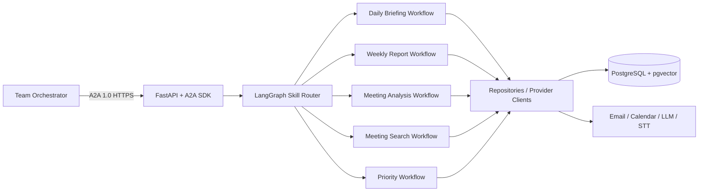
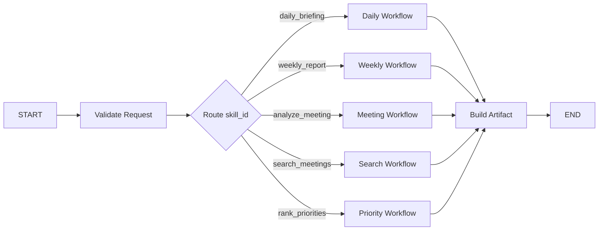

# Workmate AI 기술 상세 설계

[← 개발 계획](06-delivery-plan.md) · [목차](README.md)

## 1. 목적과 결정 상태

이 문서는 Workmate AI MVP의 구현 기준을 정의한다. 제품 기능과 업무 규칙은 다른 설계문서를 따르고, 이 문서는 기술 버전, 런타임 구성, Agent Workflow, 데이터 저장, 검색, 인증과 운영 규칙을 다룬다.

회의 녹음·Embedding·STT의 평가 결과를 구현 절차로 적용할 때는 [구현·검증 가이드](12-implementation-verification-guide.md)를 함께 참조한다.

| 항목           | 상태         | 결정                                  |
| -------------- | ------------ | ------------------------------------- |
| 언어           | 확정         | Python 3.12                           |
| HTTP API       | 확정         | FastAPI                               |
| A2A            | 확정         | A2A Protocol 1.0 호환 공식 Python SDK |
| Agent Workflow | 확정         | LangGraph                             |
| 업무 DB        | 확정         | PostgreSQL                            |
| Vector 검색    | 확정         | pgvector                              |
| Keyword 검색   | 확정         | PostgreSQL pg_trgm Trigram             |
| LLM            | 확정         | OpenAI 호환 API · `openai/gpt-4.1-mini` |
| Embedding      | 확정         | `openai/text-embedding-3-small`, 1536차원 |
| STT            | MVP 확정     | OpenAI `gpt-4o-transcribe`           |
| 메일·캘린더    | 확정         | Gmail API와 Google Calendar API       |
| UI             | 팀 결정 사용 | `workmate-agent` 최소 내부 검증 페이지와 팀 공통 UI의 제품 화면을 분리 |
| 로컬 실행      | 확정         | Docker Compose                        |

## 2. 버전 정책

### 2.1 기준 버전

| 구성요소       | 기준                  | 정책                                            |
| -------------- | --------------------- | ----------------------------------------------- |
| Python         | 3.12                  | 개발·CI·배포에서 동일 minor 사용                |
| A2A Protocol   | 1.0                   | Orchestrator도 동일 버전 사용                   |
| A2A Python SDK | 1.1.2                 | `a2a-sdk[http-server]==1.1.2` 정확히 고정       |
| LangGraph      | 1.1 이상 호환 release | `interrupt` v2와 영속 Checkpoint 사용 가능 버전 |
| PostgreSQL     | 16.14                 | 실제 Embedding·HNSW 평가와 동일한 patch 사용     |
| pgvector       | 0.8.2                 | 실제 HNSW 평가와 동일한 extension 버전           |
| pg_trgm        | 1.6                   | Trigram RRF 평가와 동일한 extension 버전         |

PostgreSQL 16.14, pgvector 0.8.2, pg_trgm 1.6을 MVP 기준으로 고정한다. Docker image tag·digest와 Migration 실행 결과를 저장소에 기록하며, major/minor 업그레이드는 A2A 계약 테스트와 검색 평가를 통과한 뒤 적용한다. A2A SDK는 Protocol 1.0 HTTP+JSON 서버를 지원하는 `1.1.2`를 최초 구현 기준으로 고정하며, 버전 변경 시 lockfile과 M0.1 Contract Test 증빙을 함께 갱신한다.

### 2.2 의존성 관리

- 패키지 선언: `pyproject.toml`
- lockfile 생성과 실행: `uv`
- A2A HTTP 서버: `a2a-sdk[http-server]==1.1.2`; 범위 지정자(`^`, `~`, `>=`)를 사용하지 않음
- 런타임 의존성은 직접 import하는 패키지만 선언
- Provider SDK는 선정된 LLM·STT·메일·캘린더용 하나씩만 추가
- LangChain 전체 패키지는 필요하지 않으면 추가하지 않고 LangGraph와 필요한 core 패키지만 사용

`workmate-agent/pyproject.toml`과 `uv.lock`을 애플리케이션 의존성의 단일 기준으로 사용한다. 현재 Mock Shell의 `requirements.txt`는 M0.1-01 전환이 끝나면 제거하거나 `pyproject.toml`에서 생성되는 호환 산출물로만 유지한다. Dockerfile·README·Compose 실행 명령도 같은 백로그에서 `uv.lock`과 `app.main:app` 기준으로 갱신해 두 의존성 원장을 병행하지 않는다.

## 3. 런타임 구조



계층별 책임:

```text
A2A/FastAPI       외부 요청·응답, 인증, Schema 검증
LangGraph         Skill 라우팅, 실행 순서, 상태, 승인 대기
Domain functions  날짜, 정규화, 중복 제거, 우선순위 점수
Repositories      PostgreSQL 읽기·쓰기
Provider clients  메일, 캘린더, LLM, Embedding, STT 호출
```

Daily Briefing과 Gmail Event Workflow만 Gmail Client를 사용한다. Priority Workflow는 Gmail Client를 호출하지 않고 Task DB의 미완료 Task를 순위 대상으로 사용한다.

A2A, LangGraph, DB 접근을 하나의 클래스에 넣지 않는다. 반대로 내부 기능마다 독립 Agent나 마이크로서비스를 만들지도 않는다.

## 4. 권장 프로젝트 구조

```text
workmate-agent/
├─ pyproject.toml
├─ uv.lock
├─ app/
│  ├─ main.py
│  ├─ config.py
│  ├─ a2a/
│  │  ├─ agent_card.py
│  │  ├─ executor.py
│  │  └─ runtime.py
│  ├─ workflows/
│  │  ├─ registry.py
│  │  ├─ daily_briefing.py
│  │  ├─ weekly_report.py
│  │  ├─ meeting_analysis.py
│  │  ├─ meeting_search.py
│  │  └─ priority.py
│  ├─ domain/
│  │  ├─ date_ranges.py
│  │  ├─ normalization.py
│  │  └─ priority.py
│  ├─ repositories/
│  │  ├─ tasks.py
│  │  └─ meetings.py
│  └─ providers/
│     ├─ email.py
│     ├─ calendar.py
│     ├─ llm.py
│     ├─ embeddings.py
│     └─ stt.py
├─ migrations/
├─ tests/
├─ Dockerfile
└─ compose.yaml
```

`Service` 클래스를 기능마다 만들지 않는다. 상태 없는 날짜·점수·정규화 로직은 함수로 두고, 외부 I/O만 Repository와 Provider Client로 분리한다.

### 4.1 코드 문서화 규칙

구현자는 모든 함수에 주석을 무조건 추가하지 않고, 다른 모듈에서 호출되거나 업무 규칙을 포함하는 함수에 Docstring 또는 JSDoc을 작성한다. 주석은 코드의 동작을 반복하기보다 호출 목적과 변경 시 주의할 계약을 설명한다.

Docstring과 JSDoc의 기본 언어는 한글이다. 새로 작성하거나 수정하는 설명은 한글로 작성하되 함수명·클래스명·프로토콜·Schema 필드명·환경변수명·SDK 타입명 같은 기술 식별자는 원문을 유지한다. 기존 영문 Docstring은 기능 변경 없이 일괄 번역하지 않고, 해당 코드를 수정하거나 문서화 보강 작업을 할 때 한글로 정리한다.

다음 함수는 문서화 대상이다.

- A2A·UI Route에서 호출하는 공개 함수와 LangGraph Workflow 진입 함수
- 날짜 범위, 정규화, 우선순위, 중복 검증 등 핵심 Domain 함수
- Gmail·Calendar·R2·LLM·STT Adapter의 외부 연동 함수
- 인증·권한, 멱등성, 재시도, 오류 변환을 담당하는 함수

함수 설명에는 가능하면 입력, 반환값, 예외와 외부 시스템의 제약을 포함한다.

```python
def calculate_priority(task, signals, as_of):
    """Task와 업무 신호를 종합해 우선순위 점수를 계산한다.

    Args:
        task: 대상 Task.
        signals: 메일·일정·회의 관련 신호.
        as_of: 점수 계산 기준 시각.

    Returns:
        점수 구성과 최종 priority_score를 포함한 결과.
    """
```

```ts
/** 승인된 Action Item을 중복 검사 후 Task로 등록한다. */
function registerApprovedActionItem(...) {}
```

변수명만으로 의미가 분명한 짧은 함수에는 불필요한 주석을 달지 않는다. 주석과 실제 계약이 달라지면 구현을 우선 수정하고, 검수 시 문서화 누락과 오래된 주석을 함께 확인한다.

#### 4.1.1 확장 주석 정책

주석은 코드의 양을 늘리기 위한 산출물이 아니라, 계약·불변식·외부 제약을 보존하기 위한 변경 안전장치다.

- 모듈·공개 API·Domain·Adapter·인증·Streaming 경계에는 역할과 책임을 기록한다.
- 새 Docstring·JSDoc은 한글을 기본으로 작성하고 기술 식별자는 원문을 유지한다.
- 함수 Docstring/JSDoc에는 가능한 경우 입력, 반환값, 예외, 외부 시스템 제약을 포함한다.
- A2A 이벤트 순서, 멱등성, 재시도, 취소, 권한 범위처럼 코드만으로 오해하기 쉬운 불변식은 명시한다.
- 테스트 함수는 무엇을 하는지보다 왜 필요한지 설명한다. 단순한 Given/When/Then 반복 주석은 생략한다.
- `TODO`는 `{백로그 ID} — {완료 조건}` 형식으로 기록하며, 담당자·기한이 필요하면 함께 적는다.
- Secret, Token, API Key, 개인정보, Presigned URL은 주석·Docstring·Fixture에 기록하지 않는다.
- 생성된 SDK·Migration·외부 라이브러리 파일에는 직접 주석을 추가하지 않는다.
- 검수 시 주석의 존재보다 실제 계약과의 일치 여부, 오래된 주석의 제거 여부를 확인한다.

M0.1 런타임의 최소 검수 대상은 `Agent Card`, 인증 미들웨어, `AgentExecutor`, Route allowlist, Streaming·Subscribe 경계다. 각 함수의 문서화 확인 결과는 하위 마일스톤 `result.md`에 기록한다.

## 5. A2A 기술 규격

### 5.1 Protocol과 Binding

- Protocol: A2A 1.0
- SDK: 공식 `a2a-sdk`
- 우선 Binding: HTTP+JSON (REST 스타일 엔드포인트)
- 개발 Agent Card: `/.well-known/agent-card.json`
- 운영 URL: HTTPS 절대 URL
- 미사용: gRPC, Push Notification, 다중 Binding
- A2A `capabilities.streaming`과 `/message:stream`은 공식 SDK REST Route로 제공한다. Push Notification, gRPC, 다중 Binding은 MVP에서 사용하지 않는다. 회의 입력의 실시간 녹음·임시 자막은 A2A와 별도의 UI WebSocket으로 지원하고, 최종 회의 분석은 A2A Task 조회 또는 Subscribe 방식으로 확인한다.

Agent Card의 `supportedInterfaces`에 URL, `protocolBinding`, `protocolVersion`을 선언한다. Interface URL은 배포 환경에서 Orchestrator가 접근 가능한 주소를 사용한다. Agent Card에는 Token이나 Secret을 넣지 않는다.

Workmate A2A Operation은 다음 경로로 고정한다.

```text
POST /a2a/message:send
POST /a2a/message:stream
GET  /a2a/tasks/{id}
POST /a2a/tasks/{id}:cancel
POST /a2a/tasks/{id}:subscribe
```

오케스트레이터와 Workmate의 필드 차이는 Workmate 입구 Adapter에서 변환한다. 공개 Workmate Skill Schema에는 `workspace_id`를 추가하지 않으며, 오케스트레이터가 전달한 값은 인증된 사용자 범위 검증에 사용한 뒤 내부 Skill 입력에서 제거한다. 오케스트레이터 상태값은 다음처럼 A2A Task 상태로 매핑한다.

```text
queued     → TASK_STATE_SUBMITTED
running    → TASK_STATE_WORKING
succeeded  → TASK_STATE_COMPLETED
failed     → TASK_STATE_FAILED
cancelled  → TASK_STATE_CANCELED
```

이 Adapter는 공개 Artifact·Skill Schema를 변경하지 않고 `messageId`, `request_id`, `user_id`를 보존한다. 변환 실패는 Task 생성 전 HTTP 400으로 반환한다. 인증·버전·Content-Type·출력 형식·상태·오류 매핑의 인수 조건은 [A2A 인터페이스 5.1](02-a2a-interface.md#51-a2a-httpjson-경계)의 Adapter Contract Test 표를 따른다.

### 5.2 공개 Skill

| Skill ID          | 실행 Workflow    | 응답 방식                   |
| ----------------- | ---------------- | --------------------------- |
| `daily_briefing`  | Daily Briefing   | 즉시 완료 Task               |
| `weekly_report`   | Weekly Report    | 즉시 완료 또는 장기 Task     |
| `analyze_meeting` | Meeting Analysis | 장기 Task                   |
| `search_meetings` | Meeting Search   | 즉시 완료 Task               |
| `rank_priorities` | Priority         | 즉시 완료 Task               |

즉시 Skill은 첫 `SendMessage` 응답에서 최종 Artifact를 포함한 `TASK_STATE_COMPLETED` Task를 반환한다. 최종 업무 결과는 Artifact의 구조화 `DataPart`에 저장하고, UI 표시용 Markdown도 별도 Part로 제공한다. 모든 결과에는 `schema_version`, `request_id`, `generated_at`, `data_freshness`, `warnings`를 포함하며 `warnings`는 공개 Schema의 Warning 객체 배열을 사용한다. Skill 데이터의 정식 계약은 [Workmate Skill JSON Schema](schemas/workmate-skill-schemas.schema.json)를, A2A Artifact 구조의 정식 계약은 [A2A Artifact JSON Schema](schemas/a2a-artifact.schema.json)를 따른다.

### 5.3 식별자 연결

| 식별자       | 용도                       |
| ------------ | -------------------------- |
| A2A Task ID  | 외부 작업 조회와 상태 추적 |
| `thread_id`  | LangGraph Checkpoint 재개  |
| `request_id` | 로그와 분산 추적           |
| `user_id`    | 사용자 권한과 데이터 범위  |

### 5.4 내부 Skill 검증 챗봇

Workmate는 Orchestrator 연동 전에 5개 공개 Skill을 직접 확인할 수 있는 최소 내부 검증 페이지를 `workmate-agent`에 제공한다. 이 페이지는 M0.4 검증 전용이며 별도 업무 데이터나 제품 상태를 저장하지 않는다. 제품 사용자가 쓰는 최종 화면은 팀 공통 UI에 통합한다. 기존 `workmate-ui-demo`는 폐기된 샘플이며 구현·검수에 사용하지 않는다.

- 대상 Skill: `daily_briefing`, `weekly_report`, `analyze_meeting`, `search_meetings`, `rank_priorities`
- 챗봇은 Orchestrator나 A2A Service Token을 호출하지 않고 같은 LangGraph Workflow·Repository·Domain 함수를 직접 호출한다.
- 결과는 A2A 경로와 같은 `Task`, `Artifact`, `schema_version`, `warnings`, `request_id` 규약으로 렌더링한다.
- `analyze_meeting`처럼 오래 걸리는 작업은 내부 Task ID를 표시하고 Polling으로 상태를 갱신한다.
- Action Item 승인·Task 생성처럼 쓰기가 발생하는 기능은 기존 Human-in-the-loop와 멱등성 규칙을 그대로 적용한다.
- 브라우저는 사용자 Session/OIDC만 사용하며 Service Token과 R2 Secret을 받지 않는다.
- `WORKMATE_INTERNAL_CHAT_ENABLED=false`이면 내부 API와 UI 진입을 차단한다. 교육용 통합 환경에서만 `true`로 켠다.
- API는 자연어와 JSON 입력을 모두 검증하고, UI는 Artifact·최신성·`warnings`·오류·장기 Task 상태·취소 결과를 표시한다.
- A2A 경로와 내부 챗봇은 같은 Workflow·Repository·Domain 함수를 호출하며 `user_id` 권한 필터와 Provider 부분 실패 규칙을 공유한다.

장기 작업은 A2A Task ID와 LangGraph `thread_id`를 DB에 매핑한다. 두 ID를 같은 값으로 사용할 수 있지만 외부 규격과 내부 저장 구조는 별도 필드로 유지한다.

## 6. LangGraph 설계

### 6.1 최상위 Router



Skill별 Workflow는 사용자 기능 단위다. 공통 Domain 함수와 Repository를 공유하되 Workflow State는 필요한 필드만 가진다.

### 6.2 공통 State

```python
class WarningState(TypedDict):
    source: str
    code: str
    message: str
    retryable: bool
    last_success_at: str | None


class WorkmateState(TypedDict, total=False):
    request_id: str
    skill_id: str
    user_id: str
    timezone: str
    as_of: str
    source_refs: list[str]
    warnings: list[WarningState]
    result: dict
    error: dict
```

`WarningState`는 공개 Result Envelope의 Warning 객체와 같은 필드를 사용한다. 내부 Workflow에서 별도 문자열 경고를 만들지 않고, 최종 Artifact에 그대로 직렬화한다.

Workflow별 세부 State가 공통 State를 확장한다. State에는 JSON으로 직렬화 가능한 작은 데이터만 저장한다.

State에 저장하지 않는 값:

- 원본 음성 Binary와 전체 대용량 회의록
- DB Connection과 HTTP Client 객체
- OAuth Token, API Key, Provider Secret
- 재조회할 수 있는 대용량 Provider 원본 응답

이 값은 저장소에 두고 State에는 ID나 URI만 둔다.

### 6.3 Checkpoint와 승인

- 개발·단위 테스트: In-memory Checkpointer
- 통합·운영: PostgreSQL 기반 영속 Checkpointer
- `thread_id`: A2A 장기 Task마다 고유값 사용
- Human-in-the-loop: Action Item 승인 Node에서 `interrupt()` 사용
- 재개: 승인/수정/거절 데이터를 `Command(resume=...)`로 전달

`interrupt()`가 있는 Node는 재개 시 처음부터 다시 실행될 수 있다. 승인 전에 수행한 외부 쓰기와 Task 생성은 idempotent해야 한다.

PostgreSQL Task Store는 외부 A2A Task 상태·Artifact·Message 멱등성 Key·`task_id ↔ thread_id` 매핑을 저장하고, LangGraph Checkpoint는 Workflow 내부 State를 저장한다. 공개 이벤트 전체 이력은 MVP에서 별도 저장하지 않는다. 이 저장 경계와 최소 Migration은 M0.1이 소유하며, M1.1은 Task·Gmail·Calendar 등 업무 도메인 Migration과 Repository를 소유한다. 프로세스 메모리 Active Task는 실행 중 전달에만 사용하며 상태 원장으로 간주하지 않는다. 서버 재시작 시 비종료 Task를 조회해 같은 Checkpoint와 멱등성 Key로 재개하고, 안전하게 재개할 수 없으면 원인을 기록해 `FAILED`로 전환한다. 취소는 영속 상태에 먼저 기록하고 Subscribe는 현재 Task 스냅샷 뒤에 연결 이후 신규 이벤트만 Streaming한다. 상세 계약은 [A2A 인터페이스 6.1.1](02-a2a-interface.md#611-task-store와-재시작-복구)을 따른다.

### 6.4 Node 재시도

| Node 종류       | 재시도                                       |
| --------------- | -------------------------------------------- |
| 날짜·점수·검증  | 재시도 없음                                  |
| DB 읽기         | 일시 오류만 최대 2회                         |
| 외부 API 읽기   | timeout/429/5xx만 지수 backoff 최대 2회      |
| LLM 구조화 출력 | Schema 오류 시 수정 프롬프트 1회             |
| DB 쓰기         | 자동 반복 대신 idempotency key로 안전성 확보 |
| 인증·권한 실패  | 재시도 없음                                  |

## 7. API와 Schema

### 7.1 FastAPI 역할

- A2A SDK용 HTTP 애플리케이션 제공
- 공식 `a2a-sdk` 타입·`AgentExecutor` 런타임 경계는 `workmate-agent/app/a2a/runtime.py`에서 관리
- 실제 업무 기능 구현 시 전송 계층과 독립적인 Workflow 요청·결과와 `skill_id → Workflow` Registry를 `workmate-agent/app/workflows/registry.py`에서 관리
- 공개 Workmate `/a2a` Route는 SDK `DefaultRequestHandlerV2`와 `AgentExecutor`를 직접 사용하고, Bearer·`A2A-Version` 검증은 Middleware에서 유지
- SDK REST Route 객체는 `create_rest_routes`로 생성하되 MVP 허용 목록인 `/message:send`, `/message:stream`, Task 조회·취소·`POST` Subscribe만 FastAPI에 등록한다. SDK가 함께 제공하는 Task 목록·Push 설정·Extended Agent Card·Tenant Route는 등록하지 않는다.
- Agent Card 제공
- 인증 Middleware
- 회의 파일 업로드와 UI 보조 API
- `/health/live`, `/health/ready` 제공
- 내부 Workflow·UI API는 Pydantic 기반 요청·응답 검증

비즈니스 로직은 FastAPI Route나 `AgentExecutor`에 작성하지 않고, 구현 예정인 Registry가 선택한 Workflow 또는 Domain 함수로 전달한다.

### 7.1.1 구현 예정 런타임의 검증 범위

구현한 공개 `/a2a` 경로는 공식 SDK REST Handler와 `AgentExecutor`를 직접 사용한다. A2A 전송 계층은 SDK `SendMessageRequest`, `Task`, `Artifact`, SSE Streaming 응답을 사용하고, 업무 도메인·내부 UI API의 Pydantic 모델은 유지한다. M0.1-01·02에서 SDK 전송 경계와 Contract Test를 완료했으며, M0.1-03에서 Registry·A2A 인프라 영속 경계를 연결한다. 실제 업무 Workflow는 후속 M1~M4에서 연결한다.

- 실제 업무 기능 연결 시 SDK `AgentExecutor`는 공통 요청 필드를 전송 독립 요청 객체로 변환하고 Registry에서 Workflow를 선택한다. Workflow 결과의 Markdown·구조화 결과·최신성·경고는 공통 변환기에서 SDK Task·Artifact로 만든다.
- 현재 5개 Skill은 Registry를 통과하는 런타임 준비 Workflow로 응답하며, 이 응답은 업무 결과가 아니다. 실제 업무 Workflow는 M1~M4 검수 순서에 따라 연결한다.
- Smoke Test와 Contract Test는 Agent Card의 `Cache-Control`, SDK REST 요청·응답, Artifact, 인증, Adapter 상태·오류 매핑과 5개 Skill을 검증한다. `/message:stream`은 첫 Task와 후속 상태·Artifact 순서를, 활성 Task `POST` Subscribe는 현재 Task 스냅샷과 신규 이벤트를, Terminal Task Subscribe는 정의된 SDK 오류를 검증한다. 비허용 `GET` Subscribe를 포함한 허용 목록 밖 SDK Route는 `404` 또는 `405`여야 한다.
- 구현 후 SDK 표준 응답은 `SendMessageResponse`의 `task` 필드를 사용한다. Task 조회·취소 응답은 SDK REST 규격에 따라 Task 객체를 직접 반환하며, 완료 Task 취소는 HTTP 400으로 처리한다.
- Push Notification은 저장소·발송기가 연결되지 않아 비활성화하며 Agent Card의 `pushNotifications`는 `false`로 유지한다.
- 승인 Schema는 추가 필드를 금지하므로 공개 Artifact에 `mock`, `received` 같은 전용 필드를 넣지 않는다. Mock Fixture는 5개 Skill별 정식 Result Envelope를 생성하고 Mock 여부는 테스트 로그·Fixture 이름·증빙 메타데이터에만 기록한다. Schema를 통과하지 않는 기존 Mock 응답은 M0.1 승인 결과로 사용할 수 없다.
- M0 완료 후 운영 Profile에는 Legacy Mock Handler를 등록하지 않는다. 미완료 업무 Workflow는 성공한 고정 응답으로 대체하지 않고 명시적인 미구현 오류를 반환하며, Mock·Fake는 테스트 Profile에서만 사용한다.

### 7.2 시간과 식별자

- 외부 시각: timezone offset이 포함된 ISO 8601 문자열
- 내부 저장: PostgreSQL `timestamptz`, UTC 기준
- 사용자 timezone: IANA 이름, 기본 `Asia/Seoul`
- ID: UUID
- 기간: 종료 시각을 포함하지 않는 `[start, end)`

### 7.3 오류 응답

```json
{
  "code": "SOURCE_UNAVAILABLE",
  "message": "캘린더 정보를 가져오지 못했습니다.",
  "retryable": true,
  "request_id": "uuid"
}
```

내부 Stack Trace, SQL, Provider 응답 본문은 외부 응답에 포함하지 않는다.

## 8. PostgreSQL과 pgvector

### 8.1 저장 원칙

PostgreSQL을 Task, Meeting, Action Item, 검색 Chunk, 우선순위 Snapshot, LangGraph Checkpoint의 단일 저장소로 사용한다. Vector DB를 별도로 운영하지 않는다.

핵심 검색 테이블:

```sql
CREATE EXTENSION IF NOT EXISTS vector;
CREATE EXTENSION IF NOT EXISTS pg_trgm;

CREATE TABLE meeting_chunks (
    meeting_chunk_id uuid PRIMARY KEY,
    parent_meeting_id uuid NOT NULL REFERENCES meetings(meeting_id) ON DELETE CASCADE,
    sequence_no integer NOT NULL,
    speaker text,
    started_at_ms integer,
    ended_at_ms integer,
    content text NOT NULL,
    embedding vector(1536) NOT NULL,
    created_at timestamptz NOT NULL DEFAULT now(),
    UNIQUE (parent_meeting_id, sequence_no)
);
```

`evidence_span.start_ms`와 `evidence_span.end_ms`는 선택한 Chunk의 `started_at_ms`와 `ended_at_ms`에 대응한다. 서버는 두 값이 모두 존재하는 근거 구간에서 `end_ms >= start_ms`를 검증한다.

Embedding 모델은 `openai/text-embedding-3-small`로 고정하고 Vector 차원은 1536으로 Migration에 고정한다. 환경변수로 DDL 차원을 바꾸지 않는다. 모델 또는 차원을 변경하면 기존 `meeting_chunks`를 전부 재생성한다.

권장 Index:

```sql
CREATE INDEX meeting_chunks_meeting_idx
    ON meeting_chunks (parent_meeting_id);

CREATE INDEX meeting_chunks_content_trgm_idx
    ON meeting_chunks USING gin (content gin_trgm_ops);

CREATE INDEX meeting_chunks_embedding_idx
    ON meeting_chunks USING hnsw (embedding vector_cosine_ops);
```

개발 초기의 소규모 로컬 데이터는 Vector Index 없이 정확 검색으로 시작할 수 있다. 운영 검색 구성은 평가된 Dense + Trigram RRF + HNSW 경로를 사용하며, 운영 환경에서는 HNSW를 기본 인덱스로 활성화한다.

### 8.2 하이브리드 검색

1. 요청된 `user_id` 데이터 범위 필터 적용
2. 날짜, 회의, 참여자 metadata 필터 적용
3. Vector Top-K 검색
4. PostgreSQL pg_trgm Trigram 유사도 Top-K 검색
5. 두 순위를 Reciprocal Rank Fusion(RRF)으로 결합
6. 상위 Chunk의 인접 구간을 Context로 확장

Vector 점수와 Keyword 점수는 척도가 다르므로 원시 점수를 `0.7 + 0.3`으로 직접 더하지 않는다.

```text
RRF(document) = 1 / (60 + vector_rank)
              + 1 / (60 + keyword_rank)
```

Trigram 검색은 한국어 형태소 분석을 전제로 하지 않고 문자열 유사도를 사용한다. 별도 Reranker는 기본 검색 경로에 상시 추가하지 않고, 평가된 조건부 호출 기준을 만족하는 질의에만 사용한다.

### 8.2.1 답변 가능성·근거 충분성 판정

Embedding Cosine 점수는 후보 검색의 순위 신호로만 사용한다. `top_dense_score >= 0.45` 같은 단일 임계값으로 답변 가능 여부를 확정하지 않는다. 실제 평가에서 답변 가능 질문과 답변 불가 질문의 점수 범위가 겹쳐 정상 질문을 과도하게 거절하기 때문이다.

운영 Workflow는 다음 순서를 따른다.

1. `user_id`·날짜·회의·참여자 필터를 적용한다.
2. Dense와 Trigram 후보를 각각 조회하고 RRF Top-K를 만든다.
3. 후보 Chunk의 필터 일치, 실제 `chunk_id`, 직접 근거 문장 존재 여부를 서버가 검증한다.
4. Top-1/Top-2 점수 차이가 작거나 다중 Chunk·Metadata 질문이면 조건부 Reranker를 호출한다. Reranker는 기존 후보 ID만 재정렬하고 새 근거를 만들지 않는다.
5. 근거가 충분하면 답변·출처를 생성하고, 부족하면 `insufficient_evidence`와 `warnings`를 반환한다.

Reranker 장애·Timeout 시에는 RRF 결과를 보존하고 `warnings`를 추가한다. 이 정책의 실제 구현과 Contract Test는 M4.4에서 수행한다.

### 8.3 Migration과 DB 접근

- PostgreSQL Driver: psycopg 3
- Migration: 순번이 있는 SQL 파일
- Connection Pool: psycopg pool
- SQL에는 항상 bind parameter 사용
- 사용자 데이터 Query에는 요청된 `user_id` 조건 필수
- 승인된 Action Item의 Task 등록은 `action_item_id` unique constraint로 중복 방지

Migration 책임은 다음처럼 나눈다.

- M0.1 A2A 인프라 Migration: A2A Task, Message 멱등성 Key, Artifact, `task_id ↔ thread_id`, LangGraph Checkpoint. 공개 이벤트 전체 이력은 MVP 저장 범위에서 제외
- M1.1 업무 DB Migration: Task, Gmail·Calendar 동기화 상태와 Cursor, 업무 Repository, 샘플 데이터
- 이후 마일스톤 Migration: Meeting·Action Item·Recording·검색 Chunk처럼 해당 기능이 처음 필요한 마일스톤

ORM과 Alembic은 복잡한 관계 변경이 반복될 때 도입한다. MVP에서는 SQL Schema와 Query가 작으므로 직접 관리한다.

## 9. LLM, Embedding, STT

### 9.1 LLM 요구조건

- 한국어 업무 문서 요약 품질
- JSON Schema 또는 안정적인 구조화 출력
- 긴 회의록 Context 처리
- timeout과 rate limit 제어
- 비용과 사용량 확인
- 팀의 데이터 처리 정책 충족

현재 선택:

| 구분 | 모델 ID·형식 | 실행 방식 | 상태 |
| --- | --- | --- | --- |
| 기본 LLM | `openai/gpt-4.1-mini` | OpenAI 호환 API | 확정 |

보류 후보:

| 후보 | 모델 ID·형식 | 실행 방식 |
| --- | --- | --- |
| OpenAI | `gpt-5.4-mini-2026-03-17` | API |
| Qwen 로컬 | `qwen2.5:3b` Q4 | CPU 로컬·Ollama |
| NVIDIA Llama | `meta/llama-3.3-70b-instruct` | NVIDIA API |
| NVIDIA Gemma | `google/gemma-4-31b-it` | NVIDIA API |

MVP는 기본 LLM의 Provider Client 하나만 구현한다. 현재 API 할당량이 소진되거나 계약이 종료되면 보류 후보를 동일한 Case와 Workmate JSON Schema로 재평가해 대체 모델을 수동으로 선정한다. 런타임 다중 Provider 전환이나 Provider Factory는 구현하지 않는다. 평가 기준, 근거와 변경 이력은 [LLM 모델 평가 계획과 개선 이력](11-llm-evaluation-plan.md)에 기록한다.

재평가 시 로컬 모델은 Context 8K와 동시 요청 1개로 시작하며, 모든 후보에 동일한 회의록 Chunk 분할 규칙을 적용한다. API 모델은 Token·응답시간과 확인 가능한 비용을, 로컬 모델은 최대 RAM·VRAM·응답시간·초당 Token을 추가 기록한다.

Provider Timeout·429·502·503·504는 한 번 재시도하고 최종 Provider 실패는 Schema 실패와 분리해 품질 통계에서 제외한다. 출처 평가는 최상위 `source_refs`만 요구하지 않고 Task·Meeting·Transcript·MeetingChunk 전용 ID 필드에서 결정적으로 수집하며, 입력에 없는 출처 ID 생성은 별도 실패로 처리한다. 주간 보고의 다음 주 계획과 회의 검색의 답변 본문·출처 인용문도 각각 검증한다.

LLM 사용 위치:

- 브리핑과 주간 보고서 작성
- 통합 회의 분석 Text와 Action Item 후보 추출
- 검색 Context 기반 답변

Action Item 생성 시 LLM은 `evidence_span`만 지정한다. 서버가 최종 회의록의 해당 구간에서 원문을 추출해 `evidence_text`로 저장하며 LLM이 작성한 인용문을 원문으로 신뢰하지 않는다. 물리 모델의 `action_items` 테이블에는 `evidence_text text NOT NULL`을 둔다.

`evidence_span`은 `meeting_chunk_ids`, `start_ms`, `end_ms`로 구성한다. 전체 회의록 API는 Cursor Pagination을 사용하며 `around_meeting_chunk_id` 요청 시 선택 Chunk와 앞뒤 문맥을 먼저 반환한다. Task 상세의 회의 근거는 `Task → ActionItem → Meeting` 조인으로 구성하고 Task 테이블에는 근거를 복제하지 않는다.

LLM이 담당하지 않는 것:

- 날짜 범위, 권한, 우선순위 점수
- 상태 전이, 중복 제거, Task 자동 승인

### 9.2 Embedding 요구조건

- 한국어 회의 문장 검색 평가
- Vector 차원과 저장 비용
- Query/Document embedding 사용법
- 모델 버전 고정 가능 여부


- 동일 입력 재처리 비용

현재 확정값:

- 모델: `openai/text-embedding-3-small`
- Vector 차원: 1536
- Provider 계약: OpenAI 호환 `/embeddings` API
- 거리 함수: cosine (`vector_cosine_ops`)
- 검색 경로: Dense + PostgreSQL Trigram RRF, HNSW 인덱스

확정 근거(2026-08-11 실제 데이터 평가):

| 결정 항목 | 근거 |
| --- | --- |
| 모델·차원 | 실제 `/embeddings` 응답이 `text-embedding-3-small`, 1536차원을 반환했고, 저장·검색 마이그레이션과 호환됨 |
| 거리 함수 | Embedding 평가에서 cosine 기준으로 Dense·HNSW·RRF를 동일하게 비교했으며, `vector_cosine_ops` Index Scan을 확인함 |
| Trigram RRF | 실제 회의록 64 Chunk·60 Case에서 Dense+Trigram RRF가 Hit@3 **98.21%**, Hit@5 **100%**, MRR **0.9777**을 기록함 |
| HNSW | HNSW+Trigram RRF의 결과가 정확 검색과 동일했고 Recall@5가 **100%**였으며, HNSW Index Scan을 확인함 |
| 운영 지연 | Hybrid DB p95 **66.3ms**, Query Embedding API p95 **893.1ms**로 평가 기준을 통과함 |

상세 근거는 [최신 PostgreSQL 평가 지표](../embedding-evaluation/results/postgres-metrics-20260811-101253.json), [최신 Reranker 평가 지표](../embedding-evaluation/results/reranker-metrics-20260811-101533.json), [Embedding 평가 계획 및 이력](10-embedding-evaluation-plan.md)을 참조한다. 이 결정 이후 `meeting_chunks.embedding`은 `vector(1536)`으로 고정하며, 모델을 변경할 때는 전체 Chunk를 재임베딩하고 새 평가 이력을 남긴다.

모델을 바꾸면 기존 Chunk를 새 embedding으로 다시 생성해야 한다. `embedding_model`과 `embedding_version`을 회의 Chunk 또는 별도 Index Metadata에 기록한다.

후보, 평가 데이터, 지표와 선정 기준은 [Embedding 모델 평가 계획](10-embedding-evaluation-plan.md)을 따른다. 평가 결과와 수정 이유는 [Embedding 평가 및 개선 이력](../embedding-evaluation/EVALUATION_HISTORY.md)에 누적한다.

### 9.3 STT 요구조건

- 한국어 게임 개발 용어 인식률
- timestamp 제공
- 긴 음성 파일 처리
- 화자 분리 지원 여부
- 지원 포맷과 최대 파일 크기
- 보존·학습 사용 정책

현재 MVP 확정값:

- Provider: OpenAI API
- 모델: `gpt-4o-transcribe`
- 입력: WAV·MP3·M4A 등 OpenAI 지원 음성 파일
- 언어: 한국어(`ko`)
- 파일 기반 재처리: 사용
- 실시간 Streaming: Realtime WebSocket 사용
- Realtime 입력: mono PCM16, 24kHz, 기본 200ms Chunk
- Realtime 이벤트: Partial Delta와 Final Completed 누적
- 화자 분리: MVP 범위에서 제외

확정 근거(2026-08-11): gTTS 한국어 합성 음성 20 Case 파일 평가에서 Provider 오류 0건·핵심어 인식 19/20(95%)을 확인했고, 16kHz WAV를 24kHz PCM16으로 변환해 200ms Chunk로 전송한 Realtime 2 Case에서 Partial/Final 이벤트 수신 성공·Provider 오류 0건을 확인했다. 상세 결과는 [STT 평가 이력](../stt-evaluation/EVALUATION_HISTORY.md)을 참조한다.


MVP는 파일 기반 STT와 실시간 Streaming STT를 모두 지원한다. 실시간 결과는 화면용 임시 자막으로만 사용하고, 녹음 종료 후 확정된 원본 음성으로 timestamp가 포함된 최종 STT를 다시 수행한다. 화자 분리는 필수가 아니다. 이 항목의 Provider·계약 확정은 코드 구현 완료를 의미하지 않으며, 구현 상태는 [구현·검증 가이드](12-implementation-verification-guide.md)의 체크리스트를 따른다.

브라우저는 WebSocket으로 순번이 포함된 음성 Chunk를 전송한다. 서버는 `RecordingSession.last_chunk_no`를 저장해 재연결 시 다음 Chunk부터 이어 받고, 종료 요청 후 Chunk를 원본 음성으로 확정한다. 이후 처리는 파일 업로드 방식과 동일한 `analyze_meeting` 장기 Task를 사용한다.

### 9.4 Provider 연결 규칙

Provider Client는 LLM, Embedding, STT 각각 하나만 구현한다. 공통 Interface, Factory, 다중 Provider 전환 기능은 만들지 않는다. 테스트에서는 HTTP 호출 경계를 Fake로 교체한다.

## 10. Gmail과 Google Calendar

메일은 Gmail API, 캘린더는 Google Calendar API, 인증은 Google OAuth 2.0을 사용한다.

연동 규칙:

- Gmail OAuth Scope: `https://www.googleapis.com/auth/gmail.readonly`
- Google Calendar OAuth Scope: `https://www.googleapis.com/auth/calendar.readonly`
- 메일 발송·삭제와 일정 수정은 MVP에서 지원하지 않으므로 전체 수정 권한을 요청하지 않음
- 필요한 최소 Scope만 요청
- 검증: `google-oauth-test`에서 OAuth·Gmail Profile/Message/History·Calendar Events·Watch 등록 성공
- Access Token과 Refresh Token은 암호화 저장
- Gmail `users.watch`와 Google Cloud Pub/Sub로 메일함 변경 알림 수신
- `source_type=gmail`인 `SourceSyncState.sync_cursor`의 `historyId`를 `users.history.list`에 전달해 이후 변경 조회
- `UNREAD` Label이 제거된 `message.id`의 메일만 할 일 후보 분석
- `SourceSyncState.sync_cursor`에 처리 완료한 Gmail `historyId`를 문자열로 저장하고 Watch 만료 시각 갱신
- Watch 만료 전 갱신하고 유효하지 않은 History ID는 초기 동기화로 복구
- 메일 원문과 LLM 제안은 DB에 저장하지 않음
- 승인된 Task만 `source_type=email`, `source_id=message.id`로 저장
- 승인 시 사용자가 확인한 `due_at`, `priority_hint`를 Task에 저장하고 Priority Workflow는 이 값을 사용
- Priority Workflow는 Gmail을 다시 조회하지 않으며 Gmail 장애 중에도 실행 가능
- 브리핑에서는 Gmail을 다시 조회하고 기존 Task와 Message ID를 비교
- 브리핑 Gmail 조회 범위는 사용자 지역 시각 기준 `[직전 영업일 00:00, as_of)`
- 영업일은 토·일요일과 조직 휴일 설정을 제외하며, 조직 휴일 설정이 없으면 토·일요일만 제외
- Google Calendar `events.watch` Webhook으로 Calendar 변경 알림 수신
- `source_type=google_calendar`인 `SourceSyncState.sync_cursor`에 Calendar `nextSyncToken`을 저장하고 Channel ID, Resource ID와 Watch 만료 시각 갱신
- Webhook 수신 후 `sync_cursor`를 `events.list(syncToken=...)`에 전달해 변경 Event를 조회하고, `410 Gone`이면 초기 동기화 후 새 `nextSyncToken`을 저장
- Calendar Event와 임시 제안은 DB에 저장하지 않고 SSE 또는 브리핑에서만 제공
- 승인된 Task만 `source_type=calendar`, `source_id={calendar_id}:{event_id}`로 저장
- 동일 원본은 중복 생성하지 않고 유사 Task는 사용자 재확인 후 생성
- 반복 일정은 MVP 제안 대상에서 제외하고 일정 변경·삭제를 기존 Task에 자동 반영하지 않음
- 캘린더 일정은 브리핑·보고서·우선순위 요청 시에도 Provider에서 조회
- Provider 장애 시 마지막 동기화 시각과 부분 결과 반환

## 11. 인증과 권한

### 11.1 MVP 서비스 인증

Orchestrator는 다음 헤더로 Workmate를 호출한다.

```http
Authorization: Bearer <WORKMATE_SERVICE_TOKEN>
```

- Token은 충분히 긴 난수로 생성
- 환경변수 또는 Secret Store에 저장
- Agent Card와 로그에 기록 금지
- 비교 시 timing-safe 비교 사용
- 누락/불일치: HTTP 401
- 인증됐지만 요청 데이터에 대한 사용자 권한 없음: HTTP 403

고정 Service Token은 호출 서비스만 인증한다. 요청의 `user_id`를 무조건 신뢰할 수 있는 사용자 인증 방식은 아니다. 운영에서 사용자별 권한이 필요하면 Orchestrator가 서명한 JWT 또는 조직 OIDC로 교체한다.

### 11.2 데이터 권한

- 모든 Repository Query에 요청된 `user_id` 필터를 강제
- 회의 검색도 Vector 유사도 계산 전에 요청된 `user_id` 범위로 제한
- MVP에서는 사용자가 자신의 `user_id` 데이터만 조회
- Task 등록은 승인 사용자와 승인 시각 기록

## 12. 설정과 Secret

권장 환경변수:

```text
APP_ENV
APP_BASE_URL
WORKMATE_AGENT_URL
DATABASE_URL
WORKMATE_SERVICE_TOKEN
WORKMATE_INTERNAL_CHAT_ENABLED
DEFAULT_TIMEZONE

LLM_BASE_URL
LLM_API_KEY
LLM_MODEL
EMBEDDING_BASE_URL
EMBEDDING_API_KEY
EMBEDDING_MODEL
STT_BASE_URL
STT_API_KEY
STT_MODEL

R2_ENDPOINT
R2_ACCESS_KEY_ID
R2_SECRET_ACCESS_KEY
R2_BUCKET
R2_REGION

OAUTH_CLIENT_ID
OAUTH_CLIENT_SECRET
OAUTH_REDIRECT_URI
GOOGLE_CLIENT_SECRET_FILE
GOOGLE_TOKEN_FILE
GOOGLE_CALENDAR_ID
GOOGLE_GMAIL_PUBSUB_TOPIC
GOOGLE_CALENDAR_WATCH_ADDRESS
GOOGLE_CALENDAR_WATCH_TOKEN
GOOGLE_CALENDAR_WEBHOOK_URL
```

운영 Workmate는 `LLM_BASE_URL`, `LLM_API_KEY`, `LLM_MODEL`을 사용하며 `LLM_MODEL`의 기본값은 `openai/gpt-4.1-mini`다. 평가기는 기존 결과와 구분하기 위해 `OPENAI_BASE_URL2`, `OPENAI_API_KEY2`, `OPENAI_MODEL2`를 사용한다. Secret은 `.env.example`에 값 없이 이름만 기록하고 실제 `.env`는 버전 관리하지 않는다.

R2 연결 테스트를 완료한 뒤에는 `r2-storage-test/.env`의 다섯 R2 값을 Workmate의 `.env` 또는 Docker Compose Secret에 같은 변수명으로 복사한다. 실제 값은 문서·Git·브라우저에 기록하지 않고, Workmate 서버 컨테이너에만 주입한다. 키를 교체할 때는 새 R2 Token을 먼저 검증한 뒤 기존 Token을 폐기한다.

| 변수                          | 사용 서비스               | 용도                                                                 |
| ----------------------------- | ------------------------- | -------------------------------------------------------------------- |
| `APP_BASE_URL`                | Workmate                  | Agent Card에 표시할 자신의 A2A Interface URL                         |
| `WORKMATE_AGENT_URL`          | Orchestrator              | Workmate를 호출할 A2A Base URL                                       |
| `WORKMATE_SERVICE_TOKEN`      | Orchestrator, Workmate    | 서비스 간 Bearer 인증                                                |
| `WORKMATE_INTERNAL_CHAT_ENABLED` | Workmate UI             | 내부 Skill 검증 챗봇 활성화 여부; 기본 `false`                      |
| `LLM_BASE_URL`                | Workmate                  | 선택한 OpenAI 호환 API의 Base URL                                    |
| `LLM_API_KEY`                 | Workmate                  | 선택한 LLM Provider 인증 Secret                                      |
| `LLM_MODEL`                   | Workmate                  | 기본 LLM 모델 ID (`openai/gpt-4.1-mini`)                             |
| `EMBEDDING_BASE_URL`          | Workmate                  | Embedding Provider의 OpenAI 호환 Base URL                            |
| `EMBEDDING_API_KEY`           | Workmate                  | Embedding Provider 인증 Secret                                       |
| `EMBEDDING_MODEL`             | Workmate                  | `openai/text-embedding-3-small`                                     |
| `STT_BASE_URL`                | Workmate                  | STT Provider의 OpenAI 호환 Base URL                                  |
| `STT_API_KEY`                 | Workmate                  | STT Provider 인증 Secret                                             |
| `STT_MODEL`                   | Workmate                  | `gpt-4o-transcribe`                                                  |
| `R2_ENDPOINT`                 | Workmate                  | Cloudflare R2 S3 호환 Endpoint                                       |
| `R2_ACCESS_KEY_ID`            | Workmate                  | R2 제한형 Access Key ID (서버 전용)                                  |
| `R2_SECRET_ACCESS_KEY`        | Workmate                  | R2 Secret Access Key (서버 전용)                                    |
| `R2_BUCKET`                   | Workmate                  | 단일 교육용 버킷 이름 (`workmate`)                                  |
| `R2_REGION`                   | Workmate                  | R2 S3 호환 Region (`auto`)                                          |
| `GOOGLE_CLIENT_SECRET_FILE`   | OAuth 테스트·로컬         | 로컬 OAuth Client JSON 경로; 운영에서는 Secret Store 사용            |
| `GOOGLE_TOKEN_FILE`           | OAuth 테스트·로컬         | 로컬 Refresh Token 파일 경로; 운영에서는 암호화 저장소 사용          |
| `GOOGLE_CALENDAR_ID`          | Workmate, OAuth 테스트    | Watch·일정 조회 대상 Calendar ID                                     |
| `GOOGLE_GMAIL_PUBSUB_TOPIC`  | Workmate, OAuth 테스트    | Gmail Watch Pub/Sub Topic 전체 이름                                  |
| `GOOGLE_CALENDAR_WATCH_ADDRESS` | Workmate, OAuth 테스트 | Calendar Watch 공개 HTTPS Callback URL                               |
| `GOOGLE_CALENDAR_WATCH_TOKEN` | Workmate, OAuth 테스트    | Callback 위조 방지용 Channel Token                                   |
| `GOOGLE_CALENDAR_WEBHOOK_URL` | Workmate, Google Calendar | Calendar Watch가 호출할 공개 HTTPS URL (`/webhooks/google-calendar`) |

각 Agent의 Service Token은 Agent별로 별도 발급한다. Orchestrator는 호출 대상 Agent의 Token만 해당 요청에 사용하며, 브라우저와 다른 Agent에 Token을 전달하지 않는다.

Docker Compose 통합 환경에서는 `APP_BASE_URL`과 `WORKMATE_AGENT_URL`을 모두 `http://workmate-agent:8001/a2a`로 설정한다. 외부 운영 환경에서는 해당 환경에서 접근 가능한 HTTPS URL을 사용한다.

검증 규칙:

- 필수 설정 누락 시 서버 시작 실패
- Docker 내부 개발·통합 환경에서는 `http://` Interface URL 허용
- 외부 운영 환경에서 HTTPS가 아닌 `APP_BASE_URL` 거부
- `GOOGLE_CALENDAR_WEBHOOK_URL`은 Google이 접근 가능한 HTTPS URL이어야 함
- 잘못된 timezone과 알 수 없는 모델명은 시작 시 검증
- Secret 값을 설정 오류 메시지에 포함하지 않음

## 13. Docker Compose와 배포

MVP Compose 서비스:

```text
compose.yaml
├─ orchestrator
├─ workmate-agent
└─ postgres-pgvector
```

Docker Compose 통합 계약:

```yaml
services:
  workmate-agent:
    build: ./workmate-agent
    command: uvicorn app.main:app --host 0.0.0.0 --port 8001
    expose:
      - "8001"
    environment:
      APP_BASE_URL: "http://workmate-agent:8001/a2a"
      WORKMATE_SERVICE_TOKEN: ${WORKMATE_SERVICE_TOKEN}
      R2_ENDPOINT: ${R2_ENDPOINT}
      R2_ACCESS_KEY_ID: ${R2_ACCESS_KEY_ID}
      R2_SECRET_ACCESS_KEY: ${R2_SECRET_ACCESS_KEY}
      R2_BUCKET: ${R2_BUCKET:-workmate}
      R2_REGION: ${R2_REGION:-auto}

  orchestrator:
    environment:
      WORKMATE_AGENT_URL: "http://workmate-agent:8001/a2a"
      WORKMATE_SERVICE_TOKEN: ${WORKMATE_SERVICE_TOKEN}
    depends_on:
      - workmate-agent
```

- Docker 서비스명은 `workmate-agent`로 고정한다.
- Workmate 애플리케이션은 컨테이너 내부 `0.0.0.0:8001`에서 수신한다.
- Orchestrator와 Workmate는 같은 Compose Network를 사용한다. 서로 다른 Compose 프로젝트로 실행하면 공통 External Network에 연결한다.
- 컨테이너 간 통신은 `http://workmate-agent:8001/a2a`를 사용한다.
- Host PC에서도 직접 접근해야 할 때만 `8001:8001` Port Mapping을 추가한다.
- 외부 운영 환경에서는 내부 서비스명 대신 HTTPS Domain을 환경변수로 주입한다.

별도 Vector DB, Redis, Message Broker는 두지 않는다. 회의 분석은 A2A Task와 LangGraph Checkpoint로 상태를 관리한다. 실제 STT 처리량 때문에 API 응답이 막히는 것이 측정되면 같은 image의 Worker process를 추가한다.

배포 규칙:

- Multi-stage Dockerfile
- non-root 사용자로 실행
- image tag 또는 digest 고정
- DB Volume 사용
- API readiness는 DB와 Migration 상태 확인
- Migration은 API 시작 전에 한 번 실행
- 원본 음성은 DB가 아니라 Cloudflare R2 Object Storage에 저장한다. 로컬 장애 시에만 임시 Volume을 사용한다.

### 13.1 단일 환경 Object Storage: Cloudflare R2

교육용 팀프로젝트이므로 개발·운영 버킷을 분리하지 않고 R2 `workmate` 버킷 하나를 사용한다. 실제 비밀값은 `.env` 또는 Secret Store에만 두고 문서·Git에는 기록하지 않는다.

- 버킷은 Private으로 설정하고 Workmate 서버만 R2 S3 API를 호출한다.
- 브라우저 업로드·다운로드는 Workmate가 발급한 단기 Presigned URL만 사용한다.
- `Meeting.source_audio_uri`에는 만료되는 Presigned URL이 아니라 R2 Object Key를 저장한다.
- Object Key 규칙: `users/{user_id}/meetings/{meeting_id}/source/{file_id}.{ext}`
- 파일 업로드 완료 후 `HeadObject`로 MIME·크기·checksum을 확인한 뒤 `analyze_meeting` Task를 시작한다.
- 실시간 녹음 Chunk를 매번 별도 객체로 저장하지 않고 세션 종료 후 하나의 음성 파일로 병합해 업로드한다.
- 원본 음성은 설계상 기본 30일 보존 후 Lifecycle 정책으로 삭제한다. 실제 R2 Lifecycle 규칙은 관리 권한으로 별도 검증해야 한다.
- R2는 S3 API와 호환되지만 모든 AWS S3 기능을 제공하지 않으므로 Put/Get/Head/Delete, Multipart, CORS, Lifecycle 범위만 사용한다.

## 14. Timeout, 동시성, 파일 제한

초기 기본값:

| 대상             | 기본값                                                         |
| ---------------- | -------------------------------------------------------------- |
| DB Query         | 5초                                                            |
| 메일·캘린더 API  | 요청당 10초                                                    |
| LLM 요청         | 60초                                                           |
| Embedding Batch  | 60초                                                           |
| STT 작업         | Provider 제한 내 장기 Task 처리                                |
| 회의 파일 업로드 | 500MB 이하, 허용 확장자·MIME 검증                              |
| 실시간 녹음      | WebSocket Chunk 순번 검증, 재연결 시 마지막 수신 순번부터 재개 |
| 검색 Top-K       | Vector 20 + Keyword 20 → RRF Top 5                             |

값은 환경변수로 무제한 노출하지 않는다. 운영 측정 결과에 따라 코드 설정에서 조정한다. 업로드는 확장자뿐 아니라 MIME과 실제 포맷을 확인한다.

## 15. 로그와 관측성

구조화 JSON 로그 필드:

```text
timestamp, level, service, request_id, a2a_task_id,
thread_id, skill_id, user_hash,
node, duration_ms, status, error_code
```

- OpenTelemetry는 팀 공통 수집기가 있을 때 A2A SDK extra로 활성화
- LLM/STT에는 Provider, model, latency, token/시간 사용량만 기록
- 메일 본문, 회의록, 프롬프트, Token은 기록하지 않음
- 장애 응답과 로그는 `request_id`로 연결

## 16. 테스트 기술 기준

| 단계       | 검증                                               |
| ---------- | -------------------------------------------------- |
| 단위       | 날짜, 정규화, 우선순위, RRF, 권한 필터             |
| Workflow   | 각 Skill Graph의 성공, 부분 실패, interrupt/resume |
| Repository | 실제 PostgreSQL+pgvector로 SQL과 Migration 검증    |
| Provider   | Fake 응답으로 timeout, 429, 502~504, 재시도와 오류 분리 검증 |
| A2A 계약   | Agent Card, 헤더·출력 형식, 5개 Skill, 상태·오류 Adapter, Artifact Schema, Streaming·Subscribe·복구 |
| 내부 챗봇  | 자연어/JSON 입력, 5개 Skill 직접 호출, 권한, Artifact·경고·오류 렌더링, 장기 Task Polling·취소 |
| 검색 평가  | 한국어 질문·정답·출처 20개 이상                    |
| 종단 간    | Orchestrator와 UI에서 여덟 시나리오 실행           |

권장 명령은 구현 시 `pyproject.toml`에 실제 도구를 추가한 후 확정한다. 존재하지 않는 lint/test 명령을 문서에 미리 약속하지 않는다.

## 17. Phase 0 기술 결정 체크리스트

- [x] Orchestrator와 A2A 1.0 및 HTTP+JSON Binding 합의
- [x] 공식 A2A Python SDK 최초 구현 버전 `a2a-sdk[http-server]==1.1.2` 확정
- [x] A2A Artifact JSON Schema 합의: `schemas/a2a-artifact.schema.json`, Text/Data Part와 MVP 미지원 기능 고정
- [x] OpenAI 호환 API의 `openai/gpt-4.1-mini`를 기본 LLM으로 확정
- [ ] 현재 API 할당량 소진 시 보류 후보 재평가와 대체 모델 선정
- [x] Embedding 후보의 회의록 검색 평가와 차원 확정: `openai/text-embedding-3-small`, 1536차원
- [x] STT MVP 후보와 파일 기반 Pipeline 평가: `gpt-4o-transcribe`, 합성 음성 20 Case
- [x] Gmail·Google Calendar OAuth Client와 Scope 확정: Gmail readonly, Calendar readonly
- [x] Agent별 Bearer Service Token 발급과 전달 방식 합의
- [x] PostgreSQL 16.14, pgvector 0.8.2, pg_trgm 1.6 확정
- [x] 원본 음성 저장 위치와 30일 보존 정책 설계값 확정: Cloudflare R2 단일 Private 버킷 `workmate`
- [ ] R2 Lifecycle 30일 삭제 규칙을 관리 권한으로 실제 확인

## 18. 공식 참고자료

- [A2A Protocol 최신 규격](https://a2a-protocol.org/latest/specification)
- [A2A 공식 Python SDK](https://github.com/a2aproject/a2a-python)
- [LangGraph 개요](https://docs.langchain.com/oss/python/langgraph/overview)
- [LangGraph Persistence](https://docs.langchain.com/oss/python/langgraph/persistence)
- [LangGraph Interrupts](https://docs.langchain.com/oss/python/langgraph/interrupts)
- [pgvector 공식 저장소](https://github.com/pgvector/pgvector)
- [PostgreSQL pg_trgm](https://www.postgresql.org/docs/current/pgtrgm.html)
