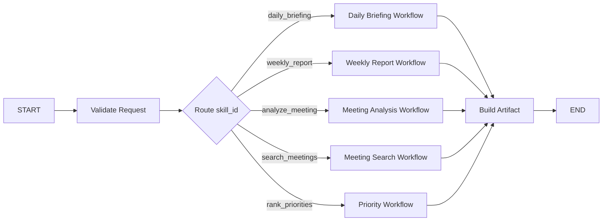
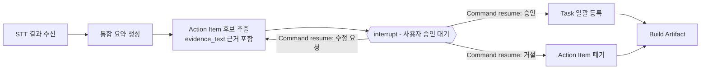

# Workmate AI 발표 PPT 구성안

작성일: 2026-08-23
목적: 심사(발표) 자리에서 사용할 PPT의 슬라이드별 구성·핵심 메시지·근거 자료를 확정한다.
전제: 라이브 데모는 [`demo-scenario.md`](../AI-agent_game_platform/workmate-agent/docs/demo-scenario.md) 6분 30초 시나리오를 그대로 쓴다. 이 PPT는 데모 앞뒤를 감싸는 발표용 자료이며, 데모에서 보여줄 화면을 다시 슬라이드로 재현하지 않는다 — 슬라이드는 "왜/무엇을/어떻게 검증했는가"에 집중하고, "실제로 되는 모습"은 라이브 데모가 보여준다.

## 발표 시간 배분 가정

전체 발표가 10~12분이라면 PPT 발화 시간은 3~4분, 데모 6분 30초, Q&A 2분 내외로 잡는다. 슬라이드 수는 표지 포함 12~14장을 넘기지 않는다 — 슬라이드가 많아지면 데모 시간을 깎아먹는다. 시간이 더 짧아지면 "발표 시간이 부족할 때 빼는 순서"(맨 아래)를 따른다.

## 한 줄 메시지 (모든 슬라이드가 이 문장을 증명한다)

> "회의록 정리, 메일 뒤지기, 보고서 작성 — 매일 반복되는 이 세 가지를 Workmate가 대신 하고, 실제로 실행되기 전엔 반드시 사람에게 확인을 받는다."

표지와 마지막 슬라이드에 동일 문장을 반복 배치해 심사자 기억에 남긴다.

## 슬라이드 구성

| # | 슬라이드 제목 | 핵심 메시지(한 줄) | 내용 요소 | 발표 노트 / 강조 포인트 | 근거 문서 |
| --- | --- | --- | --- | --- | --- |
| 1 | 표지 | Workmate AI — 업무지원 Agent | 프로젝트명, 팀명, 한 줄 메시지, 발표일 | 첫 문장부터 한 줄 메시지를 그대로 말한다 | — |
| 2 | 문제 정의 | 매일 반복되는데 아무도 안 줄여준 세 가지 업무 | 회의 끝나면 누가 뭘 하기로 했는지 재확인, 결정사항 찾으려 메일 뒤지기, 매주 보고서 새로 쓰기 — 각각 걸리는 체감 시간(예: 회의록 정리 20분, 메일 검색 10분, 보고서 작성 30분) | 숫자는 팀 내부 추정치임을 밝히고, 데모에서 "몇 초로 준다"는 대비를 예고 | [`demo-scenario.md`](../AI-agent_game_platform/workmate-agent/docs/demo-scenario.md) 오프닝 대사 |
| 3 | 우리의 답: Workmate AI | 자동화하되, 실행 전엔 반드시 확인받는다 | 오늘 브리핑·회의 분석·회의록 검색·주간 보고·자연어 챗봇 5개 기능을 한 화면에 아이콘으로 요약 | "자동화"와 "확인 필수"를 같은 무게로 강조 — 이후 신뢰성 슬라이드의 복선 | [01-overview-architecture.md](01-overview-architecture.md) §1, §3 |
| 4 | 전체 시스템에서의 위치 | Workmate는 4개 업무 Agent 중 하나, A2A로 연결된다 | Orchestrator(Main Agent) ↔ Workmate/영상생성/개발보조/게임Q&A 4개 Agent 다이어그램, "어느 화면에서 물어봐도 담당 Agent로 자동 연결" | 보너스 데모(다른 Agent Chat 핸드오프)와 연결되는 슬라이드 | [`AI-agent_game_platform/README.md`](../AI-agent_game_platform/README.md) 폴더 구조, [01-overview-architecture.md](01-overview-architecture.md) 구조도 |
| 5 | Workmate 내부 아키텍처 | 하나의 배포 단위, 5개 내부 서비스 | Mermaid 구조도 축약판: Adapter(Gmail/Calendar) → Normalizer → Task DB / Briefing·Priority·Meeting·Meeting Search Service → LLM/STT/pgvector | "별도 Agent가 아니라 모듈"이라는 점, 데이터 소스 하나가 실패해도 나머지로 결과를 만든다는 점(부분 실패 대응)만 짧게. "5개 Service"가 LangGraph에서는 5개 Skill Router 분기라는 점을 물으면 아래 "LangGraph Workflow 구조" 참고 | [01-overview-architecture.md](01-overview-architecture.md) §4·§5, [05-ai-security-operations.md](05-ai-security-operations.md) §3, 아래 [LangGraph Workflow 구조](#발표자-백업-자료-langgraph-workflow-구조) |
| 6 | 기능 ① 오늘 브리핑 & 우선순위 | 여러 소스를 알아서 합쳐 "뭐부터 할지" 점수로 매긴다 | 점수 공식 요약: 마감임박도(0~40)+중요도(0~20)+지연·차단(0~15)+회의 약속(0~10)+일정 연관(0~10), "LLM이 순위를 정하지 않는다 — 코드가 계산하고 LLM은 근거만 문장으로 표현" | 심사자가 "이거 LLM이 대충 지어낸 순위 아니냐"고 의심하기 전에 선제적으로 방어 | [03-data-priority-rules.md](03-data-priority-rules.md) §6 |
| 7 | 기능 ② 회의 분석 → Task 자동 등록 | 회의 끝나면 회의록·담당자 배정까지 이미 끝나 있다 | 실시간 녹음/파일 업로드 → STT → 통합 분석 요약 + Action Item 후보 추출 → 근거 문장(evidence_text) 포함 → 사용자 일괄 승인 → Task 생성 | "근거 없는 결정사항은 확정하지 않는다"는 원칙을 강조 — 다음 신뢰성 슬라이드로 연결 | [04-scenarios.md](04-scenarios.md), [03-data-priority-rules.md](03-data-priority-rules.md) `ActionItem` |
| 8 | 기능 ③ 회의록 검색 & ④ 이메일 검색 | 몇 주 전 회의도, 정확한 키워드 없이도 근거와 함께 즉시 찾는다 | 회의록 검색: Dense+Trigram Hybrid(RRF)+HNSW, 출처(회의명·발화자·구간) 동반 답변, 근거 부족이면 "모른다"고 답함 / 이메일 검색: 자연어 질의 → Gmail 실제 API 조회 | 수치 한 줄만: Hybrid Hit@3 98.21%, HNSW Recall@5 100%(64 Chunk·60 Case 실측) | [06-delivery-plan.md](06-delivery-plan.md) M4.5, `evidence/M4/M4.5/README.md` |
| 9 | 기능 ⑤ 주간 업무보고 | 보고서 작성 시간 30분 → 몇 초 | 완료/진행/지연/이슈 자동 집계 → LLM 문장화 → Markdown 복사 → 실제 Task 데이터 기반(`source_refs`, 지어낸 내용 없음) | "지어낸 보고서 아니냐" 예상 질문에 대한 선제 답변 | [`demo-scenario.md`](../AI-agent_game_platform/workmate-agent/docs/demo-scenario.md) 4:30~5:15 |
| 10 | 신뢰성 설계: 확인 없이는 아무 일도 안 일어난다 | 심사자가 가장 걱정할 지점을 정면 대응 | 일정 등록·Task 생성·이메일 발송성 동작은 전부 `pending_action` 확인 카드 필요 / 정보 부족하면 되묻기(예: "다음 주 화요일 2시 QA팀 회의" → 참석자·시간 재확인) / LLM은 요약·추출만, 날짜계산·권한·중복제거·점수는 코드가 담당 | 이 슬라이드가 사실상 발표의 핵심 방어 슬라이드 — 시간이 없으면 6·7번보다 이걸 남긴다 | [05-ai-security-operations.md](05-ai-security-operations.md) §1·§2, [`demo-scenario.md`](../AI-agent_game_platform/workmate-agent/docs/demo-scenario.md) 5:15~5:45 |
| 11 | 검증 현황 | 말로만 하는 주장이 아니라 실측했다 | 마일스톤 M0~M4 완료(계약·데이터·브리핑·회의분석·회의검색), M5 통합·시연 진행 / LLM·Embedding·STT 세 모델 모두 평가 이력·승인 기록 보유 | "완료"라고 쓰인 항목마다 테스트·증빙 문서가 실제로 있다는 점을 짧게 언급. 모델 선정 근거를 되물으면 아래 "발표자 백업 자료" 절로 답한다 | [06-delivery-plan.md](06-delivery-plan.md) §2.1 마일스톤 표, `docs/evidence/`, 아래 [LLM·Embedding·STT 모델 평가 상세](#발표자-백업-자료-llmembeddingstt-모델-평가-상세) |
| 12 | 기술 스택 | 무엇으로 만들었나 (짧게) | FastAPI + A2A Python SDK, LangGraph, PostgreSQL+pgvector, LLM `gpt-4.1-mini`, Embedding `text-embedding-3-small`(1536차원), STT `gpt-4o-transcribe`, Docker Compose | 기술 슬라이드는 오래 끌지 않는다 — 심사 기준이 기술 나열이 아니라면 30초 내로 | [01-overview-architecture.md](01-overview-architecture.md) §6 |
| 13 | 데모 예고 | 지금부터는 화면으로 직접 보여드리겠습니다 | 데모 6개 비트를 아이콘/화살표로 나열: 오늘 브리핑 → 회의 분석·승인 → 회의록 검색 → 이메일 검색 → 주간 보고 → 확인 절차(+보너스: 타 Agent 핸드오프) | 이 슬라이드 이후 바로 라이브 데모로 전환 | [`demo-scenario.md`](../AI-agent_game_platform/workmate-agent/docs/demo-scenario.md) 시연 흐름 표 |
| 14 | 마무리 & Q&A | 한 줄 메시지 재확인 | 한 줄 메시지 재노출 + "질문 주세요" | 예상 질문 3개(아래 표)는 슬라이드에 넣지 않고 발표자 노트로만 준비 | — |

## 발표자 백업 자료: Workmate 강점 정리

한 줄 메시지와 슬라이드 구성 전체가 아래 9가지 강점 중 하나 이상을 증명하도록 짜여 있다. 발표 중 "그래서 이게 왜 잘 만든 거냐"는 질문을 받으면 이 목록에서 답을 고른다.

| # | 강점 | 한 줄 근거 | 연결 슬라이드 |
| --- | --- | --- | --- |
| 1 | 실행 전엔 반드시 확인받는다 | 실행성 동작은 전부 `pending_action` 확인 필요, 정보 부족하면 되묻고, 근거 부족하면 `insufficient_evidence`로 거절 | 10 |
| 2 | AI와 코드의 역할을 분리했다 | 우선순위 점수·날짜·권한·중복 제거는 코드가 결정적으로 계산, LLM은 설명만 — 재현 가능하고 근거 설명 가능 | 6, 10 |
| 3 | 모델 선택이 실측 평가였다 | LLM·Embedding·STT 모두 같은 Case·Schema 반복 평가, 최초/수정 후 통과율 분리 기록, 실패 원인 분류 후 재평가(기준 유지) | 11, 발표자 백업(LLM·Embedding·STT 상세) |
| 4 | 검색 아키텍처가 실용적이다 | 별도 Vector DB 없이 PostgreSQL+pgvector 단일 저장소로 Hybrid Hit@3 98.21% 달성, Reranker는 실익 없어 상시 미적용 | 8 |
| 5 | 부분 실패에 강하다 | Gmail·Calendar 중 하나 실패해도 가능한 결과+`warnings` 반환, 장기 Task 영속·재개·취소, 멱등성으로 중복 방지 | 5, 12 |
| 6 | 표준 프로토콜로 다른 Agent와 연결된다 | 5개 기능을 A2A 공개 Skill로 통합, Mock을 성공으로 위장하지 않음 | 4, 9 |
| 7 | 회의를 검색 가능한 자산으로 만든다 | 녹음→STT→분석→승인→Task→Embedding 저장까지 한 파이프라인, 근거 구간과 출처 동반 | 7, 8 |
| 8 | 보안·개인정보 원칙이 구현 전반에 있다 | Token·API Key·원본 음성 미저장, 모든 조회에 `user_id` 범위 적용 | 12 |
| 9 | 개발 과정 자체가 정직하고 추적 가능하다 | 마일스톤마다 설계→구현→테스트→증빙→승인, "완료"마다 실제 증빙 존재, 안 끝난 부분도 숨기지 않음 | 11, 13, 15 |

발표에서 시간이 없으면 1·2·3만 말해도 충분하다 — 나머지 강점은 전부 "그래서 신뢰할 수 있다"는 결론으로 수렴하는 보강 증거이기 때문이다.

## 발표자 백업 자료: LLM·Embedding·STT 모델 평가 상세

슬라이드 11(검증 현황)은 표 한 줄로만 결과를 보여준다. 심사자가 "왜 그 모델이냐", "평가는 어떻게 했냐"고 되물으면 이 절의 내용으로 답한다 — 슬라이드에는 옮기지 않는다. 세 평가 모두 실제 Provider API를 호출한 실측 결과이며, 결과가 기준 미달일 때 기준을 낮추지 않고 원인(모델/Prompt/Case/평가기/Provider)을 분류해 수정한 뒤 재평가하는 방식을 공통으로 따랐다.

### A. LLM 평가 — `openai/gpt-4.1-mini`

**진행한 평가**

- 비교 후보 5개: `openai/gpt-4.1-mini`(확정), `gpt-5.4-mini-2026-03-17`·`meta/llama-3.3-70b-instruct`(NVIDIA)·`google/gemma-4-31b-it`(NVIDIA)·`qwen2.5:3b`(로컬 Ollama)는 보류.
- 평가 대상 Skill 4개(`daily_briefing`, `weekly_report`, `analyze_meeting`, `search_meetings`) × Pilot 4건 → Full Case 1(20건) → 내용이 겹치지 않는 독립 Full Case 2(20건) 순서로 확대.
- 형식 검증(`schema_valid`)과 업무 의미 검증(`semantic_valid`)을 분리하고, Schema 오류·의미 오류 각 1회까지만 수정 요청해 "최초 응답 통과율"과 "수정 후 최종 통과율"을 따로 기록.
- 사전 계산된 우선순위 점수·날짜·출처 ID를 LLM이 바꾸지 않는지(환각·값 변형) 별도 검증.

**결과**

| 실행 | 최초 응답 | 최종(수정 후) | 비고 |
| --- | --- | --- | --- |
| 2026-08-09 17:22, 4개 후보 Pilot 비교 | — | OpenAI 4/4, NVIDIA Gemma 3/4, NVIDIA Llama 1/4, 로컬 Qwen 0/4 | 유일하게 OpenAI만 Pilot 전량 통과 |
| Full Case 1 (20건) | 19/20 | **20/20** | Case의 점수 구성값이 Schema 최대치를 초과해 있던 데이터 오류 수정 후 재실행 |
| Full Case 2 (독립 20건) | 15/20 | **20/20** | Schema 수정 3회·의미 수정 3회 발생, 서로 다른 업무 내용에서도 일반화 확인 |

- 평균 지연 Full 1: 4.36초(p95 7.35초) / Full 2: 6.86초(p95 17.40초).
- 입력에 없는 Source ID 생성 0건, 사전 계산 우선순위 값 변형 0건 — 두 필수 조건 모두 통과.

**최종 채택 이유**

1. 4개 후보 비교에서 OpenAI 계열만 Pilot을 전량 통과했고, 로컬 Qwen(0/4)·NVIDIA Llama(1/4)는 형식·속도 문제로 조기 탈락.
2. 두 독립 Full Case 세트 모두 최종 통과율 100%로 "Full Case별 90% 이상" 통과 기준을 충족.
3. 출처 환각과 사전 계산값 변형이 0건 — 모델 교체 배제 조건에 해당하지 않음.
4. 다만 Full Case 2의 최초 응답이 15/20에 그쳐, 운영에서도 Schema·의미 검증과 제한된 수정 요청(최대 1회씩)을 그대로 유지하기로 결정 — "한 번에 완벽한 응답"을 전제하지 않는다.
5. 보류 후보(로컬 Qwen, NVIDIA Llama/Gemma, `gpt-5.4-mini-2026-03-17`)는 폐기가 아니라 "현재 API 할당량 소진 또는 계약 종료 시 동일 Case·Schema로 재평가"하는 조건부 보류다.

근거: [LLM 평가 계획과 개선 이력](11-llm-evaluation-plan.md) §7·§9, [llm-evaluation/README.md](../llm-evaluation/README.md)

### B. Embedding·검색 평가 — `openai/text-embedding-3-small`(1536차원) + PostgreSQL/pgvector

**진행한 평가**

Pilot(32 Chunk·20질문, Python Cosine 정확 검색) → PostgreSQL+pgvector+HNSW 통합 → Keyword(`pg_trgm`)·RRF 결합 개선 → 합성 1,000 Chunk·60질문 확장 평가(답변 가능 50·답변 불가 10) → 한영 혼합 용어 Holdout 20건 → LLM Reranker(`gpt-4.1-mini`) 조건부 적용 평가 → **실제 비식별 회의록 64 Chunk·61개 회의·60 Case로 최종 재평가**, 총 6단계로 확대했다.

**결과 (2026-08-11 최종, 실제 회의록 64 Chunk·60 Case)**

| 검색 방식 | Hit@1 | Hit@3 | Hit@5 | MRR |
| --- | ---: | ---: | ---: | ---: |
| Dense 정확 검색 | 73.21% | 96.43% | 100% | 0.8482 |
| `pg_trgm` Trigram | 92.86% | 94.64% | 94.64% | 0.9375 |
| **Dense + Trigram RRF (채택)** | **96.43%** | **98.21%** | **100%** | **0.9777** |
| HNSW + Trigram RRF | 96.43% | 98.21% | 100% | 0.9777 |

- HNSW Recall@5 = 정확 검색 대비 100% (근사 검색 품질 손실 없음).
- 지연: Hybrid DB p95 66.3ms(기준 300ms 이하), Query Embedding API p95 893.1ms.
- 단일 Cosine 임계값(0.45)으로 "근거 부족" 판정 시 정상 질문 오거절 41.07% — 운영 기준에서 제외하고, RRF 검색 → 근거 직접 포함 검증 → 필요할 때만 Reranker라는 다단계 Workflow로 대체.
- Reranker(`gpt-4.1-mini`)는 이 실제 데이터 세트에서 Hit@1·3·5 94.64%로 오히려 RRF보다 낮고 3건을 악화시켜(반면 이전 합성 데이터에서는 개선) 기본 경로로 채택하지 않고 "조건부 호출 + RRF fallback" 대기 상태로 보류.

**최종 채택 이유**

1. 최소 기준(하이브리드 Hit@3 80% 이상)을 98.21%로 크게 상회.
2. HNSW 근사 검색이 정확 검색 대비 Recall 손실 0%p로, "정확 검색 대비 5%p 이하 손실" 기준도 충족(참고로 1,000 Chunk 합성 데이터에서는 손실이 10%p대라 그 규모에서는 정확 검색을 선택했었고, 실제 데이터 규모에서 HNSW로 재확정).
3. DB 검색 지연 p95 66.3ms로 300ms 기준 통과, 별도 Vector DB 없이 PostgreSQL 단일 저장소로 운영 가능.
4. Reranker는 합성 데이터에서는 이득이 있었지만 실제 데이터에서는 순위를 개선하지 못하고 지연만 추가돼 상시 경로에서 제외 — "품질이 애매하면 더 비싼 옵션을 상시 켜지 않는다"는 원칙을 그대로 적용.

근거: [Embedding 평가 계획](10-embedding-evaluation-plan.md) §15, [embedding-evaluation/EVALUATION_HISTORY.md](../embedding-evaluation/EVALUATION_HISTORY.md), [embedding-evaluation/README.md](../embedding-evaluation/README.md)

### C. STT 평가 — `gpt-4o-transcribe`

**진행한 평가**

1. 파일 기반 평가: gTTS로 합성한 한국어 게임 개발 업무 문장 20 Case.
2. Streaming(Realtime API) Pilot: 16kHz WAV → 24kHz PCM16 200ms Chunk 변환·전송, 2 Case.
3. 녹음 처리 E2E 하네스 Pilot: Chunk 재연결 경계 복구·최종 파일 STT·Task 입력용 Transcript 생성 가능 여부, 2 Case.

**결과**

| 평가 | Provider 오류 | 핵심어 인식 | 비고 |
| --- | --- | --- | --- |
| 파일 기반 (합성 20 Case) | 0/20 | **19/20 (95%)** | 유일 실패는 `튜토리얼`→`포토리얼` — gTTS 발음 한계로 판단 |
| Streaming Pilot (2 Case) | 0/2 | 2/2 | 첫 Partial 약 32초, Final 약 40초, Case별 Partial 이벤트 88·90건 |
| E2E 하네스 (2 Case) | 0/2 | 최종 STT 2/2 | Chunk 재연결 통과, Task 입력 준비 2/2 |

**최종 채택 이유**

1. Provider 연결 오류 0건, 핵심어 인식률 95%로 MVP의 "파일 분석 + 실시간 임시 자막" 요구를 충족.
2. Streaming·E2E Pilot에서 Chunk 재연결, Partial/Final 누적, Task 입력 연결까지 파이프라인 전 구간이 끊김 없이 동작 확인.
3. 다만 이 결과는 gTTS 합성 음성(단일 목소리, 화자 분리 불가) 기준이라는 한계를 명시 — 실제 회의의 잡음·다중 화자 겹침·자연 발음 WER/CER, 화자 분리는 MVP 확정 범위에서 의도적으로 제외했고 별도 후속 검증 항목으로 관리한다.

근거: [stt-evaluation/EVALUATION_HISTORY.md](../stt-evaluation/EVALUATION_HISTORY.md), [stt-evaluation/README.md](../stt-evaluation/README.md)

### 세 평가 공통 발표 방어 포인트

- "모델을 어떻게 골랐냐"는 질문에는 선호가 아니라 **같은 Case·Schema로 반복 가능한 평가**, **최초 응답과 수정 후 응답의 분리 기록**, **기준 미달 시 원인 분류 후 재평가**라는 절차로 답한다.
- 세 영역 모두 "합성/Pilot 데이터로 먼저 통과 → 실제(또는 더 큰 규모) 데이터로 재확인" 순서를 지켰고, 합성 데이터만의 결과를 최종 수치로 발표하지 않는다(LLM 제외 — LLM은 Case 자체가 업무 Fixture라 실제/합성 구분보다 Full Case 2개의 독립성이 핵심 방어선이다).
- STT 95%는 반드시 "합성 한국어 20 Case 핵심어 기준"이라고 조건을 붙여 말한다. 실제 회의 WER/CER과 동일시하지 않는다(문서 §5 발표자가 지켜야 할 표현 경계와 동일 원칙, [29-workmate-agent-presentation-content.md](29-workmate-agent-presentation-content.md) 참고).

## 발표자 백업 자료: LangGraph Workflow 구조

슬라이드 5(내부 아키텍처)·7(회의 분석)·10(신뢰성 설계)에서 "LangGraph가 Skill 라우팅과 승인 대기를 담당한다"고 말할 때 심사자가 구조를 되물으면 이 도식으로 답한다. 슬라이드 자체에는 축약판만 넣고(디자인 메모 참고), 아래 두 그림은 발표자 노트/부록용 원본이다.

### 1) 최상위 Skill Router

- 5개 공개 Skill이 각각 독립된 Workflow Node이고, 모두 같은 `Validate Request`(입력 검증) → `Route`(skill_id 분기) → `Build Artifact`(A2A Artifact 변환)를 공유한다.
- 각 Workflow Node 내부에서만 Domain 함수·Repository·Provider Client를 호출한다(슬라이드 5 "Adapter → Normalizer → Service" 흐름과 같은 계층을 LangGraph 관점에서 다시 그린 것).

### 2) Meeting Analysis Workflow 내부 — 승인 대기(Human-in-the-loop)

`analyze_meeting`은 유일하게 그래프 중간에 사람 확인을 끼워 넣는 Skill이다. 설계 의도를 도식화하면 다음과 같다.

- `interrupt()` Node에서 그래프 실행이 멈추고, 사용자가 승인/수정/거절하면 `Command(resume=...)`로 같은 `thread_id`를 재개한다 — 슬라이드 10 "확인 없이는 아무 일도 안 일어난다"의 실제 실행 메커니즘이다.
- `interrupt()` Node는 재개 시 처음부터 다시 실행될 수 있어, 승인 전에 이미 수행한 외부 쓰기·Task 생성은 반드시 idempotent해야 한다(멱등성 Key로 보장).

### 3) 공통 State·Checkpoint·재시도 규칙 (요약)

| 구분 | 내용 |
| --- | --- |
| 공통 State | `request_id`, `skill_id`, `user_id`, `timezone`, `as_of`, `source_refs`, `warnings`, `result`, `error` — Skill별 세부 State는 이를 확장 |
| State에 안 두는 값 | 원본 음성 Binary, 전체 회의록 원문, DB/HTTP Client 객체, OAuth Token·API Key, 재조회 가능한 대용량 Provider 응답 (ID·URI만 저장) |
| Checkpoint | 개발·단위 테스트는 In-memory, 통합·운영은 PostgreSQL 영속 Checkpointer. `thread_id`는 A2A 장기 Task마다 고유값이며 `task_id ↔ thread_id`를 DB에 매핑 |
| Node 재시도 | 날짜·점수·검증 Node는 재시도 없음 / DB 읽기·외부 API 읽기는 일시 오류에 한해 최대 2회 / LLM 구조화 출력은 Schema 오류 시 수정 프롬프트 1회 / DB 쓰기는 재시도 대신 멱등성 Key / 인증·권한 실패는 재시도 없음 |

### 구현 현황 — 발표에서 과장하지 않을 지점

- 위 그래프 구조와 State·Checkpoint 규칙은 [기술 상세 설계](07-technical-specification.md) §6에 **확정된 설계**다. 슬라이드 3·5·11에서 "LangGraph로 만들었다"고 말할 때는 이 설계가 기준이라고 전제한다.
- 실제 `workmate-agent/app/workflows/registry.py`는 현재 `langgraph` 패키지의 `StateGraph`를 직접 생성하지 않고, `skill_id → 비동기 Handler` 매핑을 쓰는 단순 Registry로 라우팅을 구현했다(`pyproject.toml`/`uv.lock`에 `langgraph` 의존성 자체가 아직 없다). 즉 "Skill 라우팅"이라는 설계 의도는 동작하지만, `interrupt()`·영속 Checkpointer 같은 LangGraph 고유 기능의 배선은 [구현·검증 가이드](12-implementation-verification-guide.md) §4.2의 미완료 항목("LangGraph Checkpoint 복구")으로 남아 있다.
- 심사자가 "이거 진짜 LangGraph로 돌아가나요?"라고 구체적으로 물으면 "Skill 라우팅·State·승인 대기 그래프는 LangGraph 설계로 확정했고, Action Item '확인 없이는 실행 안 한다'는 사용자 경험은 현재도 실제로 동작한다 — 다만 지금 그 확인 단계는 `interrupt()`/`Command(resume=...)`가 아니라 별도 REST API(`app/action_item_api.py`)와 멱등한 Task 등록으로 구현돼 있고, LangGraph의 `interrupt()`·영속 Checkpointer 자체로 옮기는 배선은 아직 검증 대기 항목"이라고 정확히 구분해서 답한다.

## 예상 질문 대응 (슬라이드에는 넣지 않고 구두로만 준비)

| 예상 질문 | 대응 요지 | 연결 슬라이드 |
| --- | --- | --- |
| AI가 잘못 판단하면요? | 실행이 필요한 모든 동작은 `pending_action` 확인 없이는 실행되지 않는다. 검색·질의응답은 즉시 답하지만 데이터를 만들거나 바꾸는 동작만 확인을 거친다 | 10 |
| 데모용 가짜 데이터 아닌가요? | 회의 분석·주간보고·우선순위는 실제 Task/회의 데이터 근거(`source_refs`)로 만들어지고, 이메일 검색은 실제 Gmail API 호출 결과다 | 8, 9, 11 |
| 다른 팀 도구(영상 제작, 개발, 게임 기획)와는 무슨 관계인가요? | Workmate는 4개 업무 도구 중 하나이고, 어느 화면에서 요청하든 알아서 담당 도구로 연결된다(A2A) | 4 |
| 왜 LLM이 우선순위를 직접 안 정하나요? | 순위는 재현 가능해야 하고 근거를 설명할 수 있어야 한다 — 코드가 결정적으로 계산하고 LLM은 그 근거를 사람이 읽기 쉬운 문장으로 바꾸는 역할만 한다 | 6 |
| 지금 뭐가 아직 안 끝났나요? | M5 통합·시연 마일스톤이 진행 중이며, 실시간 화자 분리·자동 메일 발송·Task 자동 승인은 MVP 범위에서 의도적으로 제외했다 | 11, 3 |

## 발표 시간이 부족할 때 빼는 순서

데모와 마찬가지로 뒤에서부터 뺀다 — 앞쪽일수록 "왜 믿을 만한가"에 더 가깝다.

1. (가장 먼저 뺀다) 슬라이드 12 기술 스택 — 구두로 한 문장만 언급하고 슬라이드 자체를 스킵
2. 슬라이드 8 회의록/이메일 검색 수치 — "실측했다"는 문장만 남기고 세부 수치는 생략
3. 슬라이드 5 내부 아키텍처 다이어그램 — 슬라이드 4(전체 구조)로 대체
4. (마지막까지 남긴다) 표지 / 문제 정의 / 우리의 답 / 신뢰성 설계(10) / 검증 현황(11) / 데모 예고 / 마무리 — 한 줄 메시지를 증명하는 최소 뼈대

## 디자인 메모

- 슬라이드 6·8·9는 표/숫자가 들어가므로 큰 글씨 1~2줄 요약 + 작은 보조 텍스트 구조를 권장한다.
- 슬라이드 4·5는 다이어그램 1개만 크게 배치하고 텍스트를 최소화한다(원본 Mermaid는 [01-overview-architecture.md](01-overview-architecture.md) §4 참고, PPT용으로는 단순화한 박스 다이어그램으로 다시 그린다).
- 슬라이드 5의 "LangGraph Skill Router" 언급은 위 "발표자 백업 자료: LangGraph Workflow 구조"의 Router 다이어그램을 5개 노드짜리 단순 박스로 축약해 넣는다. Human-in-the-loop(승인 대기) 그림은 슬라이드에는 넣지 않고 슬라이드 10 발표 노트에서 구두로만 설명한다.
- 슬라이드 10은 발표 전체에서 가장 오래 머무는 슬라이드가 되어도 된다 — 심사자 신뢰를 얻는 지점이다.
- 실제 슬라이드 제작(디자인 시안)은 이 문서를 소스로 `design` 스킬 또는 PPT 툴에서 진행한다.
