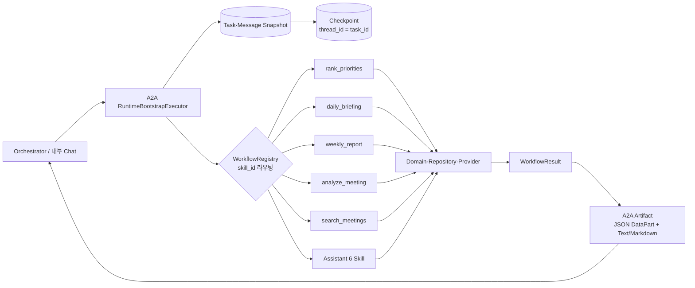
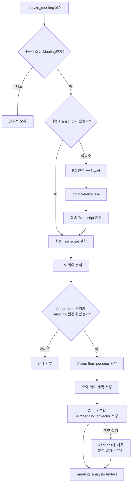

# Workmate Agent 발표 PPT 내용 구성

## 1. 발표 기본 설정

- 대상: 프로젝트 팀원, 개발 리더, 협업 Agent 담당자
- 목적: Workmate Agent가 어떤 업무 문제를 해결하며, 어떤 구조로 구현·검증되었고, 현재 어디까지 사용할 수 있는지 설명한다.
- 권장 분량: 22~29분, 본문 20장
- 핵심 메시지: **Workmate는 메일·일정·할 일·회의를 하나의 업무 맥락으로 연결하고, 결정론적 규칙과 근거 기반 AI로 사용자의 다음 행동을 돕는 A2A 업무 Agent다.**
- 발표 원칙: 구현 완료와 검증 완료를 구분하고, 아직 남은 수동 검수·운영 통합 항목을 숨기지 않는다.

## 2. 전체 발표 흐름

1. 흩어진 업무 정보가 만드는 문제
2. Workmate가 제공하는 하나의 업무 흐름
3. 핵심 기능과 사용자 경험
4. A2A·Workflow·데이터 구조
5. AI를 통제하는 결정론적 규칙과 근거
6. 모델·검색·STT 검증 결과
7. 구현 및 통합 현황
8. 데모 시나리오와 다음 단계

---

## 슬라이드 1. Workmate AI — 흩어진 업무 정보를 다음 행동으로 연결하다

### 화면 문구

**Workmate AI**

메일·일정·할 일·회의를 연결하는 A2A 업무 Agent

오늘의 우선순위부터 회의 근거 검색까지

### 발표 포인트

- Workmate는 단순 요약 챗봇이 아니라 여러 업무 데이터를 연결해 사용자가 지금 해야 할 행동을 찾도록 돕는 Agent다.
- 발표에서는 제품 경험, 기술 구조, 실제 검증 결과, 현재 한계를 차례로 보여준다.

### 권장 시각 자료

- 중앙의 Workmate와 주변의 Gmail, Calendar, Task, Meeting을 연결한 단순한 허브 이미지
- 첫 장은 기능 목록을 추가하지 않고 제목과 한 문장만 강조한다.

### 근거 문서

- [프로젝트 개요와 아키텍처](01-overview-architecture.md)
- [설계문서 목차와 현재 결정](README.md)

---

## 슬라이드 2. 업무 정보는 많지만, 우선순위와 근거는 서로 떨어져 있다

### 화면 문구

**업무 정보는 여러 도구에 흩어지고, 결정의 맥락은 회의 속에 남는다**

- 오늘 처리할 일은 Task, 메일, 일정에 나뉘어 있다.
- 주간 보고를 만들 때 완료·지연·회의 내용을 다시 모아야 한다.
- 회의에서 정한 일정과 담당자를 나중에 다시 찾기 어렵다.
- AI가 요약해도 출처와 계산 규칙이 없으면 신뢰하기 어렵다.

**필요한 것은 또 하나의 화면이 아니라, 업무 맥락을 연결하는 실행 계층이다.**

### 발표 포인트

- Workmate의 출발점은 정보 부족이 아니라 정보 분산이다.
- 따라서 목표는 모든 데이터를 새로 만드는 것이 아니라, 기존 데이터를 사용자 범위 안에서 정규화하고 행동 가능한 결과로 바꾸는 것이다.

### 권장 시각 자료

- 왼쪽에 분리된 메일·캘린더·Task·회의, 오른쪽에 한 줄로 정리된 “지금 할 일 / 근거 / 다음 행동” 대비

### 근거 문서

- [프로젝트 목표와 사용자 유스케이스](01-overview-architecture.md)
- [시나리오별 처리 흐름](04-scenarios.md)

---

## 슬라이드 3. Workmate의 강점은 ‘신뢰할 수 있는 업무 연결’이다

### 화면 문구

**업무를 연결하고, 판단을 통제하고, 결과를 검증한다**

1. **연결된 업무 맥락**
   - Gmail·Calendar·Task·회의를 같은 사용자와 Source ID로 연결
2. **결정론적 판단**
   - 날짜·권한·상태·우선순위는 코드가 계산하고 LLM은 설명에 집중
3. **검증 가능한 근거**
   - 회의 답변과 Action Item에 원문 출처를 제공하고 근거 부족 시 답변 거절
4. **사용자 통제권**
   - 메일 제안과 Action Item은 사용자 승인 후에만 Task로 등록
5. **실패를 고려한 운영성**
   - 멱등성·부분 결과·`warnings`·Checkpoint·사용자 데이터 격리 지원

**Workmate는 AI가 업무를 대신 판단하는 제품이 아니라, 검증 가능한 근거와 사용자 승인 위에서 업무 판단을 안전하게 자동화하는 Agent다.**

### 발표 포인트

- 핵심 차별점은 기능 개수가 아니라 여러 업무 데이터를 하나의 실행 가능한 맥락으로 묶는 방식이다.
- 생성형 AI를 업무 원장으로 사용하지 않고, Domain 규칙과 사용자 승인을 통과한 결과만 실제 Task로 연결한다.
- 성공한 결과뿐 아니라 출처, 경고, 실패 상태와 보류 사유까지 사용자에게 드러낸다.

### 권장 시각 자료

- 중앙에 “신뢰할 수 있는 다음 행동”, 주변에 연결·규칙·근거·승인·운영성 다섯 축을 배치
- 다섯 개의 UI 카드처럼 보이지 않도록 하나의 원형 또는 방사형 구성으로 표현

### 근거 문서

- [프로젝트 개요와 아키텍처](01-overview-architecture.md)
- [데이터와 우선순위 규칙](03-data-priority-rules.md)
- [시나리오별 처리 흐름](04-scenarios.md)
- [AI·보안·운영](05-ai-security-operations.md)
- [A2A 인터페이스](02-a2a-interface.md)
- [구현·검증 가이드](12-implementation-verification-guide.md)

---
## 슬라이드 4. Workmate는 다섯 가지 Skill을 하나의 Agent로 제공한다

### 화면 문구

**하나의 Agent, 다섯 개의 업무 Skill**

| Skill | 사용자에게 주는 결과 |
| --- | --- |
| `daily_briefing` | 오늘 일정·업무·메일 요약과 우선순위 Top 3 |
| `weekly_report` | 완료·진행·지연·이슈·다음 주 계획 |
| `analyze_meeting` | 회의 요약, Action Item, 근거 구간 |
| `search_meetings` | 이전 회의에 대한 답변과 출처 |
| `rank_priorities` | 재계산된 순위와 변경 이유 |

**기능은 분리하되 사용자와 Orchestrator에는 하나의 Workmate Agent로 보인다.**

### 발표 포인트

- 다섯 기능을 별도 Agent로 분산하지 않고 공개 Skill로 제공해 계약과 운영 경계를 단순화했다.
- Orchestrator는 의도에 맞는 Skill을 선택하고, Workmate가 실제 업무 규칙과 결과 생성을 담당한다.

### 권장 시각 자료

- Workmate 중심에서 다섯 Skill이 부채꼴로 펼쳐지는 구조

### 근거 문서

- [A2A 공개 Skill](02-a2a-interface.md)
- [전체 구조와 구성요소 책임](01-overview-architecture.md)

---

## 슬라이드 5. 하루의 시작부터 회고까지 하나의 업무 흐름으로 이어진다

### 화면 문구

**아침의 판단, 업무 중 변화, 회의, 주간 회고가 연결된다**

1. 아침: 일정·Task·메일을 모아 오늘 브리핑 생성
2. 업무 중: 상태 변화에 따라 우선순위 재계산
3. 회의 후: 녹음에서 회의록과 Action Item 추출
4. 승인 후: Action Item과 메일 후보를 Task로 등록
5. 주말: 한 주의 결과와 다음 주 계획을 보고서로 정리
6. 필요할 때: 과거 회의의 결정과 근거를 검색

### 발표 포인트

- 기능이 독립 메뉴로 끝나지 않고 동일한 Task·Meeting·Source ID를 통해 이어진다는 점이 핵심이다.
- Action Item과 메일 후보는 자동 등록하지 않고 사용자의 승인을 거친다.

### 권장 시각 자료

- 아침 → 업무 → 회의 → 승인 → 보고 → 검색의 가로 타임라인

### 근거 문서

- [시나리오별 처리 흐름](04-scenarios.md)
- [AI·보안·운영 원칙](05-ai-security-operations.md)

---

## 슬라이드 6. 오늘 브리핑은 정보를 나열하지 않고 ‘왜 지금 해야 하는지’를 보여준다

### 화면 문구

**우선순위 Top 3에는 점수와 변경 이유가 함께 온다**

- 일정, Task, 중요 메일 신호를 한 화면에서 확인
- 마감·중요도·진행 상태·일정 연관성을 코드로 계산
- 이전 Snapshot과 비교해 순위 상승·하락 이유 표시
- 이미 Task로 등록된 메일·일정은 중복 행동을 방지
- Provider 일부가 실패해도 가능한 결과와 `warnings` 반환

### 발표 포인트

- LLM이 우선순위를 임의로 정하는 것이 아니다.
- 점수와 정렬은 코드가 결정하고, LLM은 이미 계산된 결과를 설명하는 역할만 맡는다.
- UI에는 점수 구성, 순위 변경 이유, 등록 여부가 노출되도록 보완했다.

### 권장 시각 자료

- 실제 브리핑 화면 캡처: Top 3, 점수 구성, 변경 사유, 등록됨 배지가 보이도록 구성

### 근거 문서

- [데이터와 우선순위 규칙](03-data-priority-rules.md)
- [UI 설계](09-ui-design.md)
- [UI 연동 갭 분석과 구현 결과](14-workmate-ui-integration-gaps.md)

---

## 슬라이드 7. 주간 보고는 흩어진 활동을 검증 가능한 구조로 재구성한다

### 화면 문구

**완료·진행·지연·미해결·다음 주 계획을 같은 기준으로 묶는다**

- 사용자 timezone 기준으로 주간 범위를 결정
- Task, 승인된 Gmail·Calendar 원본, 회의 Action Item을 연결
- 다음 주 계획을 확정·이월·제안으로 구분
- JSON DataPart를 원본으로 만들고 Markdown 보고서를 함께 제공
- 107개 회귀 테스트를 SKIP 없이 통과한 실제 Workflow

### 발표 포인트

- 보고서 문장을 먼저 생성하는 것이 아니라, 주간 데이터를 결정론적으로 분류하고 근거 후보를 만든 다음 LLM이 문장을 생성한다.
- 현재 자동 테스트와 Workflow는 완료됐지만, 주간 보고 전용 화면의 최종 사용자 육안 검수는 보류 상태다.

### 권장 시각 자료

- “원본 데이터 → 주간 분류 → 근거 후보 → LLM 문장 → JSON/Markdown” 파이프라인

### 근거 문서

- [주간 보고 구현 계획](06-delivery-plan.md)
- [M2.1 주간 데이터 분류 증빙](evidence/M2/M2.1/README.md)
- [M2.2 계획·근거 추출 증빙](evidence/M2/M2.2/README.md)
- [M2.3 보고서 생성 승인 결과](evidence/M2/M2.3/result.md)
- [M2.4 보고서 UI 상태](evidence/M2/M2.4/README.md)

---

## 슬라이드 8. 회의는 녹음 파일에서 검색 가능한 업무 자산으로 바뀐다

### 화면 문구

**녹음 → STT → 분석 → 승인 → 저장 → 검색**

- 파일 업로드와 실시간 녹음 지원
- PCM16 24kHz, 200ms Chunk로 실시간 Partial 자막 처리
- 종료 후 최종 파일 STT와 LLM 회의 분석 수행
- Action Item마다 Transcript 근거 구간 연결
- 사용자 승인 후에만 Task 등록
- Transcript Chunk와 Embedding을 PostgreSQL·pgvector에 저장

### 발표 포인트

- 실시간 자막은 임시 피드백이고, 최종 결과는 녹음 종료 후 파일 기반 STT로 확정한다.
- Chunk Gap, 중복 전송, 재연결, 재시도, Task 멱등성 등 운영 중 발생할 수 있는 경계를 명시적으로 처리한다.

### 권장 시각 자료

- 녹음 파형에서 Transcript, Action Item, 검색 결과로 이어지는 단일 파이프라인

### 근거 문서

- [회의 시나리오](04-scenarios.md)
- [구현·검증 가이드](12-implementation-verification-guide.md)
- [회의 UI 연동 구현 결과](14-workmate-ui-integration-gaps.md)
- [M3 회의 분석 상위 검수](evidence/M3/README.md)

---

## 슬라이드 9. 회의 검색은 답보다 먼저 근거를 찾는다

### 화면 문구

**Dense 의미 검색과 키워드 검색을 결합하고, 근거가 부족하면 답하지 않는다**

1. 질문을 1536차원 Embedding으로 변환
2. pgvector Dense 검색과 `pg_trgm` 키워드 검색 수행
3. RRF로 두 순위를 결합
4. 사용자·회의·날짜 필터 적용
5. 검색된 Chunk만으로 답변 생성
6. 회의명·날짜·Chunk 원문을 출처로 제공

**검색 결과가 없거나 기준점수 미만이면 `insufficient_evidence`로 응답한다.**

### 발표 포인트

- 별도 Vector DB를 추가하지 않고 PostgreSQL과 pgvector를 단일 저장소로 사용했다.
- 모든 검색은 `user_id` 범위를 포함해 다른 사용자의 회의가 섞이지 않도록 한다.

### 권장 시각 자료

- 질문이 Dense/Keyword 두 갈래로 나뉜 뒤 RRF에서 합쳐져 근거 있는 답변으로 이어지는 최소 다이어그램

### 근거 문서

- [기술 상세 설계](07-technical-specification.md)
- [M4.2 Trigram 검색](evidence/M4/M4.2/README.md)
- [M4.3 Hybrid 검색](evidence/M4/M4.3/README.md)
- [M4.4 답변·출처](evidence/M4/M4.4/README.md)

---

## 슬라이드 10. A2A 계약이 Workmate와 Orchestrator의 경계를 고정한다

### 화면 문구

**표준 계약으로 요청·진행 상태·최종 산출물을 분리한다**

- A2A Protocol 1.0, 공식 Python SDK 1.1.2
- `/.well-known/agent-card.json`으로 Agent와 Skill 공개
- 즉시 작업은 완료 Task, STT 등 장기 작업은 제출·진행 Task 후 Polling
- 진행 안내와 추가 입력은 Message, 최종 결과는 Artifact
- 구조화 JSON DataPart가 원본, Markdown/Text Part는 표현 계층
- Route allowlist, Bearer Service Token, 사용자 범위 검증

### 발표 포인트

- 공개 계약에는 Mock 전용 필드를 넣지 않으며, 운영 경로에서 미구현 기능을 고정 성공 응답으로 위장하지 않는다.
- `messageId`, `task.id`, `contextId`, `request_id`를 분리해 멱등성·상관관계·재개를 관리한다.

### 권장 시각 자료

- Orchestrator → A2A 경계 → Workmate Workflow → Artifact의 4단 구조

### 근거 문서

- [A2A 인터페이스](02-a2a-interface.md)
- [A2A Artifact Schema](schemas/a2a-artifact.schema.json)
- [Workmate Skill Schema](schemas/workmate-skill-schemas.schema.json)
- [M0 계약·검증 통합 증빙](evidence/M0/README.md)

---

## 슬라이드 11. 현재 구현은 LangGraph 설계 경계까지 준비된 Workflow 그래프다

### 화면 문구

**A2A Task를 영속화한 뒤 Registry가 실제 업무 Workflow를 선택한다**

### 회의 분석 Workflow 세부 흐름

### 구현 상태를 정확히 설명하는 문구

- 현재 코드에는 `WorkflowRegistry`, 11개 비동기 Workflow, `task_id ↔ thread_id`, SQLite·PostgreSQL Checkpoint 저장 경계가 구현돼 있다.
- `RuntimeBootstrapExecutor`는 Task를 먼저 저장한 뒤 submitted Checkpoint를 기록하고 Workflow를 실행한다.
- `analyze_meeting`은 Transcript가 없으면 R2 음성을 STT로 변환하고, 근거 검증·Action Item 저장·검색 Chunk 색인까지 수행한다.
- 색인 실패는 회의 분석 전체를 버리지 않고 `warnings`로 보존한다.

### 중요한 현재 한계

**현재 체크아웃에는 `langgraph` 패키지, `StateGraph`, `interrupt()`, `Command(resume=...)`가 연결돼 있지 않다.**

- 따라서 위 도식은 “실제로 구현된 Workmate Workflow 실행 그래프”다.
- 설계 문서의 LangGraph Human-in-the-loop는 목표 구조이며, 현재 Action Item 승인은 별도 Review Skill/API가 담당한다.
- 발표에서는 “LangGraph 기반 설계와 Checkpoint 경계는 준비됐고, 현재 실행은 Registry 기반 Workflow”라고 표현한다.

### 발표 포인트

- 전송 계층, Workflow 선택, 업무 규칙, 결과 변환이 분리되어 있어 실제 LangGraph StateGraph로 교체해도 공개 A2A 계약을 유지할 수 있다.
- Checkpoint Table이 존재한다는 사실과 LangGraph 공식 Checkpointer가 연결됐다는 주장은 구분해야 한다.

### 근거 문서와 코드

- [A2A Runtime과 Registry 등록](../workmate-agent/app/a2a/runtime.py)
- [Workflow Registry](../workmate-agent/app/workflows/registry.py)
- [회의 분석·검색 Workflow](../workmate-agent/app/workflows/meetings.py)
- [Task·Checkpoint 영속성](../workmate-agent/app/a2a/persistence.py)
- [A2A 인프라 Migration](../workmate-agent/migrations/001_a2a_infrastructure.sql)
- [현재 Python 의존성](../workmate-agent/pyproject.toml)
- [LangGraph 목표 설계](07-technical-specification.md#6-langgraph-설계)
- [M0.1 Workflow·Task 경계 증빙](evidence/M0/M0.1/runs/20260812-224743/result.md)

---
## 슬라이드 12. 업무 규칙은 코드가, 언어 이해와 요약은 LLM이 담당한다

### 화면 문구

**AI가 바꿀 수 있는 것과 바꿀 수 없는 것을 분리했다**

| 코드가 책임지는 것 | LLM이 책임지는 것 |
| --- | --- |
| 날짜·timezone·사용자 권한 | 근거 기반 요약 |
| Task 상태와 중복 제거 | 구조화 정보 추출 |
| 우선순위 점수와 정렬 | 계산 결과의 자연어 설명 |
| Source ID와 근거 범위 | 주간 보고 문장 생성 |
| 승인·멱등성·오류 상태 | 회의 내용의 의미 분류 |

**LLM은 Task 순위와 근거 ID를 생성하거나 변경할 수 없다.**

### 발표 포인트

- 생성형 AI를 의사결정의 단일 원장으로 사용하지 않는다.
- Schema 검증, 의미 검증, 제한된 수정 요청을 거쳐 출력 품질을 통제한다.

### 권장 시각 자료

- 중앙 경계를 사이에 둔 “결정론적 Domain”과 “생성형 AI”의 대비

### 근거 문서

- [AI·보안·운영](05-ai-security-operations.md)
- [데이터와 우선순위 규칙](03-data-priority-rules.md)
- [LLM 프롬프트 목록](16-llm-prompts.md)

---

## 슬라이드 13. 모델 선택은 선호가 아니라 반복 가능한 평가로 결정했다

### 화면 문구

**LLM·Embedding·STT를 각각 실제 Case와 지표로 검증했다**

| 영역 | 선택 | 핵심 검증 결과 |
| --- | --- | --- |
| LLM | `openai/gpt-4.1-mini` | 수정된 Full Case 20/20, 독립 Full Case 20/20 최종 통과 |
| Embedding | `text-embedding-3-small` | Hybrid Hit@3 98.21%, Hit@5 100% |
| Vector 검색 | PostgreSQL + pgvector HNSW | Recall@5 100%, DB p95 64.743ms |
| STT | `gpt-4o-transcribe` | 합성 한국어 핵심어 19/20, Streaming Pilot 성공 |

**최종 통과율과 최초 응답 통과율을 분리해 운영 중 수정 요청의 필요성도 확인했다.**

### 발표 포인트

- 독립 Full Case에서 최초 응답은 15/20이었지만 제한된 검증·수정 후 20/20이었다.
- STT의 실제 회의 WER/CER, 화자 분리, 잡음·겹침 발화는 별도 한계로 관리한다.

### 권장 시각 자료

- 네 영역을 같은 크기의 카드로 나열하지 말고, 중앙의 “검증된 선택”에서 세 갈래 결과가 펼쳐지는 구성

### 근거 문서

- [LLM 평가 계획과 이력](11-llm-evaluation-plan.md)
- [Embedding 평가 계획](10-embedding-evaluation-plan.md)
- [구현·검증 가이드](12-implementation-verification-guide.md)
- [M4.5 검색 평가 증빙](evidence/M4/M4.5/README.md)

---

## 슬라이드 14. LLM 후보 비교와 최종 모델 선정

**무엇을 평가했나**

- 후보: OpenAI 계열, 로컬 Qwen, NVIDIA Llama, NVIDIA Gemma
- Pilot: `daily_briefing`, `weekly_report`, `analyze_meeting`, `search_meetings` 각 1건씩 4 Case
- 본 평가: Skill별 5건인 Full Case 1 20개와 내용이 겹치지 않는 Full Case 2 20개
- 공통 조건: 동일 Prompt·입력·Workmate JSON Schema, 사전 계산 우선순위 고정
- 판정: Schema 준수, 업무 의미, Source ID 환각, 근거 원문 일치, 우선순위 변형 여부
- 실패를 모델·Prompt·Case·평가기·Provider 문제로 분리하고 같은 Case로 재검증

**평가 결과**

| 평가 | 결과 |
| --- | --- |
| 4개 후보 동일 Pilot | OpenAI 4/4 · Gemma 3/4 · Llama 1/4 · Qwen 0/4 |
| 최종 Pilot | 4/4, Provider 실패 0건 |
| Full Case 1 | 최초 19/20 → 최종 20/20, 평균 호출 1.05회 |
| Full Case 2 | 최초 15/20 → 최종 20/20, 평균 호출 1.25회 |
| 전체 계약 | Schema·의미 44/44, Source ID 환각·우선순위 변형 0건 |

**최종 채택: OpenAI 호환 API의 `openai/gpt-4.1-mini`**

- 후보 비교에서 Pilot 품질이 가장 높고 구조화 출력이 안정적이었다.
- 두 개의 독립 Full Case에서 최종 품질 기준을 모두 통과했다.
- NVIDIA Llama는 지연·형식 안정성이 낮았고 Gemma는 Provider 실패와 별도 Adapter 제약이 있었다.
- 로컬 Qwen은 동일 Pilot에서 업무 의미·Schema 기준을 통과하지 못했다.
- 운영 복잡도를 줄이기 위해 다중 Provider 자동 전환 대신 검증된 단일 Provider Client를 선택했다.
- Full Case 2 최초 응답은 15/20이므로 운영에서도 Schema·의미 검증과 제한된 수정 요청이 필요하다.
- 2026-08-13 재평가의 평균 지연은 Full Case 1 48.44초, Full Case 2 57.12초였고 비용은 Provider 가격표가 없어 산정하지 않았다.

**근거**

- [LLM 평가 실행 안내](../llm-evaluation/README.md)
- [LLM 평가 계획과 개선 이력](11-llm-evaluation-plan.md)
- [LLM 평가 실행기](../llm-evaluation/run_eval.py)
- [LLM Pilot Case](../llm-evaluation/cases/sample_cases.jsonl)
- [LLM Full Case 1](../llm-evaluation/cases/full_cases.jsonl)
- [LLM Full Case 2](../llm-evaluation/cases/full_cases2.jsonl)
- [M0.2-01 실제 Provider 재평가](evidence/M0/M0.2/runs/20260813-093322/result.md)

---

## 슬라이드 15. Embedding 검색 시스템 평가와 최종 구성

**무엇을 평가했나**

- Dense Pilot: 합성 32 Chunk·20 질문을 3회 반복해 순위 안정성 확인
- PostgreSQL Pilot: pgvector 정확 검색, HNSW, 한국어 FTS, Trigram, RRF 비교
- 확장 평가: 합성 1,000 Chunk, 답변 가능 50개·불가 10개 질문
- 실제 회의 평가: 비식별 실제 회의록 64 Chunk·60 Case
- Reranker 평가: 기존 Top 5 후보의 재정렬 효과와 답변 가능성 비교

**평가 결과**

- Hybrid Hit@1 96.43%, Hit@3 98.21%, Hit@5 100%
- HNSW Recall@5 100%, HNSW Index Scan 확인
- Hybrid DB p95 64.743ms, Query Embedding p95 893.1ms
- Dense 단독 Hit@1 73.21%에서 Hybrid 96.43%로 개선
- Reranker는 Hit@1·Hit@3가 94.64%로 하락했고, 1건 개선·3건 악화
- 단일 Cosine 임계값 0.45는 답변 가능한 질문을 41.07% 오거절

**최종 채택: `openai/text-embedding-3-small`, 1536차원 + HNSW·Trigram RRF**

- 단일 후보 모델이지만 Pilot→확장→실제 회의 데이터로 평가 규모와 현실성을 높여 기준을 통과했다.
- Dense는 의미가 비슷한 표현에, Trigram은 정확한 제목·키워드에 강해 서로의 실패를 보완했다.
- PostgreSQL + pgvector는 업무 DB의 사용자 필터를 유지하면서 별도 Vector DB 없이 운영할 수 있다.
- Reranker는 품질·지연·Token 비용 대비 이점이 없어 기본 경로에서 제외했다.
- 단일 Cosine 임계값은 답변 가능성 판정에 사용하지 않고 M4.4 근거 검증 Workflow가 답변 거절을 담당한다.

**근거**

- [Embedding 평가 실행 안내](../embedding-evaluation/README.md)
- [Embedding 평가 계획](10-embedding-evaluation-plan.md)
- [Embedding 전체 평가 이력](../embedding-evaluation/EVALUATION_HISTORY.md)
- [실제 회의 60 Case](../embedding-evaluation/cases/real_cases_60.jsonl)
- [최종 PostgreSQL 평가 지표](../embedding-evaluation/results/postgres-metrics-20260811-101253.json)
- [최종 Reranker 평가 지표](../embedding-evaluation/results/reranker-metrics-20260811-101533.json)
- [M0.2-02 Embedding 재검수](evidence/M0/M0.2/runs/20260813-134129/result.md)

---

## 슬라이드 16. STT 파일·Realtime·E2E 평가와 모델 선정

**무엇을 평가했나**

| 평가 | 입력·검증 | 결과 |
| --- | --- | --- |
| 파일 STT | gTTS 한국어 업무 문장 20 Case | 핵심어 19/20(95%), Provider 오류 0건 |
| Realtime Pilot | WAV 2건을 PCM16 24kHz·200ms Chunk로 전송 | 핵심어 2/2, Partial·Final 수신, 오류 0건 |
| 녹음 E2E | Case별 146·147 Chunk 재결합 후 최종 STT | 재연결 2/2, Task 입력 준비 2/2 |

**최종 채택: OpenAI `gpt-4o-transcribe`**

- 파일 기반 회의 분석과 Realtime 임시 자막을 같은 모델 계약으로 지원할 수 있었다.
- 한국어 합성 Case에서 핵심 업무 용어를 95% 보존했고 Provider 실패가 없었다.
- Realtime WebSocket의 Partial·Final 이벤트와 24kHz PCM16·200ms Chunk 계약을 검증했다.
- Chunk 재연결 후 최종 Transcript를 회의 분석 Task 입력으로 넘길 수 있음을 확인했다.

**평가 한계**

- 비교 모델을 둔 상대평가가 아니라 `gpt-4o-transcribe` 단일 후보의 MVP 적합성 평가였다.
- 실패 1건은 `튜토리얼`을 `포토리얼`로 인식한 Case였다.
- gTTS 합성 음성이므로 실제 회의 WER/CER, 다중 화자, 잡음, 겹침 발화 품질을 대표하지 않는다.
- Streaming 측정은 녹음 파일을 실시간 속도로 재생한 결과이므로 실제 브라우저 마이크 지연으로 해석하지 않는다.
- 확정 범위는 MVP 파일 분석과 실시간 임시 자막이며, 최종 분석은 녹음 종료 후 파일 STT를 사용한다.

**근거**

- [STT 평가 실행 안내](../stt-evaluation/README.md)
- [STT 전체 평가 이력](../stt-evaluation/EVALUATION_HISTORY.md)
- [STT 합성 20 Case](../stt-evaluation/cases/synthetic_cases_20.jsonl)
- [STT 파일 평가기](../stt-evaluation/run_eval.py)
- [STT Streaming 평가기](../stt-evaluation/run_streaming_eval.py)
- [STT E2E 평가기](../stt-evaluation/run_e2e_pipeline.py)
- [M0.2-03 STT 재검수](evidence/M0/M0.2/runs/20260813-134542/result.md)
---

## 슬라이드 17. 실패를 숨기지 않고 부분 결과와 재개 가능한 상태로 다룬다

### 화면 문구

**업무 Agent의 신뢰성은 성공 응답보다 실패 경계에서 드러난다**

- Gmail 또는 Calendar 장애 시 가능한 결과와 `warnings` 반환
- 장기 Task 상태를 영속 저장하고 Polling·취소·재개 지원
- 같은 Message·Task·Chunk 재전송 시 중복 작업 방지
- Embedding 실패 시 기존 Chunk 보존
- 근거 부족 시 답변 거절
- OAuth Token, API Key, 원본 음성을 문서·로그·Fixture에 저장하지 않음

### 발표 포인트

- 부분 실패와 전체 실패를 구분해 사용자가 현재 믿을 수 있는 범위를 알 수 있게 한다.
- 인증과 사용자 범위는 Route가 아니라 Adapter·Repository·Workflow 전 구간에서 유지한다.

### 권장 시각 자료

- 정상, 부분 실패, 재시도, 거절의 네 상태가 하나의 Task 수명주기 위에 배치된 그림

### 근거 문서

- [AI·보안·운영](05-ai-security-operations.md)
- [A2A 오류·Warning 계약](02-a2a-interface.md)
- [기술 상세 설계](07-technical-specification.md)

---

## 슬라이드 18. 핵심 기능은 단계별 증빙과 회귀 테스트로 검증했다

### 화면 문구

**설계 → 구현 → 테스트 → 증빙 → 승인 흐름을 마일스톤마다 반복했다**

- M0 완료: A2A 계약, 모델·OAuth, 내부 API·UI 통합 — 회귀 26개 PASS
- M1 완료: 업무 DB, Gmail·Calendar, Task, 제안, 우선순위·브리핑
- M2.1~M2.3 완료: 주간 분류·근거·보고서 Workflow — 회귀 107개 PASS
- M3 완료: 회의 입력·STT·분석·승인·저장 전 단계 승인
- M4 완료: 검색 데이터·Hybrid 검색·출처·평가
- 실제 A2A 5개 Skill HTTP 호출과 비-Mock Artifact 검증 완료

### 발표 포인트

- 테스트 개수는 서로 다른 실행의 수치이므로 단순 합산하지 않는다.
- 구현 코드뿐 아니라 Schema, Migration, Fixture, 실제 Provider, PostgreSQL, Docker 경계를 각 단계에 맞게 검증했다.

### 권장 시각 자료

- M0부터 M5까지의 진행 막대. 완료 영역과 보류 영역의 색을 명확히 구분한다.

### 근거 문서

- [M0 통합 증빙](evidence/M0/README.md)
- [M1.5 통합·회귀 증빙](evidence/M1/M1.5/README.md)
- [M2.3 보고서 생성 승인 결과](evidence/M2/M2.3/result.md)
- [M3 상위 검수](evidence/M3/README.md)
- [M4.5 검색 평가](evidence/M4/M4.5/README.md)
- [Workmate 실제 Workflow A2A 재검수](evidence/M5/M5.1/runs/20260814-203000/result.md)

---

## 슬라이드 19. 데모는 ‘요청 → 실행 → 근거 → 다음 행동’을 보여준다

### 화면 문구

**권장 데모 시나리오**

1. “오늘 뭐부터 해야 해?” → 브리핑과 Top 3 확인
2. 우선순위 항목의 점수 구성과 변경 이유 확인
3. “이번 주 업무 보고 만들어줘” → 구조화 보고서와 Markdown 확인
4. “QA 빌드 일정은 어느 회의에서 결정됐어?” → 답변과 회의 근거 확인
5. 회의 Action Item 또는 메일 제안을 승인해 Task로 등록

**성공 기준: 결과가 보이는 것뿐 아니라 출처·사용자 범위·오류 상태까지 확인한다.**

### 발표 포인트

- 데모 데이터는 비식별 Fixture를 사용한다.
- `search_meetings` 데모 전 PostgreSQL, pgvector, `DATABASE_URL`, Embedding 설정과 회의 Chunk를 준비해야 한다.
- `analyze_meeting`을 채팅에서 직접 호출할 때는 현재 회의 UUID가 필요하다.

### 권장 시각 자료

- 실제 화면 캡처 2~3장을 순서대로 배치하되, 한 화면에 모든 메뉴를 축소해 넣지 않는다.

### 근거 문서

- [회의 검색 데모 환경 보완 가이드](26-meeting-search-demo-environment.md)
- [Orchestrator 채팅 Skill 라우팅 검수](evidence/M5/runs/20260814-201500/result.md)
- [오케스트레이터 수동 검수 체크리스트](21-orchestrator-workmate-manual-verification-checklist.md)

---

## 슬라이드 20. 다음 단계는 기능 추가보다 제품 통합의 마지막 간극을 닫는 것이다

### 화면 문구

**핵심 Workflow는 준비됐다. 이제 실제 사용 경로를 완성해야 한다.**

1. 주간 보고 UI의 사용자 육안 검수 완료
2. 오케스트레이터 전체 스택에서 5개 Skill 종단 간 재검증
3. 회의 선택 UI로 `meeting_id`를 안전하게 전달
4. 팀 데모 Compose에 PostgreSQL·pgvector·Embedding 환경 통합
5. Main Chat과 개별 Agent Chat의 Handoff 계약 확정
6. 실제 회의 음성·부하·복구·운영 비용 검증 확대

**Workmate의 다음 성과는 더 많은 기능이 아니라, 검증된 기능이 실제 협업 흐름에서 끊김 없이 동작하는 것이다.**

### 발표 포인트

- M2.4는 자동 테스트가 통과했지만 최종 육안 검수가 남아 있다.
- 개별 Agent Chat은 고정 Agent 매핑을 사용하므로 Main Chat의 공통 Handoff와 같은 방식으로 교차 라우팅되지 않는다.
- 제품 통합과 운영 검증이 끝나야 전체 완료로 선언할 수 있다.

### 권장 시각 자료

- 왼쪽 “검증된 Core”, 오른쪽 “제품 통합 마지막 간극”을 잇는 다리 이미지

### 근거 문서

- [M2.4 보고서 UI 상태](evidence/M2/M2.4/README.md)
- [오케스트레이터 이식 계획과 완료 기록](19-workmate-ui-orchestrator-port-plan.md)
- [오케스트레이터 pull 이후 드리프트](25-orchestrator-pull-conflicts.md)
- [Main Chat Handoff 검증 계획](27-main-chat-handoff-routing-verification-plan.md)

---

## 3. 선택 부록 슬라이드

발표 시간이 20분을 넘거나 기술 질의응답이 예상될 때만 추가한다.

### 부록 A. 우선순위 계산 규칙

- 마감 임박도, 중요도, 진행 상태, 일정 연관성 등 점수 구성
- 동일 입력에 동일 결과가 나오도록 결정적 계산
- Snapshot 비교를 통한 순위 변경 이유 생성
- 상세 근거: [데이터와 우선순위 규칙](03-data-priority-rules.md)

### 부록 B. 데이터·저장소 구조

- Task·Meeting·Transcript·Chunk·PrioritySnapshot
- PostgreSQL + pgvector 단일 저장소
- `task_id ↔ thread_id`, Checkpoint, 사용자 범위
- 상세 근거: [기술 상세 설계](07-technical-specification.md)

### 부록 C. UI 구성과 이식 현황

- 오늘 브리핑, 주간 업무보고, 할 일, 회의 녹음, 회의 관리, 회의 검색, 제안함
- 독립 `workmate-ui`에서 검증 후 팀 공통 Orchestrator UI로 이식
- 상세 근거: [화면별 기능·데이터 참조](15-workmate-ui-screens-reference.md), [이식 계획](19-workmate-ui-orchestrator-port-plan.md)

### 부록 D. 현재 알려진 제품 간극

- 주간 보고 UI 육안 검수
- 회의 전체 Transcript·근거 이동 경험
- 일부 Calendar·주간 보고 개념의 추가 결정
- 개별 Agent Chat 간 교차 Handoff
- 상세 근거: [UI 갭 분석](14-workmate-ui-integration-gaps.md), [갭 분석 v2](17-workmate-ui-gap-analysis.md), [Handoff 검증 계획](27-main-chat-handoff-routing-verification-plan.md)

## 4. PPT 제작 시 자료 준비 목록

- 실제 Orchestrator의 오늘 브리핑 화면 캡처
- 주간 업무보고 화면 캡처
- 회의 녹음 중 Partial 자막과 분석 완료 화면 캡처
- 회의 검색 결과와 근거 링크 화면 캡처
- 제안 승인 후 Task 등록 전후 화면 캡처
- Agent Card 또는 A2A Task·Artifact 응답 예시
- 검증 수치를 보여줄 검색 평가 결과 그래프
- 캡처 전 Token, 이메일 주소, 회의 원문 등 개인정보·Secret 제거

## 5. 발표자가 지켜야 할 표현 경계

- “전체 완료” 대신 “핵심 Workflow와 M0·M1·M3·M4 검증 완료”라고 말한다.
- M2.4 UI는 “자동 테스트 완료, 사용자 육안 검수 보류”라고 말한다.
- M5는 여러 실연동 검증이 존재하지만 상위 게이트·전체 제품 통합 완료와 동일시하지 않는다.
- 검색 품질 수치는 승인된 64 Chunk·60 Case 평가 범위의 결과라고 밝힌다.
- STT 95%는 합성 한국어 20 Case의 핵심어 기준이며 실제 회의 WER/CER 결과로 표현하지 않는다.
- LLM 20/20은 검증·제한된 수정 요청을 포함한 최종 결과이며, 최초 응답 품질과 구분한다.
- 개별 Agent Chat 간 Handoff는 아직 검증·설계가 남은 항목으로 설명한다.
