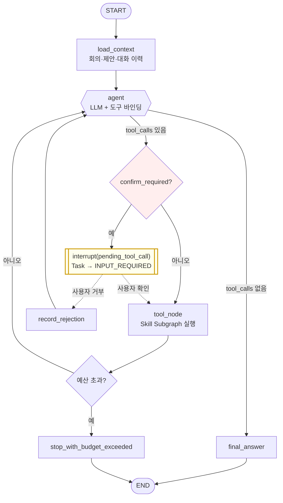

# W10-5 — 설계

> [30-10-w10-react-agent.md](30-10-w10-react-agent.md) §5의 상세 문서.

## 0. 설계 결정 목록

| ID | 결정 | 절 |
| --- | --- | --- |
| W10-D1 | **계산 규칙은 프롬프트가 아니라 코드로 내린다** | §5 |
| W10-D2 | 확인 게이트를 Graph 분기로 둔다 (프롬프트 지시 아님) | §6 |
| W10-D3 | 거부는 루프를 끝내지 않고 Agent에게 돌려준다 | §6 |
| W10-D4 | 도구 = W3 Skill Subgraph 래핑 | §8 |
| W10-D5 | 권한 인자는 Schema에서 제외하고 State 주입 | §8 |
| W10-D6 | 예산 초과 시 부분 결과 + `warnings` | §7 |
| W10-D7 | 카탈로그 규칙을 네 갈래로 나눠 이전 | §5 |
| W10-D8 | `assistant_router` Subgraph를 당장 지우지 않는다 | [30-10-12](30-10-12-rollback.md) |

## 1. ReAct Graph 구조



### 1.1 표준 ReAct와 다른 점 둘

| 노드 | 표준 ReAct | 여기 |
| --- | --- | --- |
| `confirm_required?` | 없음 | **있음** — 확인 대상 4종을 루프 안에서 가로챈다 |
| `budget` | 보통 반복 카운터만 | 4종 예산 + 중단 사유 기록 |

**`confirm_required?` 게이트가 이 설계의 핵심이다.** LangGraph의 `create_react_agent` prebuilt에는
이 지점이 없어서 커스텀 StateGraph로 짠다(D7-2=B).

### 1.2 노드별 책임

| 노드 | 책임 | LLM 호출 |
| --- | --- | --- |
| `load_context` | 회의·제안·대화 이력 조회. **`user_id` 범위 적용** | 없음 |
| `agent` | 다음 행동 결정. 도구 호출 또는 종료 | **있음** |
| `confirm_required?` | 도구별 확인 규칙 판정 | 없음 |
| `tool_node` | Skill Subgraph 실행 | 도구 내부에서 있을 수 있음 |
| `record_rejection` | 거부 사실을 `messages`에 추가 | 없음 |
| `budget` | 4종 예산 판정 | 없음 |
| `final_answer` | 최종 답변 정리. Schema 검증 | 상황에 따라 |
| `stop_with_budget_exceeded` | 부분 결과 + `warnings` | 없음 |

**`agent` 노드만 라우팅 판단을 한다.** 나머지는 결정적이다.

## 2. State

W2의 `WorkmateState`를 확장한다.

```python
class WorkmateState(TypedDict, total=False):
    # (기존 필드 유지)
    ...
    # W10 추가
    messages: Annotated[list[AnyMessage], add_messages]   # ReAct 대화 누적
    tool_calls_made: Annotated[list[dict], operator.add]  # 실행한 도구 기록
    iteration: int                                         # 루프 횟수
    budget_exceeded_reason: str | None
```

| 채널 | Reducer | 이유 |
| --- | --- | --- |
| `messages` | `add_messages` | LangGraph 표준. 도구 결과가 누적된다 |
| `tool_calls_made` | `operator.add` | 감사 기록. 공개 응답 `executed_skill_ids`의 근거 |
| `iteration` | 덮어쓰기 | 예산 판정 |
| `budget_exceeded_reason` | 덮어쓰기 | 중단 사유 |

### 2.1 `messages`와 `tool_calls_made`를 따로 두는 이유

`messages`는 LLM에 보내는 대화다. `tool_calls_made`는 **감사 기록**이다.

| | `messages` | `tool_calls_made` |
| --- | --- | --- |
| 용도 | LLM 입력 | 공개 응답·증빙 |
| 내용 | 도구 결과 전문 | 도구 이름·인자 요약·성공 여부 |
| 요약·절삭 | 예산 때문에 할 수 있다 | **하지 않는다** |

**`messages`를 절삭해도 `tool_calls_made`는 남는다.** 토큰 예산 때문에 대화를 줄이더라도 "무엇을
실행했는지"는 완전해야 한다.

## 3. LLM 바인딩

```python
llm = ChatOpenAI(model=..., temperature=0, max_retries=0)
llm_with_tools = llm.bind_tools(TOOLS)
```

| 항목 | 값 | 이유 |
| --- | --- | --- |
| `temperature` | 0 | 선택 안정성(W10-V9)을 최대한 유지 |
| `max_retries` | 0 | 재시도는 노드 `RetryPolicy`가 소유(W8) |
| 도구 바인딩 | `bind_tools` | LangChain 표준 |

**`temperature=0`으로도 완전 결정적이지 않다.** 대화가 길어지면 같은 입력에 다른 경로가 나올 수 있다.
그래서 W10-V9로 측정한다.

## 4. 도구 정의 — 평평한 Schema가 해소된다

### 4.1 현재의 문제

`_ARGUMENTS_SCHEMA`가 **15개 필드를 평평하게** 갖고 있고 전부 `required`다.

```python
"required": ["week_of", "query", "date_from", "date_to", "meeting_id", "decisions",
             "source_type", "decision", "message_id", "calendar_id", "event_id",
             "action", "title", "due_at", "task_id"]
```

OpenAI strict 모드가 모든 property를 `required`에 넣을 것을 요구하기 때문이다. 그래서 코드가 `null`을
걸러낸다.

```python
# assistant_router.py:691
arguments = {key: value for key, value in raw_arguments.items() if value is not None}
```

### 4.2 ReAct에서는 도구마다 자기 Schema를 갖는다

| | 현재 | ReAct |
| --- | --- | --- |
| Schema 수 | 1개(15필드 평평) | 10개(각 2~4필드) |
| `null` 필터링 | 필요 | 불필요 |
| 인자 오배치 | 가능 (`meeting_id`를 `manage_tasks`에 줄 수 있다) | **구조적으로 불가** |
| 필드 설명 | 하나의 거대 프롬프트에 섞임 | 해당 도구 옆에 |

**이것이 ReAct 전환의 가장 확실한 이득이다.** LLM 품질과 무관한 구조적 개선이다.

### 4.3 Schema 작성 원칙

```
[포함]  그 도구가 실제로 쓰는 인자만
[제외]  user_id, task_id, thread_id            ← W10-D5
[제외]  다른 도구의 인자
[설명]  필드 description에 계산 규칙 대신 "의도 표현 방법"을 쓴다
```

## 5. 134줄 카탈로그를 어디로 옮기는가 — 최대 위험

### 5.1 무엇이 들어 있는가

| 규칙 | 배경 |
| --- | --- |
| `week_of`를 절대 비우지 말고 상대 표현별로 계산 | 2026-08-17 사용자 요청 |
| "지난 주"에 7일을 두 번 빼지 마라 | 실사용 오류 |
| `[분석 완료]` 회의는 `analyze_meeting` 대신 `get_meeting_analysis` | 비용 낭비 방지 |
| 회의가 하나로 특정 안 되면 짐작하지 말고 목록으로 되물어라 | 엉뚱한 회의 분석 방지 |
| `call_skill`일 때도 `reply`를 채워라(확인 배너 문구) | UX |

**이 규칙들이 흩어지면 회귀한다.**

### 5.2 W10-D7 — 네 갈래로 나눈다

| 규칙 유형 | 이전처 | 예 |
| --- | --- | --- |
| **도구 선택 기준** | 도구 `description` | "이미 분석된 회의에는 쓰지 마라" |
| **인자 계산 규칙** | **코드**(도구 기본값) | `week_of` 계산 → 도구가 계산 |
| **인자 표현 규칙** | Schema 필드 `description` | "상대 표현은 `relative`로" |
| **되묻기 규칙** | Agent 시스템 프롬프트 | "특정 안 되면 목록으로" |

### 5.3 W10-D1 — 계산 규칙은 프롬프트가 아니라 코드로 내린다

`week_of` 계산은 지금 LLM이 한다(프롬프트에 "오늘-7일" 규칙). ReAct로 가면서 **도구가 기본값을
계산**하게 바꾼다.

| 현재 | W10 |
| --- | --- |
| LLM이 `week_of="2026-09-15"` 계산 | LLM이 `relative="last_week"` 전달 → 도구가 계산 |

```python
def weekly_report_tool(relative: str | None = None, week_of: str | None = None, ...):
    """주간 업무보고를 생성한다.

    relative: "this_week" | "last_week" | None
        상대 표현은 코드가 날짜로 변환한다. LLM이 직접 날짜를 계산하지 않는다.
    week_of: 명시적 주 시작일(YYYY-MM-DD). relative가 있으면 무시한다.
    """
```

**이것이 05번 문서 §1("날짜 범위 계산은 코드")과도 일치한다.** 개정으로 LLM 칸을 넓히면서 동시에
계산은 코드로 되돌리는 것이다 — 넓히는 것과 좁히는 것이 같은 작업 안에 있다.

### 5.4 이전 후에도 프롬프트에 남는 것

| 남는 것 | 왜 |
| --- | --- |
| 되묻기 판단 기준 | 코드로 표현할 수 없는 대화 판단 |
| 답변 어조·길이 | 표현 지침 |
| 확인이 필요한 상황의 설명 문구 | UX |

**134줄이 0줄이 되지는 않는다.** 규칙성 있는 것만 옮기고, 판단과 표현은 프롬프트에 남는다.

## 6. 확인(HITL) 설계

### 6.1 W6의 interrupt를 루프 안으로

```
agent가 tool_calls 반환
  → confirm_required? 게이트
      ├ 파괴적 도구 아님 → 바로 실행
      └ 파괴적 도구      → interrupt(pending_tool_call)
                            ├ 승인 → 실행
                            └ 거부 → record_rejection → agent에게 "거부됨" 전달
```

### 6.2 W10-D2 — 게이트는 Graph 구조다

프롬프트에 "파괴적인 작업은 확인받아라"라고 쓰면 LLM이 건너뛸 수 있다. **Graph의 조건 분기로 두면
건너뛸 경로가 없다.**

```python
builder.add_conditional_edges(
    "agent",
    route_after_agent,
    {"confirm": "interrupt_node", "tools": "tool_node", "final": "final_answer"},
)
```

`route_after_agent`는 **코드**다. LLM의 출력을 보고 판정하지만 판정 자체는 결정적이다.

### 6.3 W10-D3 — 거부는 루프를 끝내지 않는다

**W6과 다른 점이다.** W6은 거부 시 Task를 종료한다.

| | W6 | W10 |
| --- | --- | --- |
| 거부 후 | Task 종료 | Agent에게 전달 → 재계획 가능 |
| 사용자 체감 | "취소됐습니다" | "그럼 대신 …할까요?" |

**주의** 거부된 도구를 같은 인자로 다시 호출하면 무한 확인 루프가 된다. 예산의 "같은 도구 연속 호출
2회" 상한이 이 경우도 막는다.

### 6.4 확인 대상 4종 — 그대로 유지

W6-R10과 동일하다. 도구 수준 메타데이터로 표시한다.

```python
TOOL_REQUIRES_CONFIRMATION = {
    "analyze_meeting": lambda args: True,
    "review_action_items": lambda args: any(d.get("decision") == "reject" for d in args.get("decisions", [])),
    "review_proposal": lambda args: args.get("decision") == "ignore",
    "manage_tasks": lambda args: args.get("action") == "delete",
}
```

**W10에서 늘리거나 줄이지 않는다.** 확인 대상 변경은 별건이다.

## 7. 루프 예산 (D7-5)

| 예산 | 권장 | 초과 시 |
| --- | --- | --- |
| 반복 횟수 | 6 | `stop_with_budget_exceeded` |
| 누적 토큰 | 모델 컨텍스트의 70% | 동상 |
| 경과 시간 | 60초(비동기 경로는 더 길게) | 동상 |
| 같은 도구 연속 호출 | 2회 | 동상 |

### 7.1 W10-D6 — 조용히 끊지 않는다

```python
{
  "reply": "회의를 찾는 데까지는 했지만 승인 처리는 완료하지 못했습니다. …",
  "executed_skill_ids": ["search_meetings"],
  "warnings": [{"code": "AGENT_BUDGET_EXCEEDED", "detail": "반복 6회 초과"}]
}
```

`AGENTS.md`의 "외부 Provider 장애 시 정의된 부분 결과와 `warnings`를 반환한다"와 같은 원칙이다.

### 7.2 왜 반복 6회인가

| 회수 | 커버하는 시나리오 |
| --- | --- |
| 1~2 | 단일 도구 (현재 구조와 동등) |
| 3~4 | 조회 → 실행 (다단계의 대부분) |
| 5~6 | 조회 → 실행 → 재조회 → 확인 |
| 7+ | **대부분 헤매는 중이다** |

**6을 넘는 정상 시나리오를 찾지 못했다.** W10-T10 측정에서 6회에 자주 걸리면 상한을 다시 본다.

## 8. 도구 = Skill Subgraph

### 8.1 W10-D4 — W3 산출물을 그대로 감싼다

```python
def build_skill_tool(skill_id: str, subgraph: CompiledGraph) -> BaseTool:
    """Skill Subgraph를 ReAct 도구로 감싼다.

    user_id·task_id·thread_id는 Agent State에서 주입한다 — LLM이 인자로
    채우게 두면 권한 범위가 깨진다(AGENTS.md).
    """
```

**Skill 내부는 결정적 Workflow로 남는다.** ReAct는 Skill **바깥**의 라우팅만 대체한다.

```
[W10 이후 구조]

Root Graph
  ├ weekly_report      → Skill Subgraph (결정적)
  ├ daily_briefing     → Skill Subgraph (결정적)
  ├ …
  └ assistant_ask      → ReAct Agent Subgraph  ← 여기만 Agent
                           └ 도구 = 위의 Skill Subgraph들
```

### 8.2 W10-D5 — 권한 인자는 Schema에서 제외

**`user_id`를 LLM이 채우게 하면 안 된다.** 도구 Schema에서 제외하고 State에서 주입한다.

| 인자 | 출처 |
| --- | --- |
| `user_id` | State (인증된 요청에서) |
| `task_id`·`thread_id` | State |
| 업무 인자 | LLM |

**검증** W10-V6이 도구 Schema에 권한 인자가 없음을 단정한다.

## 9. 결정적 규칙은 그대로 코드에 남는다

**ReAct가 넓히는 것은 "도구 선택과 실행 순서"뿐이다.** 아래는 변하지 않는다.

| 항목 | 소유 | 근거 |
| --- | --- | --- |
| 우선순위 점수·순위·`score_breakdown` | `app/domain/priority.py` | `AGENTS.md` |
| 근거 ID(`source_refs`) | Domain·Repository | 동상 |
| 날짜 경계 계산 | 도구 내부 코드 | 05번 §1, W10-D1 |
| `user_id` 범위 | Repository | `AGENTS.md` |
| 중복 제거·상태 전이 | 코드 | 05번 §1 |
| 결과 Schema 검증 | `validate_contract` 노드 | 96번 §11-9 |

**Agent는 "어떤 도구를 부를지"만 정하고, 도구가 반환한 값을 바꾸지 않는다.**

이를 강제하는 검증이 [30-10-7](30-10-7-verification.md) W10-V5다 — Agent가 점수를 재계산하거나
`source_refs`를 만들어내면 실패다.

## 10. 참조

- [30-10-4](30-10-4-requirements.md) — 이 설계가 만족하는 요구사항
- [30-10-7](30-10-7-verification.md) — W10-V5·V6·V7
- [30-6-5](30-6-5-design.md) — W6의 interrupt 설계 (W10이 확장)
- [30-3-5](30-3-5-design.md) §3.4 — 부작용 노드 (확인 대상과 겹친다)
- [assistant_router.py](../workmate-agent/app/workflows/assistant_router.py) `_SKILL_CATALOG`·`_ARGUMENTS_SCHEMA`
