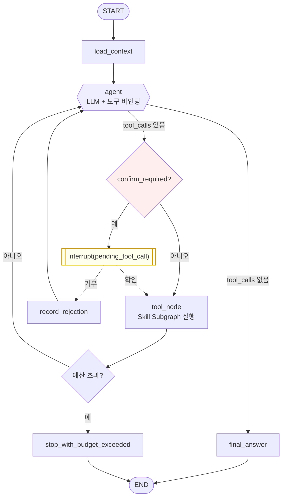

# W10 — ReAct Agent 전환

> **이 문서는 요약과 색인이다.** 각 절의 상세는 아래 13개 문서에 있고, 충돌 시 상세 문서를 기준으로
> 한다.
>
> | 절 | 상세 문서 | 내용 |
> | --- | --- | --- |
> | §1 | [30-10-1](30-10-1-document-info.md) | 문서 정보·용어·**왜 별도 단계인가** |
> | §2 | [30-10-2](30-10-2-scope.md) | 목적, 좋아지는 것·나빠지는 것, 범위 |
> | §3 | [30-10-3](30-10-3-entry-criteria.md) | 선행 조건 W10-E1~E6 — **착수 금지 조건 셋** |
> | §4 | [30-10-4](30-10-4-requirements.md) | 요구사항 W10-R1~R13 |
> | §5 | [30-10-5](30-10-5-design.md) | 설계 W10-D1~D8 — Graph·State·도구·HITL·예산 |
> | §6 | [30-10-6](30-10-6-wbs.md) | 작업 분해 W10-T1~T11 |
> | §7 | [30-10-7](30-10-7-verification.md) | 검증 설계 W10-V1~V10 |
> | §8 | [30-10-8](30-10-8-traceability.md) | 추적성 — **카탈로그 규칙 추적** |
> | §9 | [30-10-9](30-10-9-exit-criteria.md) | 완료 정의 — 자동 승인 불가 |
> | §10 | [30-10-10](30-10-10-approval.md) | **승인 경계 — D7-1~D7-7, 05번 개정안, 대안** |
> | §11 | [30-10-11](30-10-11-risks.md) | 위험 등록부 W10-K1~K8 |
> | §12 | [30-10-12](30-10-12-rollback.md) | 롤백·중단 기준 |
> | §13 | [30-10-13](30-10-13-references.md) | 참조 자료와 읽을 지점 |
>
> **W10의 특징 셋.**
> (1) **전환(W0~W9)의 일부가 아니다.** W0~W9는 동작 보존이 목표였고 W10은 동작을 바꾸는 것이 목적이다.
> 따라서 검증도 스냅샷 대조가 아니라 **규칙 회귀 + 새 능력 확인**이다.
> (2) **최대 위험이 코드가 아니라 프롬프트에 있다.** `_SKILL_CATALOG` 134줄은 실사용 피드백으로 한 줄씩
> 쌓인 규칙이다. 흩어지면서 조용히 사라지고, 위반해도 오류가 아니라 **틀린 답**이 나온다.
> (3) **재현성을 의도적으로 포기한다.** 현재는 `temperature=0` 단발 분류라 사실상 10/10 결정적이다.
> 얼마나 나빠지는지 측정하고 임계값을 둔다(W10-V9).

작성일: 2026-09-29
상위 계획: [30-langgraph-migration-plan.md](30-langgraph-migration-plan.md)
선행 단계: [W9 문서·증빙 정리](30-9-w9-docs-evidence.md) — **전환 완료·승인 후**
상태: **계획 수립.** D7-1~D7-7과 05번 개정 승인은 **착수 시점에** 받는다([30-10-10](30-10-10-approval.md) §1.1)

## 1. 문서 정보

| 항목 | 값 |
| --- | --- |
| 단계 코드 | W10 |
| 단계명 | ReAct Agent 전환 |
| 성격 | **LangGraph 전환의 후속 작업.** W0~W9와 독립적으로 승인받는다 |
| 상태 | 계획 수립 — 착수 전 |
| 신규 결정 | D7-1~D7-7 |
| 승인 필요 | 05번 문서 §1 개정, 공개 계약 재변경, UI 육안 검수 |

**전환은 W9에서 끝난다.** W10은 번호만 이어 붙인 별건이며, "전환이 열한 단계"라고 말하지 않는다.

상세 → [30-10-1](30-10-1-document-info.md)

## 2. 목적과 범위

`assistant_ask`의 **단발 분류 라우팅**을 **ReAct Agent 루프**로 바꾼다.

```
[현재]
LLM ①  Context 참조 해소
LLM ②  action + skill_id + arguments   ← 단 한 번의 결정
코드    allowlist 검증 → 확인 판정 → Skill 1개 실행
LLM ③  결과를 문장으로

[ReAct 이후]
LLM    생각 → 도구 호출 → 결과 관찰 → 생각 → 도구 호출 → … → 최종 답변
```

| 좋아지는 것 | 나빠지는 것 |
| --- | --- |
| 다단계 요청 처리 | LLM 호출 횟수·비용·지연이 가변 |
| **평평한 15필드 Schema 해소** | 재현성 저하 |
| 결과 관찰 후 재계획 | 스냅샷 대조가 Fake로만 성립 |
| 규칙이 도구별로 분산 | 확인이 루프 중 여러 번 발생 |

**범위는 `assistant_ask` 하나다.** 나머지 10개 Skill은 진입점이 명확한 결정적 작업이라 Agent가 필요
없다.

상세 → [30-10-2](30-10-2-scope.md)

## 3. 선행 조건

| ID | 조건 | 미충족 시 |
| --- | --- | --- |
| W10-E1 | **W9 완료 및 승인** | **착수 금지** |
| W10-E2 | W6의 `interrupt` 동작 확인 | 확인 흐름의 토대가 없음 |
| W10-E3 | **결정 D7-1~D7-7 확정** | **착수 금지** |
| W10-E4 | **05번 문서 §1 개정 승인** | **착수 금지** |
| W10-E5 | 카탈로그 규칙 목록화 | 회귀 방지선 없음 |
| W10-E6 | 루프 예산 기준 확정 | 비용·지연 통제 불가 |

[05번 문서 §1](05-ai-security-operations.md)의 표가 LLM을 텍스트 생성으로 한정하고 있어 **"도구를
고르고 실행 순서를 정한다"가 LLM 칸에 없다.** 이건 누락이 아니라 2026-08-17의 설계 결정이므로, 문서를
먼저 고쳐야 한다.

상세 → [30-10-3](30-10-3-entry-criteria.md)

## 4. 요구사항

| ID | 요구사항 | 검증 |
| --- | --- | --- |
| W10-R1 | 다단계 실행 (도구 여러 번 호출) | W10-V2 |
| W10-R2 | 도구별 개별 Schema | W10-V10 |
| W10-R3 | 권한 인자는 State 주입, Schema 제외 | **W10-V6** |
| W10-R4 | **카탈로그 134줄 규칙 전수 보존** | **W10-V1** |
| W10-R5 | 계산은 코드가 소유 | W10-V1, V5 |
| W10-R6 | **결정적 규칙 불변** | **W10-V5** |
| W10-R7 | 확인 게이트 우회 불가 | W10-V3 |
| W10-R8 | 거부 후 재계획 | W10-V4 |
| W10-R9 | 루프 예산 + 부분 결과 | W10-V7 |
| W10-R10 | 공개 계약 `executed_skill_ids` | W10-V10, 육안 |
| W10-R11 | 05번 문서 §1 개정 | 승인 기록 |
| W10-R12 | 비용·지연·안정성 측정 기록 | W10-V8, V9 |
| W10-R13 | 스냅샷 4건 재작성, **23건 불변** | W10-V10 |

상세 → [30-10-4](30-10-4-requirements.md)

## 5. 설계



**`confirm_required?` 게이트가 이 설계의 핵심이다.** 표준 ReAct에 없는 노드이며, 확인 대상 4종을 루프
안에서 가로챈다. 프롬프트 지시가 아니라 **Graph 분기**이므로 건너뛸 경로가 없다.

### 5.1 설계 결정

| ID | 결정 |
| --- | --- |
| **W10-D1** | **계산 규칙은 프롬프트가 아니라 코드로 내린다** |
| W10-D2 | 확인 게이트를 Graph 분기로 |
| W10-D3 | 거부는 루프를 끝내지 않고 Agent에게 돌려준다 |
| W10-D4 | 도구 = W3 Skill Subgraph 래핑 |
| W10-D5 | 권한 인자는 Schema 제외, State 주입 |
| W10-D6 | 예산 초과 시 부분 결과 + `warnings` |
| W10-D7 | 카탈로그 규칙을 네 갈래로 나눠 이전 |
| W10-D8 | `assistant_router` Subgraph를 당장 지우지 않는다 |

**W10-D1이 방향을 정한다.** `week_of` 계산은 지금 LLM이 하지만, ReAct로 가면서 LLM은
`relative="last_week"`만 전달하고 **도구가 날짜를 계산**한다. 05번 문서의 "날짜 범위 계산은 코드"와
일치하며, **넓히는 것과 좁히는 것이 같은 작업 안에 있다.**

상세 → [30-10-5](30-10-5-design.md)

## 6. 작업 분해

| ID | 작업 | 완료 조건 |
| --- | --- | --- |
| W10-T1 | 결정 확정 + 05번 개정안 | **사용자 승인** |
| W10-T2 | **카탈로그 134줄 규칙 목록화** | 전수 + 이전처 + 회귀 케이스 |
| W10-T3 | 도구 Schema 10개 | 권한 인자 제외 |
| W10-T4 | 계산 규칙을 코드로 이전 | 규칙표의 "코드" 항목 전부 |
| W10-T5 | ReAct Graph 구현 | 루프 동작 |
| W10-T6 | 확인 게이트 + interrupt | 4종 전부 게이트 통과 |
| W10-T7 | 루프 예산 | 4종 각각 발동 |
| W10-T8 | 공개 계약 + UI·어댑터 | 02번 반영 |
| W10-T9 | 회귀 검증 | **규칙표 전항 PASS** |
| W10-T10 | 비용·지연·안정성 측정 | 수치 기록 |
| W10-T11 | 증빙·승인 | 사용자 승인 |

**W10-T2가 이 단계의 성패를 가른다.** 134줄의 규칙을 하나씩 목록으로 만들고 각각에 회귀 테스트를
붙인다. 이 목록 없이 구현하면 무엇이 빠졌는지 알 수 없고, 빠진 규칙은 **사용자 신고로 발견된다.**

상세 → [30-10-6](30-10-6-wbs.md)

## 7. 검증

| ID | 검증 | 실패 시 |
| --- | --- | --- |
| W10-V1 | **카탈로그 규칙 회귀** (전항 PASS) | **중단** |
| W10-V2 | 다단계 요청 | 재작업 |
| W10-V3 | 확인 게이트 (4종 + 우회 시험) | **중단** |
| W10-V4 | 거부 후 재계획 | 재작업 |
| W10-V5 | **결정적 규칙 보존** | **중단** |
| W10-V6 | `user_id` 전파 | **중단**(보안) |
| W10-V7 | 루프 예산 4종 | 재작업 |
| W10-V8 | 비용·지연 | 보고 후 판단 |
| W10-V9 | **선택 안정성** | §7.1 임계값 |
| W10-V10 | 전체 회귀 + **스냅샷 23건 불변** | 재작업 |

### 7.1 W10-V9 — 선택 안정성 (신규 지표)

```
같은 입력 10회 → 같은 도구 시퀀스가 나오는 비율
```

| 결과 | 판단 |
| --- | --- |
| 9/10 이상 | 수용 |
| 7~8/10 | 프롬프트·도구 설명 보완 |
| 6/10 이하 | **설계 재검토** |

현재 구조는 사실상 10/10이다. **이 수치가 떨어지는 것이 ReAct의 대가다.**

상세 → [30-10-7](30-10-7-verification.md)

## 8. 추적성

| 추적 | 핵심 |
| --- | --- |
| 요구사항↔작업↔검증 | R1~R13 전부 검증에 연결 |
| **카탈로그 규칙 추적** | **134줄의 각 규칙이 어디로 갔고 무엇이 지키는지** |
| 위험↔완화↔검증 | "높음" 이상 다섯이 전용 검증을 가짐 |
| 05번 개정↔구현 | 개정 문장마다 구현·검증 연결 |
| 계약 변경 누적 | W6(확인 프로토콜) + W10(`executed_skill_ids`) |

상세 → [30-10-8](30-10-8-traceability.md)

## 9. 완료 정의

| # | 조건 |
| --- | --- |
| E-1 | W10-V1~V10 PASS |
| E-2 | **W10-V1(카탈로그 규칙 회귀) 전항 PASS** |
| E-3 | **W10-V5(결정적 규칙 보존) PASS** |
| E-4 | 05번 문서 §1 개정 승인·반영 |
| E-5 | 공개 계약 변경이 02번 문서에 반영 |
| E-6 | UI 육안 검수 사용자 PASS |
| E-7 | 비용·지연 측정값이 기록되고 수용 판단을 받음 |

**자동 승인 대상이 아니다.** 05번 개정·계약 변경·UI 육안 검수 셋이 걸린다.

**E-2는 부분 PASS가 있을 수 없다.** 40개 중 38개 PASS는 통과가 아니다 — 빠진 2개가 어떤 규칙인지 모르면
위험을 평가할 수 없고, 빠진 규칙은 대개 "드물게 발생하지만 발생하면 틀린 답을 주는" 종류다.

상세 → [30-10-9](30-10-9-exit-criteria.md)

## 10. 승인 경계

| 시점 | 대상 |
| --- | --- |
| **착수 전** | 결정 D7-1~D7-7, 05번 문서 §1 개정안 |
| 계약 확정 | `executed_skill_ids` 설계안 |
| 완료 시 | UI 육안 검수 + 비용 수용 판단 |

### 10.1 결정 D7-1 ~ D7-7 (권장안)

| ID | 결정할 것 | 권장 |
| --- | --- | --- |
| D7-1 | 적용 범위 | **A** — `assistant_ask`만 |
| D7-2 | 구현 방식 | **B** — 커스텀 StateGraph |
| D7-3 | 도구 집합 | **A** — Skill 10개 그대로 시작 |
| D7-4 | 확인 지점 | **A** — 파괴적 도구 호출 직전 |
| D7-5 | 루프 예산 | **반복 6회 + 토큰·시간·중복 상한** |
| D7-6 | 공개 계약 | **A** — `executed_skill_ids` 복수 |
| D7-7 | 시점 | **A** — W9 완료 후 별도 |

**지금 확정하지 않는다.** D7-2·D7-3·D7-4·D7-6은 W2~W6을 거치면서 판단 근거가 채워지는 질문이다. 미리
정하면 경험 없이 정한 것을 되돌리는 절차가 하나 더 생긴다. 05번 개정도 지금 하면 W1~W9 동안 문서가
구현보다 앞서 나간다.

### 10.2 대안 — W3·W6에 접어 넣기 (D7-7의 B안)

| | A안(별도) | B안(전환에 포함) |
| --- | --- | --- |
| W9 완료 판정 | 깨끗함 | **설명 불가 차이가 섞임** |
| 원인 분리 | 가능 | **불가** |
| 총 기간 | 길다 | 짧다 |
| UI 작업 | 두 번 | 한 번 |

**A안을 권한다.** UI 작업 한 번을 아끼려고 전환 판정을 포기하는 거래다.

상세 → [30-10-10](30-10-10-approval.md)

## 11. 위험

| ID | 위험 | 노출도 | 검증 |
| --- | --- | --- | --- |
| W10-K1 | **134줄 카탈로그 규칙 유실** | **매우 높음** | **W10-V1** |
| W10-K2 | 결정적 규칙 침해 | 높음 | **W10-V5** |
| W10-K3 | 무한 루프·비용 폭주 | 높음 | W10-V7 |
| W10-K4 | 확인 우회 | 높음 | W10-V3 |
| W10-K5 | 재현성 저하 | 중 | W10-V9 |
| W10-K6 | 스냅샷 대조 불가 | 중 | W10-V10 |
| W10-K7 | `user_id`를 LLM이 채움 | **높음(보안)** | **W10-V6** |
| W10-K8 | 계약이 또 바뀜 | 중 | 승인 기록 |

### 11.1 W10-K1이 압도적이다

규칙이 사라져도 **오류가 나지 않는다.** 형식은 정상이고 내용만 틀린다.

```
"지난주 보고서 써줘"
  → 규칙 유실 시: 2주 전 데이터로 보고서가 나온다
  → 오류 없음. 사용자가 날짜를 확인하지 않으면 발견되지 않는다
```

**W10-T2를 건너뛰면 W10을 시작하지 않는다.**

상세 → [30-10-11](30-10-11-risks.md)

## 12. 롤백·중단

| 항목 | 롤백 |
| --- | --- |
| ReAct Graph | 이전 `assistant_router` Subgraph로 복귀 |
| 도구 정의·예산 노드 | 삭제 |
| 공개 계약·05번 문서 | revert |
| 날짜 계산 함수(W10-T4) | **유지해도 된다** — 단발 구조에서도 옳다 |

**중단 조건 넷** — W10-V1(규칙 회귀)·V5(결정적 규칙)·V6(`user_id`)·V3(확인 게이트) FAIL. 이 넷은
재작업이 아니라 **설계를 다시 본다.**

**W10-D8** `assistant_router` Subgraph를 완료 즉시 지우지 않는다. 134줄 원문이 규칙의 최종 근거이므로
이전이 완전하다고 확신할 때까지 남긴다.

상세 → [30-10-12](30-10-12-rollback.md)

## 13. 참조

| 자료 | 읽는 이유 |
| --- | --- |
| [05-ai-security-operations.md](05-ai-security-operations.md) §1 | **LLM과 코드의 책임 표** — 개정 대상 |
| [`assistant_router.py`](../workmate-agent/app/workflows/assistant_router.py) | `_SKILL_CATALOG`(134줄), `_ARGUMENTS_SCHEMA`, `route()`, `_requires_confirmation()` |
| [16-llm-prompts.md](16-llm-prompts.md) | 프롬프트 원문 — 규칙 대조 |
| [18-workmate-assistant-implementation-plan.md](18-workmate-assistant-implementation-plan.md) 설계 결정 2 | **Agent를 안 쓴 것이 결정이었다는 기록** |
| [30-6-5](30-6-5-design.md) | W6의 interrupt 설계 — W10이 확장 |
| [30-9-12](30-9-12-backlog.md) | W9-B7(스트리밍)·B8(트레이싱)과의 관계 |
| LangGraph — `ToolNode`, `add_messages`, `interrupt` | 표준 패턴 |
| LangChain — `BaseTool`, `bind_tools` | 도구 정의 |

**`AgentExecutor`는 W10 이후에도 쓰지 않는다.** "ReAct Agent"라고 해서 LangChain의 Agent 추상화를
쓰는 것이 아니라 LangGraph StateGraph로 직접 짠다.

상세 → [30-10-13](30-10-13-references.md)
