# Workmate LangGraph StateGraph 목표 아키텍처

작성일: 2026-08-24  
문서 성격: **가정형 목표 아키텍처**  
가정: Workmate의 모든 Workflow가 LangGraph `StateGraph`와 영속 Checkpointer로 구현돼 있다.

> 이 문서는 현재 구현 상태를 설명하지 않는다. “Workmate를 실제 LangGraph `StateGraph`로
> 구현했다면 어떤 구조인가”를 나타내는 목표 설계도다. 현재 Runtime과의 차이는
> [97번 문서](97-workmate-langgraph-structure.md)에서 확인한다.

## 1. 전체 LangGraph 구조

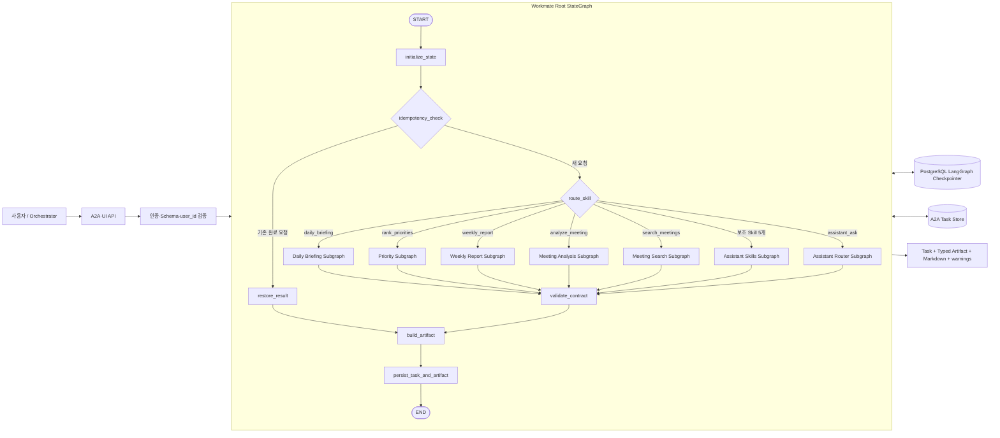

Root Graph는 전송 계층과 업무 Subgraph 사이의 공통 실행 계약을 소유한다. 인증과 요청 Schema 검증은
Graph 진입 전에 끝내고, Graph 안에서는 멱등성, Skill 분기, 상태 전이, Checkpoint, 결과 검증과
Artifact 생성을 처리한다.

## 2. Graph 구성 계층

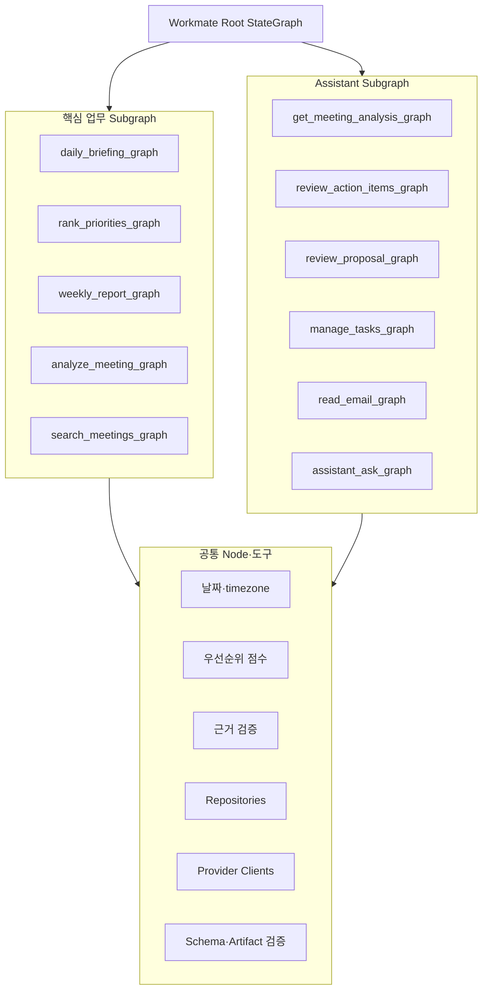

Skill은 별도 Agent가 아니라 Root Graph가 호출하는 Subgraph다. 날짜, 점수, 중복 제거, 권한과 근거
검증은 결정적인 공통 Node 또는 Domain 함수로 유지하고, 외부 I/O만 Repository와 Provider Client를
통해 수행한다.

## 3. 공통 State

```python
from typing import Any, Literal, TypedDict


class WarningState(TypedDict):
    source: str
    code: str
    message: str
    retryable: bool
    last_success_at: str | None


class WorkmateState(TypedDict, total=False):
    # 요청·실행 식별자
    request_id: str
    message_id: str
    task_id: str
    thread_id: str
    user_id: str
    skill_id: str

    # 입력과 실행 문맥
    input: dict[str, Any]
    now: str
    timezone: str
    deadline_at: str

    # Workflow 중간 상태
    source_data: dict[str, Any]
    normalized_items: list[dict[str, Any]]
    warnings: list[WarningState]
    pending_action: dict[str, Any] | None

    # 결과와 상태 전이
    task_state: Literal[
        "SUBMITTED",
        "WORKING",
        "INPUT_REQUIRED",
        "AUTH_REQUIRED",
        "COMPLETED",
        "FAILED",
        "CANCELED",
    ]
    result: dict[str, Any]
    markdown: str
    error: dict[str, Any] | None
```

State Reducer는 다음 규칙을 따른다.

- `warnings`는 Node별 경고를 덮어쓰지 않고 누적한다.
- `source_data`는 출처별 Namespace로 병합한다.
- `task_state`는 허용된 상태 전이만 적용한다.
- `user_id`, `request_id`, `message_id`, `task_id`, `thread_id`는 실행 중 변경하지 않는다.
- Secret, Token, Presigned URL과 원본 개인정보는 State에 저장하지 않는다.

## 4. Root StateGraph 정의

```python
from langgraph.graph import END, START, StateGraph


def build_workmate_graph(checkpointer):
    """Workmate Root Graph와 Skill Subgraph를 조립한다."""
    graph = StateGraph(WorkmateState)

    graph.add_node("initialize_state", initialize_state)
    graph.add_node("idempotency_check", idempotency_check)
    graph.add_node("restore_result", restore_result)
    graph.add_node("route_skill", route_skill_node)
    graph.add_node("daily_briefing", build_daily_briefing_graph())
    graph.add_node("rank_priorities", build_priority_graph())
    graph.add_node("weekly_report", build_weekly_report_graph())
    graph.add_node("analyze_meeting", build_meeting_analysis_graph())
    graph.add_node("search_meetings", build_meeting_search_graph())
    graph.add_node("assistant_skills", build_assistant_skills_graph())
    graph.add_node("assistant_ask", build_assistant_router_graph())
    graph.add_node("validate_contract", validate_contract)
    graph.add_node("build_artifact", build_artifact)
    graph.add_node("persist_result", persist_result)

    graph.add_edge(START, "initialize_state")
    graph.add_edge("initialize_state", "idempotency_check")
    graph.add_conditional_edges("idempotency_check", route_idempotency)
    graph.add_conditional_edges("route_skill", route_skill)

    for node in (
        "daily_briefing",
        "rank_priorities",
        "weekly_report",
        "analyze_meeting",
        "search_meetings",
        "assistant_skills",
        "assistant_ask",
    ):
        graph.add_edge(node, "validate_contract")

    graph.add_edge("restore_result", "build_artifact")
    graph.add_edge("validate_contract", "build_artifact")
    graph.add_edge("build_artifact", "persist_result")
    graph.add_edge("persist_result", END)

    return graph.compile(checkpointer=checkpointer)
```

위 코드는 구조를 설명하기 위한 의사 코드다. 실제 구현에서는 조건부 Edge의 경로 Map, `Command` 반환,
Subgraph 입출력 Adapter와 오류 Edge를 포함해야 한다.

## 5. 핵심 업무 Subgraph

### 5.1 Daily Briefing

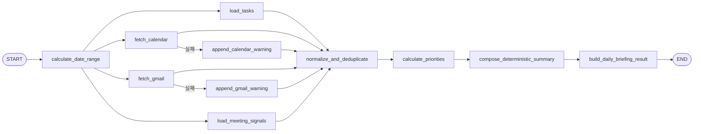

`compose_deterministic_summary`는 LLM Node가 아니다. 일정, 메일 신호, 우선순위 수를 코드의 고정
템플릿으로 조합한다. Task 저장소 실패는 전체 실패지만 Gmail·Calendar 일부 실패는 Warning Edge로
우회해 부분 결과를 만든다.

### 5.2 Priority

```mermaid
flowchart LR
    S([START]) --> LOAD[load_incomplete_tasks]
    LOAD --> FILTER[filter_user_and_soft_delete]
    FILTER --> SCORE[calculate_deterministic_score]
    SCORE --> SORT[stable_sort_and_top3]
    SORT --> PREV[load_previous_snapshot]
    PREV --> DIFF[explain_rank_changes]
    DIFF --> SAVE[save_priority_snapshot]
    SAVE --> RESULT[build_priority_result]
    RESULT --> E([END])
```

Priority Subgraph는 Gmail Node를 갖지 않는다. LLM도 순위, 점수, 근거 ID를 생성하거나 변경하지 않는다.

### 5.3 Weekly Report

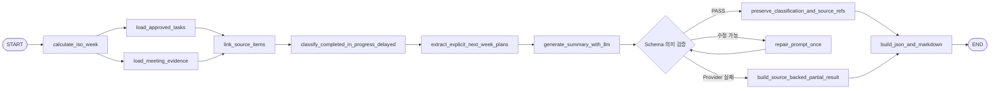

LLM은 보고서 문장을 작성하지만 분류, 계획 종류, `source_refs`의 원장은 Graph State와 Domain Node다.

### 5.4 Meeting Analysis

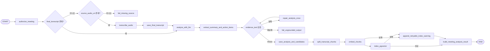

분석과 검색 색인은 분리한다. 색인이 실패해도 이미 근거 검증을 통과해 저장된 요약과 Action Item 후보를
롤백하지 않고 재시도 가능한 경고를 남긴다.

### 5.5 Meeting Search

```mermaid
flowchart LR
    S([START]) --> AUTH[apply_user_metadata_filters]
    AUTH --> QE[embed_query]
    AUTH --> KW[search_pg_trgm]
    QE --> DENSE[search_hnsw_cosine]
    DENSE --> RRF[fuse_with_rrf]
    KW --> RRF
    RRF --> EVID[verify_metadata_and_direct_evidence]
    EVID --> NEED{reranker 필요?}
    NEED -->|예| RERANK[rerank_or_groundedness]
    NEED -->|아니오| CONTEXT[build_grounded_context]
    RERANK -->|성공| CONTEXT
    RERANK -->|실패·Timeout| FALLBACK[use_rrf_and_append_warning]
    FALLBACK --> CONTEXT
    CONTEXT --> ANSWER[generate_grounded_answer]
    ANSWER --> CHECK{인용 근거 충분?}
    CHECK -->|예| OK[answer_with_sources]
    CHECK -->|아니오| NONE[insufficient_evidence]
    OK --> E([END])
    NONE --> E
```

근거 부족은 예외 Edge가 아니라 정상 완료 Edge다. 단일 Cosine 임계값으로 답변 가능 여부를 결정하지
않는다.

## 6. Assistant Router Subgraph

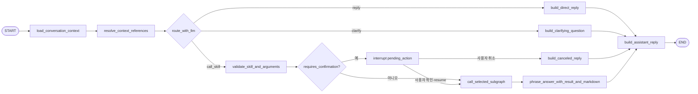

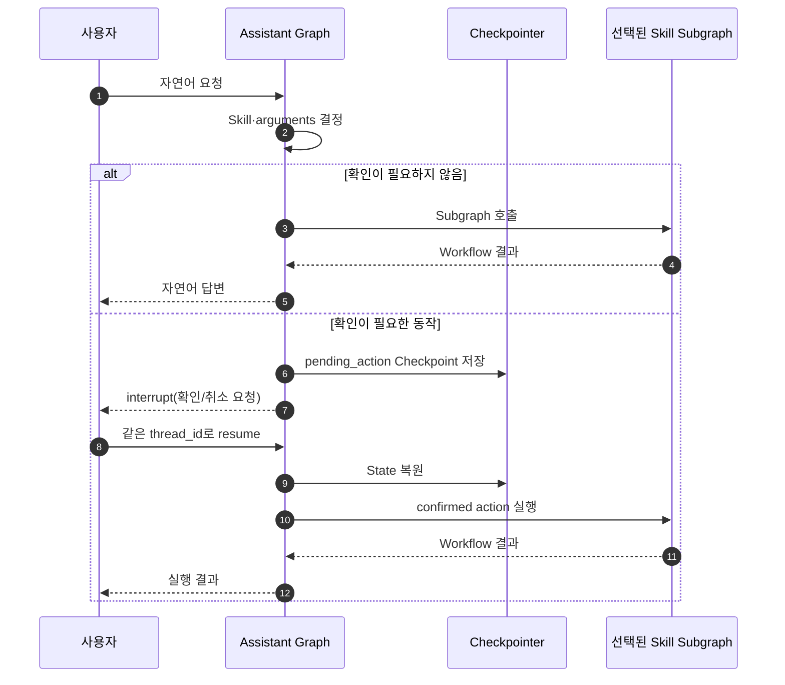

확인 대상은 Action Item 거절, 제안 무시, Task 삭제, 비용이 큰 회의 분석이다. Resume 시 LLM Router를
다시 호출하지 않고 Checkpoint에 저장된 `skill_id`와 검증된 `arguments`를 사용한다.

## 7. Task 상태와 Checkpoint

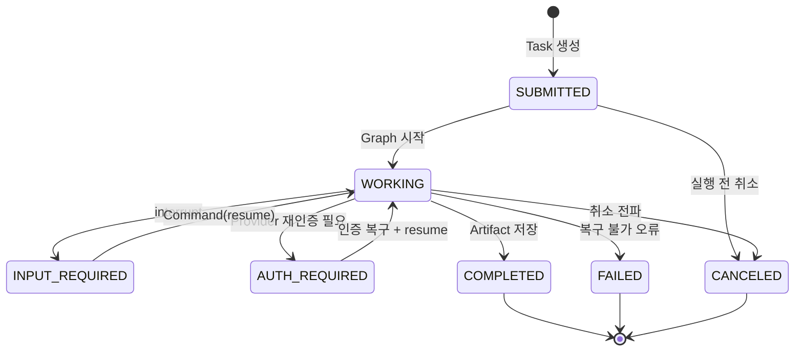

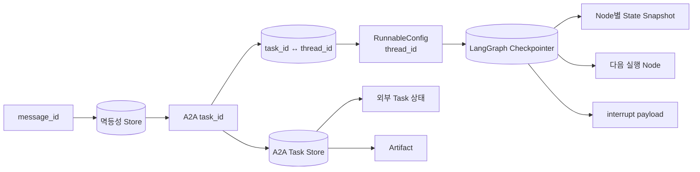

Task Store는 외부 A2A 상태와 Artifact의 원장이고, LangGraph Checkpointer는 내부 State와 재개 지점의
원장이다. 두 저장소를 합치지 않고 `task_id ↔ thread_id`로 연결한다.

## 8. 오류·재시도 Graph

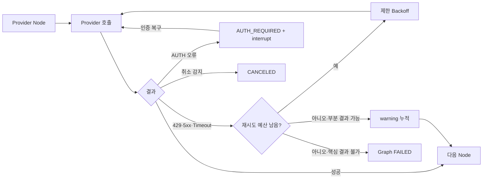

HTTP 계층 재시도는 Orchestrator가 같은 `message_id`로 담당하고, Graph는 Node 내부 Provider 호출만
재시도한다. 즉시 실행의 전체 예산이 부족하면 Graph 실행을 계속 기다리지 않고 Task를 반환한 뒤 같은
`thread_id`에서 비동기로 이어간다.

## 9. 영속 실행 시퀀스

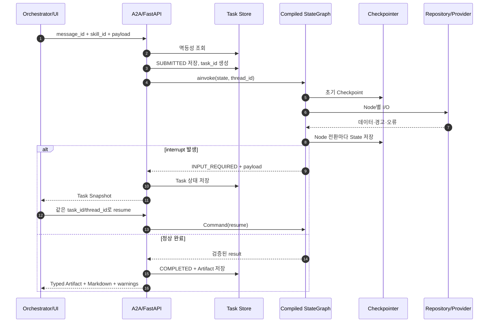

## 10. 구현 경계

| 계층 | 책임 | 하지 않는 일 |
| --- | --- | --- |
| A2A/FastAPI | 인증, 전송 Schema, 상태·오류 매핑 | 업무 규칙, Provider 직접 호출 |
| Root StateGraph | 공통 State, Skill 분기, 멱등성, 결과 조립 | SQL과 Provider 세부 구현 |
| Skill Subgraph | 업무 실행 순서, 조건부 Edge, 부분 실패 | 공개 A2A 모델 변경 |
| Domain 함수 | 날짜, 점수, 중복, 권한, 근거 검증 | 외부 I/O |
| Repository | 사용자 범위가 적용된 DB I/O | 업무 흐름 결정 |
| Provider Client | Gmail, Calendar, LLM, Embedding, STT, R2 | Task 상태 원장 |
| Checkpointer | 내부 State, interrupt, 재개 위치 | 외부 A2A Artifact 원장 |
| Task Store | 외부 Task Snapshot, Artifact, 멱등성 | Graph 내부 Node State |

## 11. 목표 구조의 불변식

1. 하나의 Workmate Agent 안에 Root Graph와 Skill Subgraph를 둔다.
2. 모든 실행은 `user_id`, `task_id`, `thread_id`, `message_id`를 끝까지 보존한다.
3. 모든 조회는 `user_id` 범위를 적용하고 Soft Delete 데이터를 제외한다.
4. 날짜, 순위, 점수, 중복, 권한과 근거 검증은 결정적 코드 Node가 담당한다.
5. LLM은 요약, 구조화 추출, 자연어 라우팅과 근거 기반 문장화만 담당한다.
6. Provider 일부 실패는 사용 가능한 결과와 `warnings`를 보존한다.
7. 사용자 확인이 필요한 동작은 `interrupt` 전에는 외부 상태를 변경하지 않는다.
8. Resume은 새 Task를 만들지 않고 같은 `thread_id`와 멱등성 Key를 사용한다.
9. 공개 결과는 승인된 Skill·Artifact Schema를 통과한 뒤에만 `COMPLETED`가 된다.
10. Mock과 고정 샘플 결과는 운영 Graph에 연결하지 않는다.
