# Workmate LangGraph 구조 도식

작성일: 2026-08-24  
목적: `docs/`의 설계, 시나리오, 구현 계획, 검수 증빙을 종합해 Workmate의 목표 LangGraph 구조와 현재 운영 Workflow Runtime을 한 문서에서 구분해 설명한다.

## 1. 먼저 구분할 것: 목표 Graph와 현재 Runtime

Workmate는 **LangGraph형 State·분기·Checkpoint·Interrupt 구조로 설계**됐다. 다만 현재
`workmate-agent` 운영 코드는 `langgraph` 패키지나 `StateGraph`를 실행하지 않고,
`WorkflowRegistry`가 `skill_id`를 비동기 Python Handler로 연결하는 경량 Runtime이다.

따라서 현재 상태를 정확히 표현하면 다음과 같다.

| 구분 | 현재 구현 | 목표 구조 |
| --- | --- | --- |
| Skill 라우팅 | `WorkflowRegistry`의 `skill_id → handler` 매핑 | `StateGraph` 조건부 Edge |
| Workflow 실행 | Skill별 비동기 Python Workflow | Skill별 Subgraph/Node |
| 공통 State | `WorkflowRequest`·`WorkflowResult` 및 Skill별 모델 | `WorkmateState` TypedDict |
| 장기 Task | A2A Task Store와 Polling/Subscribe | Graph 실행과 Task 상태 연동 |
| Checkpoint | `thread_id`와 Checkpoint JSON 저장 경계 구현 | LangGraph Checkpointer 직접 연결 |
| 사용자 승인 | API/UI의 확인 후 재요청 | `interrupt` 후 동일 `thread_id` 재개 |

> 발표나 문서에서는 “LangGraph로 구현 완료”가 아니라 **“LangGraph형 Workflow 구조로 설계했고,
> 현재는 A2A Registry 기반 경량 Runtime으로 구현했다”**고 표현한다.

## 2. 문서 종합 기준

- 기술 구조와 목표 Graph: [07-technical-specification.md](07-technical-specification.md)
- Skill·A2A Task·멱등성·Polling 계약: [02-a2a-interface.md](02-a2a-interface.md)
- 업무별 데이터 흐름: [04-scenarios.md](04-scenarios.md)
- 날짜·점수·중복·근거 규칙: [03-data-priority-rules.md](03-data-priority-rules.md)
- AI 책임과 실패 처리: [05-ai-security-operations.md](05-ai-security-operations.md)
- 모델·검색·STT 구현 기준: [10-embedding-evaluation-plan.md](10-embedding-evaluation-plan.md), [11-llm-evaluation-plan.md](11-llm-evaluation-plan.md), [12-implementation-verification-guide.md](12-implementation-verification-guide.md)
- Assistant·Human-in-the-loop: [18-workmate-assistant-implementation-plan.md](18-workmate-assistant-implementation-plan.md)
- 현재 구현 정합성 감사: [99-workmate-ppt-content.md](99-workmate-ppt-content.md)
- 완료 여부와 실행 증빙: [06-delivery-plan.md](06-delivery-plan.md), `docs/evidence/`

18번 문서에는 2026-08-17 당시 “공개 5개 + 내부 전용 6개”라는 기록이 남아 있다. 이후 2026-08-24
정합성 검증이 반영된 01·02·07·99번 문서는 현재 Agent Card와 내부 Skill 목록을 모두 **11개**로
정리한다. 이 문서는 더 최신인 2026-08-24 기준을 사용한다.

## 3. 전체 요청·실행 구조

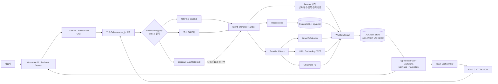

두 진입 경로는 인증 방식만 다르다. Orchestrator는 A2A Service Token을, UI는 Session/OIDC를 사용하지만
같은 Registry·Workflow·Repository·Domain 함수를 호출하며 모든 조회에 `user_id` 범위를 적용한다.

## 4. 현재 Workflow Runtime

현재 실행 경로에는 최상위 `StateGraph`가 없다. 요청을 받은 Runtime이 영속 Task 경계를 연 뒤 Registry를
호출하고, Handler 결과를 공통 Artifact로 변환한다.

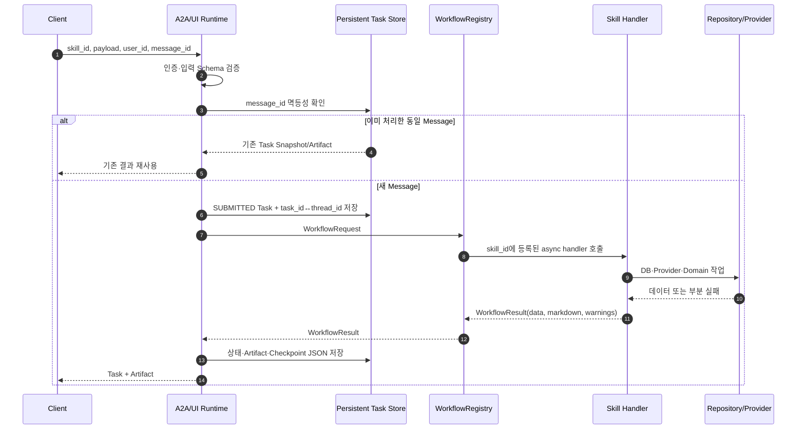

### 현재 11개 Skill 분기

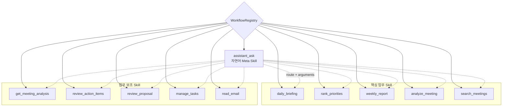

`assistant_ask`는 요청 전에 실제 하위 Skill을 알 수 없고 `analyze_meeting`으로 분기할 수도 있으므로 항상
비동기 Task/Polling 경로를 사용한다.

## 5. 목표 LangGraph

### 5.1 최상위 Graph

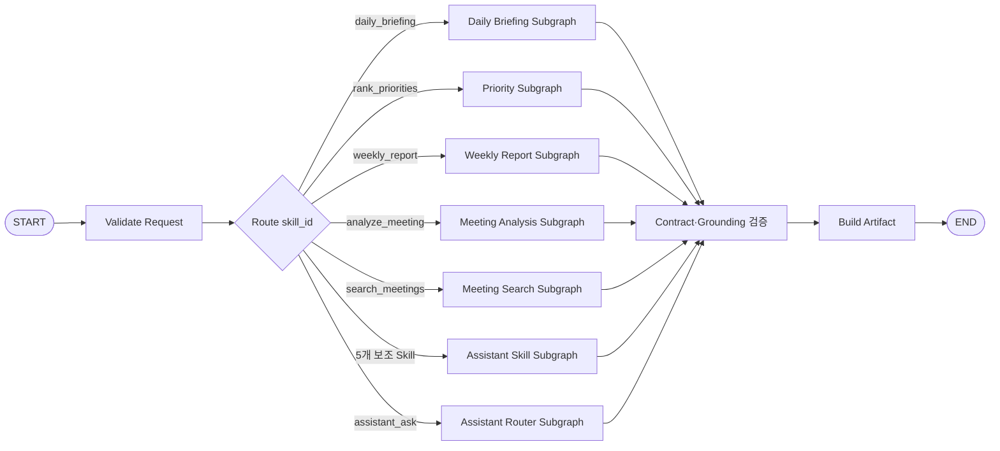

### 5.2 공통 State

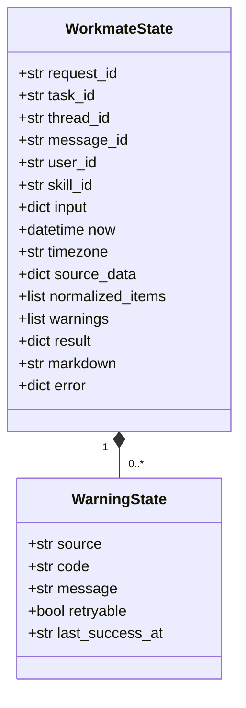

State의 핵심 불변식은 다음과 같다.

- `user_id`는 모든 Repository 조회와 Provider 결과 결합에 유지한다.
- 날짜 범위는 사용자 timezone과 `as_of`를 기준으로 코드가 계산한다.
- 우선순위 순위·점수·근거 ID는 LLM이 생성하거나 변경하지 않는다.
- Provider 일부 실패는 사용 가능한 결과를 버리지 않고 `warnings`에 기록한다.
- Secret, Token, Presigned URL, 원본 개인정보는 State나 Artifact에 노출하지 않는다.

## 6. 핵심 Skill Subgraph

### 6.1 `daily_briefing`과 `rank_priorities`

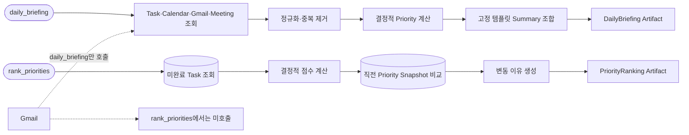

`daily_briefing.summary`는 LLM 요약이 아니라 조회 건수를 이용한 결정적 템플릿 조합이다.
`rank_priorities`는 Gmail을 직접 조회하지 않고 승인되어 Task DB에 저장된 미완료 Task만 순위 후보로 쓴다.

### 6.2 `weekly_report`

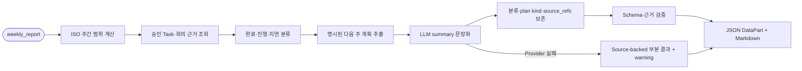

LLM은 `summary`를 문장화하지만 Workflow가 만든 분류, 계획 종류, `source_refs`를 바꿀 수 없다.

### 6.3 `analyze_meeting`

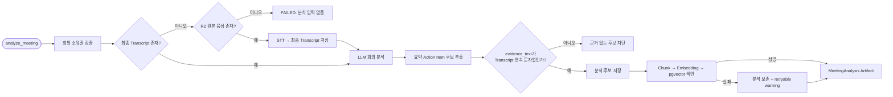

실시간 녹음의 Partial 자막은 UI 표시용이며 분석 원장이 아니다. 녹음 종료 후 확정한 최종 Transcript만
LLM 분석과 근거 검증에 사용한다. Action Item의 Task 등록은 별도의 사용자 승인 뒤에 수행한다.

### 6.4 `search_meetings`

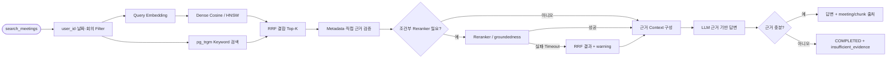

단일 Cosine 임계값은 답변 거절 조건이 아니다. 근거가 없는 것은 시스템 실패가 아니므로
`COMPLETED`와 `insufficient_evidence: true`를 반환한다.

## 7. Assistant와 Human-in-the-loop

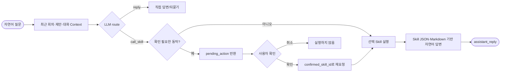

확인 대상은 `review_action_items`의 거절, `review_proposal`의 무시, `manage_tasks`의 삭제,
비용이 큰 `analyze_meeting`이다. 현재 Runtime에서는 `pending_action`과 확인 재요청으로 구현하며,
목표 LangGraph에서는 `interrupt`와 동일 `thread_id` 재개로 대응한다. 자연어 경로의
`manage_tasks`는 LLM의 ID 환각을 막기 위해 조회·생성만 허용하고 수정·삭제는 구조화된 직접 경로를 사용한다.

## 8. Task 상태와 Checkpoint

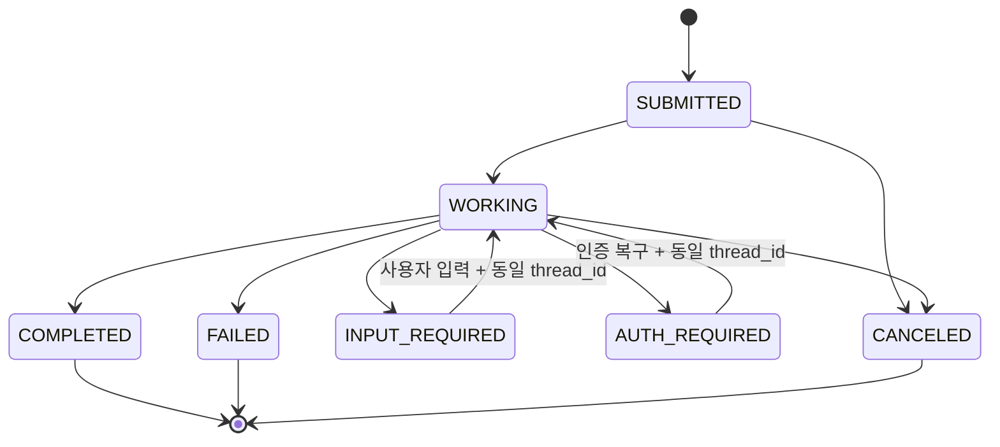

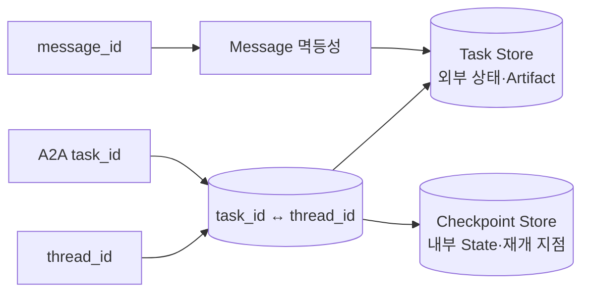

Task Store와 Checkpoint Store는 책임이 다르다. Task Store는 외부 A2A 상태와 Artifact의 원장이며,
Checkpoint는 Workflow 내부 State와 재개 지점이다. 현재는 두 저장 경계와 JSON Checkpoint가 있지만
LangGraph Checkpointer가 직접 연결되지는 않았다.

재시작 시 `SUBMITTED`, `WORKING`, `INPUT_REQUIRED`, `AUTH_REQUIRED` Task를 조회한다. 안전하게 재개할 수
있으면 같은 멱등성 Key와 Checkpoint를 사용하고, 재개할 수 없으면 원인을 기록한 뒤 `FAILED`로 전환한다.
취소는 먼저 Task Store에 기록한 후 실행 중인 Workflow·Provider에 전파한다.

## 9. Provider 실패와 재시도 경계

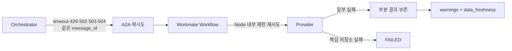

Orchestrator와 Workmate가 같은 계층을 중복 재시도하지 않는다. HTTP 재시도는 Orchestrator가 담당하고,
Workmate는 Node/Handler 내부 Provider 호출만 제한적으로 재시도한다. 즉시 Workflow는 전체 15초 예산을
공유하며, 예산 내 완료가 어렵다면 현재 Task를 장기 Task로 전환한다.

## 10. 현재에서 목표 LangGraph로의 연결점

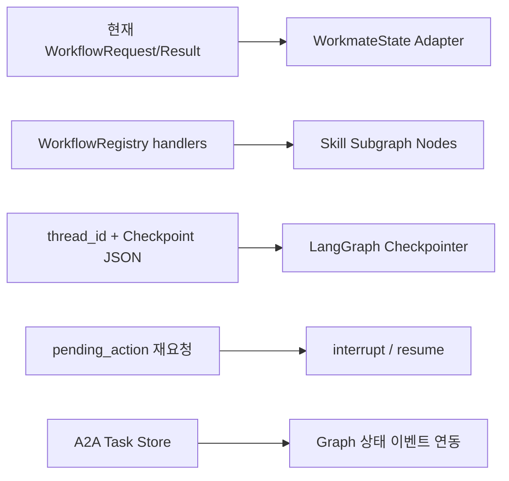

전환 시 공개 A2A Schema나 업무 데이터 모델을 바꿀 필요는 없다. Registry의 Handler 계약을 Graph 입출력
Adapter로 감싸고 기존 `task_id ↔ thread_id`, 멱등성, Artifact 변환, Provider 부분 실패 규칙을 유지하면
된다. LangGraph 도입의 실질적 이점은 단순 Skill 분기 자체보다 다단계 승인, 중단·재개, Node별 재시도와
복잡한 실패 복구가 늘어날 때 커진다.

## 11. 구조 요약

1. Workmate는 하나의 A2A Agent이며 Skill마다 별도 Agent나 마이크로서비스를 만들지 않는다.
2. 현재 11개 Skill은 하나의 `WorkflowRegistry`와 공통 Runtime을 공유한다.
3. 업무 규칙은 Domain 코드, 외부 I/O는 Repository·Provider, 전송은 A2A/FastAPI 경계가 담당한다.
4. LLM은 요약·추출·라우팅·근거 기반 문장화를 담당하고 날짜·순위·권한·중복·근거 검증은 코드가 통제한다.
5. 현재 구현은 LangGraph형 경량 Workflow이며 실제 `StateGraph`와 Checkpointer 연결은 후속 구조다.
