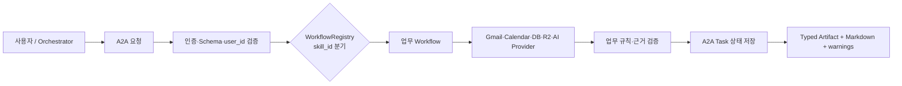
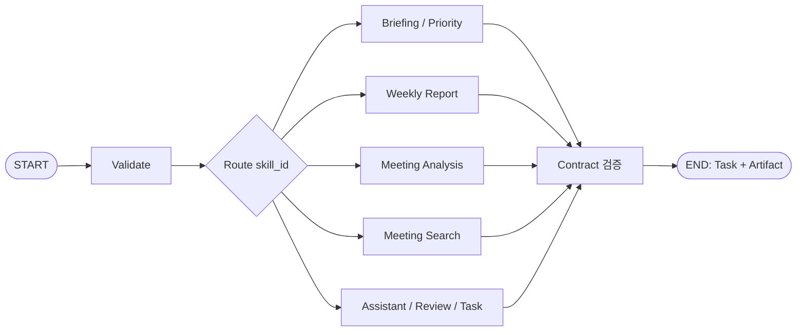
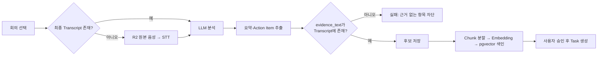
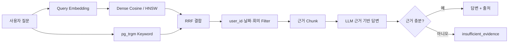

# Workmate PPT 콘텐츠 원고

작성일: 2026-08-24  
목적: Workmate 발표 자료에서 Skill, 모델·API, Workflow 구조, 모델 평가와 실제 구현 반영 내용을 설명하기 위한 슬라이드 원고다.  
기준: 문서의 설계안보다 `workmate-agent`의 현재 운영 코드와 승인된 `docs/evidence/` 결과를 우선한다.

## 발표 핵심 메시지

> Workmate는 메일·일정·회의·Task를 하나의 업무 흐름으로 연결하고, LLM은 요약과 추출에 집중시키며 순위·권한·근거 검증은 코드로 통제한 업무지원 Agent다.

## 슬라이드 1. Workmate Skill 개요

**반복 업무를 11개 A2A Skill로 제공한다.**

- 핵심 업무 Skill 5개: `daily_briefing`, `weekly_report`, `analyze_meeting`, `search_meetings`, `rank_priorities`
- 업무 보조 Skill 5개: `get_meeting_analysis`, `review_action_items`, `review_proposal`, `manage_tasks`, `read_email`
- 자연어 진입점 1개: `assistant_ask`
- 모든 Skill은 `user_id` 범위에서 실행되고 결과를 A2A Task·Artifact로 반환한다.

발표 포인트: 초기 MVP의 중심은 5개 핵심 Skill이었고, 실제 Agent Card에는 Drawer와 자연어 Assistant에서 쓰는 보조 Skill까지 합쳐 현재 11개가 공개돼 있다. `assistant_ask`는 자유 문장을 해석해 나머지 10개 중 적절한 Skill과 인자를 고르는 Meta Skill이다.

## 슬라이드 2. 핵심 Skill이 해결하는 업무

| Skill | 사용자의 질문·행동 | 처리 내용 | 결과 |
| --- | --- | --- | --- |
| `daily_briefing` | “오늘 뭐부터 해야 해?” | Gmail·Calendar·Task를 수집하고 중요 신호와 우선순위를 결합 | 오늘 일정, 중요 신호, Top 3 |
| `rank_priorities` | “우선순위를 다시 계산해줘” | Task 상태와 기한을 결정적 점수식으로 계산하고 이전 Snapshot과 비교 | 순위, 점수 구성, 변동 이유 |
| `weekly_report` | “이번 주 업무보고 만들어줘” | 완료·진행·지연 Task와 회의 근거를 조립한 뒤 LLM으로 문장화 | 구조화 보고서, Markdown, `source_refs` |
| `analyze_meeting` | “이 회의를 분석해줘” | 음성 STT 또는 최종 Transcript를 분석하고 Action Item 후보를 추출 | 요약, 담당자·기한 후보, 근거 문장 |
| `search_meetings` | “QA 일정은 어느 회의에서 결정됐어?” | Query Embedding과 Dense+Trigram Hybrid 검색 후 근거 기반 답변 생성 | 답변, 회의·Chunk 출처, 근거 부족 여부 |

발표 포인트: LLM이 업무 전체를 임의로 결정하지 않는다. 우선순위 점수, 날짜 범위, 사용자 권한, 중복 제거는 코드가 담당하고 LLM은 구조화 추출·요약·근거 기반 문장 생성에만 사용한다.

## 슬라이드 3. 보조 Skill과 Human-in-the-loop

| Skill | 역할 | 안전장치 |
| --- | --- | --- |
| `get_meeting_analysis` | 저장된 회의 요약과 Action Item 재조회 | 요청 사용자 소유 회의만 조회 |
| `review_action_items` | Action Item 후보 승인·수정·거절 | 승인 전 Task로 확정하지 않음 |
| `review_proposal` | Gmail·Calendar에서 만든 Task 제안 승인·무시 | 제안과 실제 Task 생성을 분리 |
| `manage_tasks` | Task 조회·생성·수정·삭제 | 사용자 범위와 입력 검증 적용 |
| `read_email` | Gmail 원문을 다시 읽어 근거 있는 답변 생성 | 저장된 요약만으로 단정하지 않고 실제 Provider 재조회 |
| `assistant_ask` | 자연어를 Skill과 인자로 라우팅하고 결과를 자연어로 설명 | 실행성 동작은 확인 카드(`pending_action`)를 거침 |

발표 포인트: “찾고 정리하는 일은 자동화하되, Task 생성·수정처럼 외부 상태를 바꾸는 행동은 사용자 확인을 받는다.”

## 슬라이드 4. 모델과 API 사용 스펙

| 구분 | 채택 모델·규격 | 호출 방식 | 주요 설정 | 사용 위치 |
| --- | --- | --- | --- | --- |
| LLM | `openai/gpt-4.1-mini` | OpenAI 호환 Chat Completions API | `temperature=0`, 계약이 필요한 응답은 JSON Schema 구조화 출력, 비Streaming | 회의 분석, 주간 보고, 검색 답변, 메일 추출·판정, Assistant |
| Embedding | `openai/text-embedding-3-small` | OpenAI 호환 Embeddings API | 1536차원, 입력 순서 보존 | 회의 Chunk 색인, 검색 Query 벡터화 |
| STT | `gpt-4o-transcribe` | Audio Transcriptions API | 기본 언어 `ko`, 파일 기반 최종 Transcript | 녹음·업로드 음성의 최종 회의록 |
| 실시간 자막 | `gpt-4o-transcribe` 계열 Realtime | WebSocket Realtime API | PCM16 Chunk, Partial/Final 이벤트 | 회의 중 임시 자막 |
| Agent 연동 | A2A 1.0 HTTP+JSON | `a2a-sdk[http-server]==1.1.2` | Bearer Service Token, JSON Data Part, Task·Artifact·Streaming | Orchestrator ↔ Workmate |
| 검색 저장소 | PostgreSQL + pgvector + `pg_trgm` | SQL | Cosine Dense + Trigram, RRF, HNSW | 회의 근거 검색 |

발표 포인트: canonical 모델명은 Provider를 포함한 `openai/...` 형식이고, OpenAI 직접 API로 보낼 때는 Provider 접두사를 제거한다. API Key·Token은 환경변수로만 주입한다.

## 슬라이드 5. 공통 실행 구조

- `message_id`는 중복 실행 방지에, `task_id ↔ thread_id`는 장기 Task와 Checkpoint 연결에 사용한다.
- Provider 일부가 실패해도 의미 있는 부분 결과가 있으면 `warnings`와 함께 반환한다.
- 운영 경로는 Mock이나 고정 샘플 응답을 성공 결과로 사용하지 않는다.

## 슬라이드 6. LangGraph 구조: 설계와 실제 구현

**Graph로 설계했으며, 현재 Runtime은 같은 분기를 경량 Workflow로 실행한다.**

### 정확한 구현 상태

- 기술 설계는 LangGraph의 State, 분기, Checkpoint, Interrupt 개념을 기준으로 작성됐다.
- 현재 `workmate-agent`에는 `langgraph` 패키지와 `StateGraph` 실행 코드가 없다.
- 실제 라우팅은 `WorkflowRegistry`가 `skill_id`를 비동기 Python Handler에 연결한다.
- A2A Task Store에는 `thread_id`와 Checkpoint JSON 저장소가 구현돼 있지만 LangGraph Checkpointer가 직접 연결된 상태는 아니다.
- 발표에서는 “LangGraph 기반으로 구현 완료”가 아니라 **“LangGraph형 Workflow 구조로 설계했고, 현재는 A2A Registry 기반 경량 Runtime으로 구현했다”**고 표현한다.

MVP의 분기가 명확하고 각 Skill이 독립적이어서 별도 Graph Runtime 없이도 결정적 실행과 테스트가 가능했다. 향후 다단계 승인 중단·재개와 복잡한 실패 복구가 늘어나면 현재 `thread_id`·Checkpoint 계약을 LangGraph Checkpointer와 연결할 수 있다.

## 슬라이드 7. 회의 분석 Workflow

Action Item의 `evidence_text`가 실제 최종 Transcript의 연속 부분 문자열인지 코드가 검사한다. 검색 색인이 실패해도 이미 생성된 회의 요약과 Action Item은 버리지 않고 재시도 가능한 경고를 붙인다.

## 슬라이드 8. 회의 검색 Workflow

단일 Cosine 점수로 답변 가능 여부를 결정하지 않는다. 실제 평가에서 정상 질문 오거절이 커서, Dense와 키워드 결과를 RRF로 결합하고 실제 근거를 답변에 포함시키는 방식으로 바꿨다.

## 슬라이드 9. LLM 평가 진행과 결과

### 평가 방법

- 대상: `daily_briefing`, `weekly_report`, `analyze_meeting`, `search_meetings`
- 단계: Pilot 4 Case → Full Case 1 20건 → 독립 Full Case 2 20건
- 검증: JSON Schema와 업무 의미를 분리 평가
- 추가 검증: 입력에 없는 Source ID 생성, 사전 계산 우선순위 값 변경 여부
- 재현 설정: `temperature=0`, `top_p=1`, `max_tokens=1024`, `stream=false`; Prompt·Schema·Case Hash와 Retry 정책 기록

| 평가 세트 | 최종 결과 | Schema | 의미 검증 | 평균 호출 수 |
| --- | ---: | ---: | ---: | ---: |
| Pilot | 4/4 | 4/4 | 4/4 | 1.00 |
| Full Case 1 | 20/20 | 20/20 | 20/20 | 1.05 |
| Full Case 2 | 20/20 | 20/20 | 20/20 | 1.25 |

- 전체 Schema·의미 검증: **44/44 PASS**
- 입력 외 Source ID 생성·우선순위 값 변형: **0건**
- Provider 실패: **0건**
- 주의: 제한된 수정 요청을 포함한 최종 통과율이며 첫 응답이 항상 완벽하다는 뜻은 아니다.

### 실제 구현 영향

1. 기본 LLM을 `openai/gpt-4.1-mini`로 확정했다.
2. 모든 구조화 응답에 JSON Schema 검증을 유지했다.
3. 의미 검증과 근거 ID 검사를 추가했다.
4. 우선순위와 날짜는 LLM 입력 전에 코드로 계산하고 모델이 변경하지 못하게 했다.
5. 오류 시 제한된 재시도 후 실패를 명시한다.

## 슬라이드 10. Embedding·검색 평가 진행과 결과

- 최종 데이터: 실제 비식별 회의록 **64 Chunk, 60 Case**
- 비교: Dense 정확 검색, `pg_trgm`, Dense+Trigram RRF, HNSW+Trigram RRF
- 지표: Hit@K, MRR, HNSW Recall@5, DB 검색 p95, Query Embedding p95

| 지표 | 기준 | 결과 |
| --- | ---: | ---: |
| Hybrid Hit@3 | 80% 이상 | **98.21% PASS** |
| HNSW Recall@5 | 90% 이상 권장 | **100% PASS** |
| Hybrid DB p95 | 300ms 이하 | **66.3ms PASS** |
| Query Embedding p95 | 1초 이하 권장 | **893.1ms PASS** |

### 실제 구현 영향

1. `text-embedding-3-small`, 1536차원을 Schema·Domain 검증에 고정했다.
2. PostgreSQL+pgvector를 검색 원장으로 채택하고 별도 Vector DB를 추가하지 않았다.
3. **Dense + Trigram RRF**를 기본 검색 경로로 채택했다.
4. HNSW를 사용하되 정확 검색 대비 Recall을 회귀 지표로 유지했다.
5. Cosine 0.45 단일 임계값은 정상 질문 오거절 41.07% 때문에 답변 거절 기준에서 제외했다.
6. LLM Reranker는 실제 데이터에서 기본 RRF보다 성능이 낮아 상시 경로에 넣지 않았다.

## 슬라이드 11. STT 평가 진행과 결과

- 파일 기반: 합성 한국어 게임 개발 업무 음성 20 Case
- Realtime: PCM16 Chunk 전송과 Partial/Final 이벤트 2 Case
- E2E: Chunk 재연결 → 최종 STT → Task 입력용 Transcript 2 Case

| 평가 | 결과 |
| --- | ---: |
| 파일 핵심어 인식 | **19/20, 95% PASS** |
| 파일 Provider 오류 | **0/20** |
| Realtime Partial/Final | **2/2 PASS** |
| Chunk 재연결·최종 STT E2E | **2/2 PASS** |

### 실제 구현 영향

1. 파일 최종 전사는 `gpt-4o-transcribe`로 확정했다.
2. 회의 중 Partial 자막과 종료 후 최종 Transcript를 분리했다.
3. 분석의 원장은 임시 자막이 아니라 최종 Transcript로 정했다.
4. 원본 음성이 있고 최종 Transcript가 없으면 분석 Workflow가 STT를 먼저 실행한다.
5. 실제 회의 음성의 WER/CER, 다중 화자 분리, 잡음·겹침 발화는 이 95% 수치에 포함되지 않는다. “실제 회의 정확도 95%”라고 표현하지 않는다.

## 슬라이드 12. 평가가 Workmate를 어떻게 바꿨는가

| 평가에서 발견한 사실 | 구현 결정 | 사용자 효과 |
| --- | --- | --- |
| LLM은 수정 후 44/44를 통과하지만 첫 응답 오류 가능성이 있음 | Strict Schema·의미 검증·제한 재시도 | 잘못된 구조가 UI나 DB로 전달되는 것을 차단 |
| LLM이 순위까지 만들면 재현성과 신뢰가 떨어짐 | 순위·점수·날짜는 코드에서 결정 | 같은 입력에 같은 결과, 점수 근거 설명 가능 |
| Dense 검색만으로는 정확 키워드·고유명사 검색이 약함 | Dense+Trigram RRF | 의미 검색과 정확 키워드 검색을 동시에 확보 |
| 단일 Cosine 임계값은 정상 질문을 41.07% 오거절 | 단일 임계값 제거, 근거 검증과 `insufficient_evidence` 분리 | 찾을 수 있는 답을 불필요하게 거절하지 않음 |
| Reranker가 실제 데이터에서는 검색 순위를 악화 | 기본 경로에서 제외 | 불필요한 비용·지연 없이 더 높은 검색 품질 유지 |
| 실시간 자막은 최종 회의록과 목적이 다름 | Partial UI와 최종 STT 분석 경로 분리 | 회의 중 반응성과 종료 후 정확성을 함께 확보 |
| 합성 STT 평가만으로 실제 회의 품질을 보장할 수 없음 | 실제 음성 품질을 후속 검증으로 관리 | 검증 범위를 과장하지 않고 운영 위험 표시 |

> Workmate의 모델 평가는 모델을 고르는 데서 끝나지 않았다. 평가에서 드러난 실패 유형을 Workflow 검증, 검색 결합 방식, 사용자 승인 절차로 직접 반영했다.

## 발표자용 표현 주의사항

- “5개 Skill”은 핵심 업무 기능을 말할 때만 사용한다. 현재 Agent Card 전체는 11개다.
- “LangGraph를 사용했다”라고 단정하지 않는다. 현재 코드는 LangGraph형 구조와 Checkpoint 계약을 사용하지만 LangGraph Runtime 의존성은 없다.
- LLM 44/44는 제한된 수정 요청을 포함한 최종 결과다.
- Embedding 98.21%는 실제 비식별 회의록 64 Chunk·60 Case의 Hybrid Hit@3 결과다.
- STT 95%는 합성 한국어 20 Case의 핵심어 인식 결과이며 실제 회의 WER/CER가 아니다.
- 전체 제품 완료와 핵심 Workflow 검증 완료를 구분한다. UI 육안 검수와 전체 Orchestrator 통합 상태는 발표 직전에 최신 `HANDOFF.md`를 확인한다.

## 근거 자료

- [A2A 인터페이스와 Skill 계약](02-a2a-interface.md)
- [기술 상세 설계](07-technical-specification.md)
- [Embedding 평가 계획과 이력](10-embedding-evaluation-plan.md)
- [LLM 평가 계획과 이력](11-llm-evaluation-plan.md)
- [구현·검증 가이드](12-implementation-verification-guide.md)
- [LLM 승인 실행](evidence/M0/M0.2/runs/20260813-093322/result.md)
- [Embedding 승인 실행](evidence/M0/M0.2/runs/20260813-134129/result.md)
- [STT 승인 실행](evidence/M0/M0.2/runs/20260813-134542/result.md)
- [Workmate Workflow Registry](../workmate-agent/app/workflows/registry.py)
- [A2A Runtime과 현재 Agent Card](../workmate-agent/app/a2a/runtime.py)
- [회의 분석·검색 Workflow](../workmate-agent/app/workflows/meetings.py)
